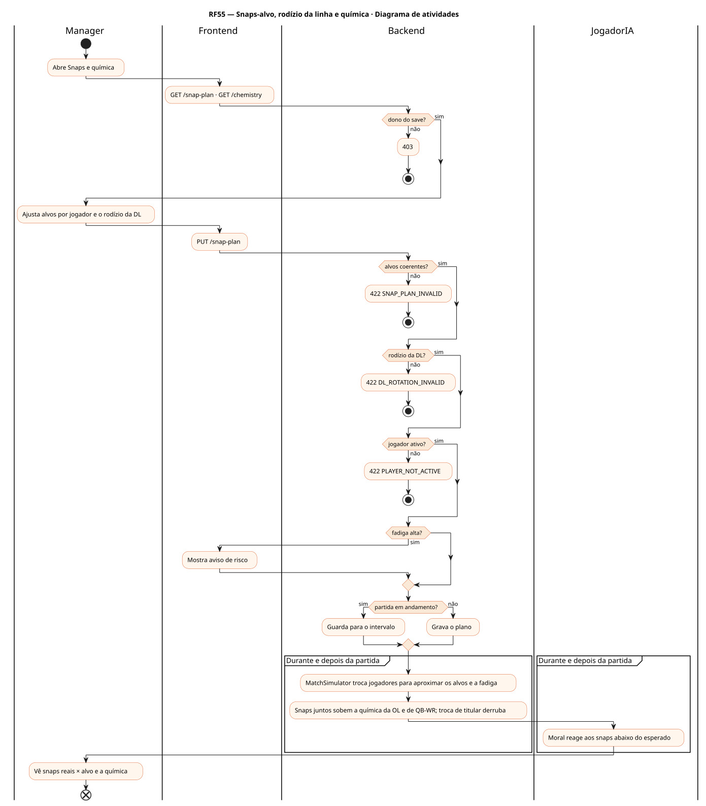
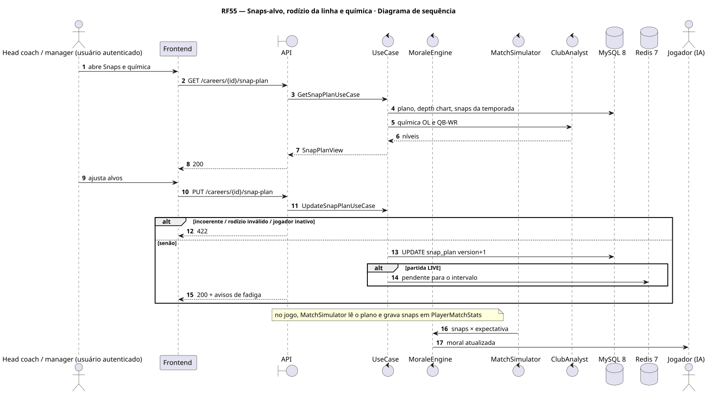
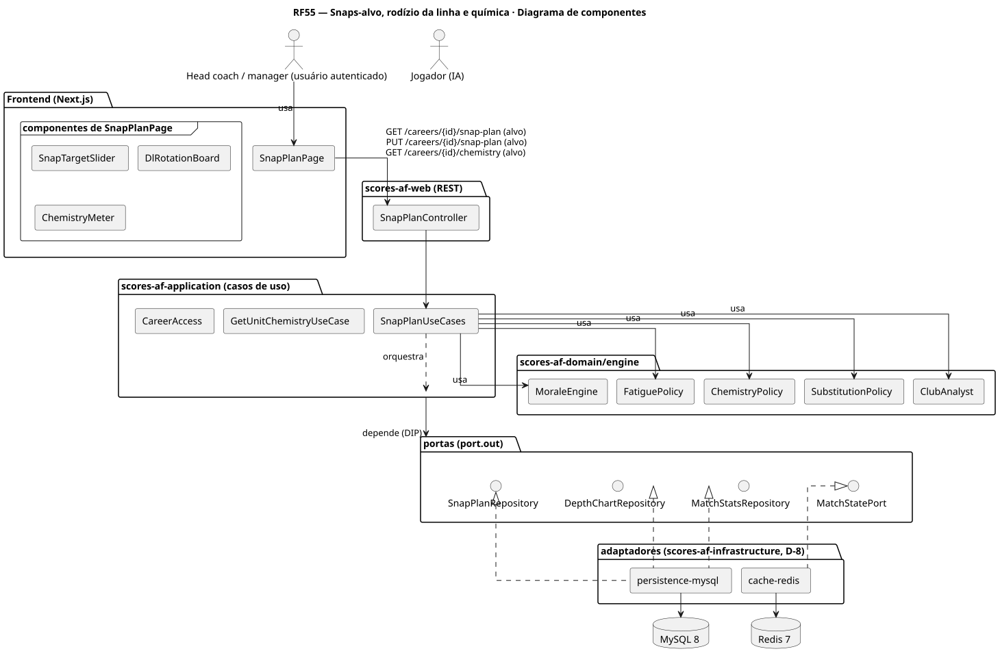
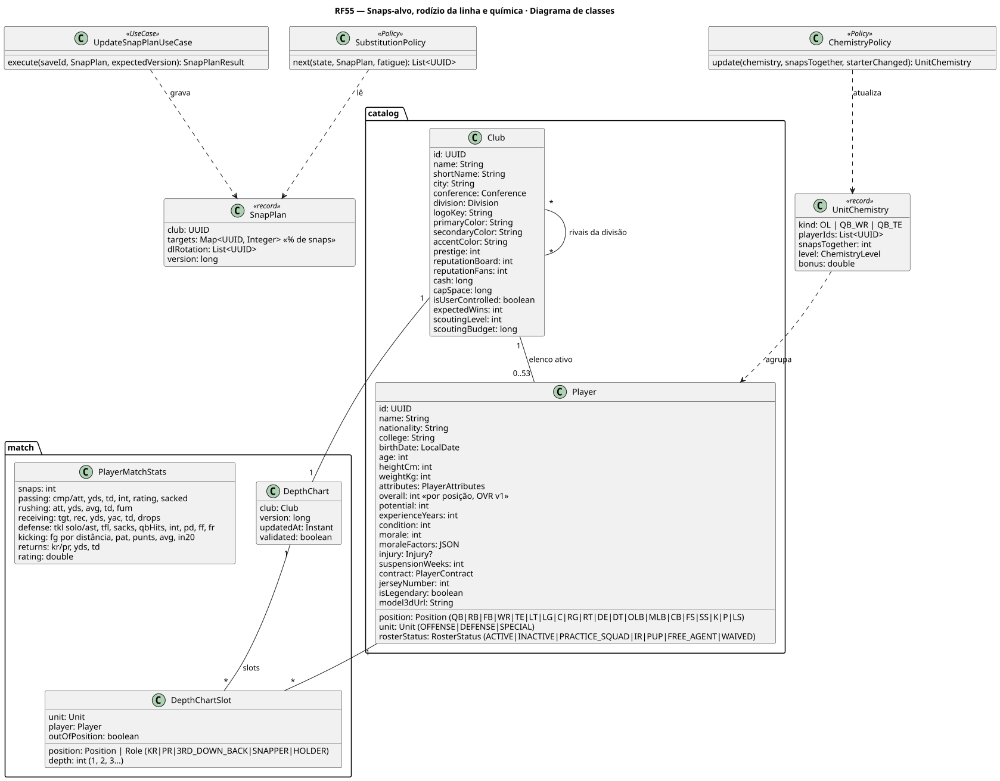
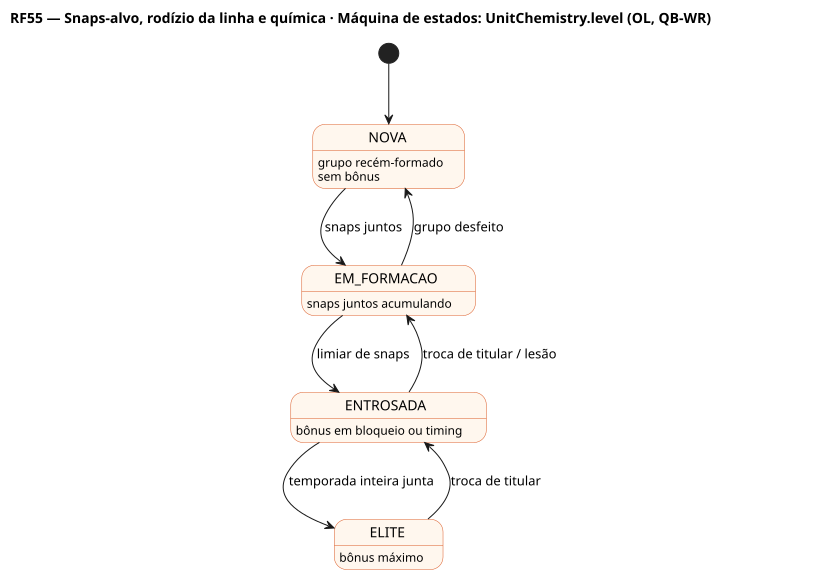
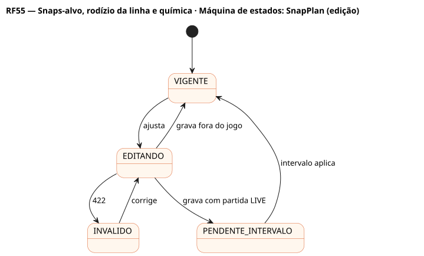

# RF55 — Snaps-alvo, rodízio da linha e química

## História de usuário

> HU-RF55 — COMO head coach QUERO definir a porcentagem de snaps de cada jogador, o rodízio da linha defensiva e acompanhar a química da linha ofensiva e da dupla QB-WR PARA equilibrar fadiga, moral e desempenho

Sprint: 11 · Atores: Manager, JogadorIA · Tela: Escalação (RF6) → aba Snaps e química (/c/{careerId}/lineup#snaps)

## Diagramas

### Atividades

Fonte: [`RF55-act.puml`](RF55-act.puml)

### Sequência

Fonte: [`RF55-seq.puml`](RF55-seq.puml)

### Componentes

Fonte: [`RF55-cmp.puml`](RF55-cmp.puml)

### Classes

Fonte: [`RF55-cls.puml`](RF55-cls.puml)

### Máquina de estados: UnitChemistry.level (OL, QB-WR)

Fonte: [`RF55-stm.puml`](RF55-stm.puml)

### Máquina de estados: SnapPlan (edição)

Fonte: [`RF55-stm-snapplan-edicao.puml`](RF55-stm-snapplan-edicao.puml)

## Endpoints

✅ = existe num controller do `scores-af-web` · ⛔ alvo = previsto no modelo, ainda sem controller (lista em `generator/endpoints_code.json`).

| Estado | Método | Rota | Caso de uso | Autorização | Descrição |
|---|---|---|---|---|---|
| ⛔ alvo | `GET` | `/api/v1/careers/{id}/snap-plan` | `GetSnapPlanUseCase` | JWT · dono do save | Porcentagem-alvo por jogador, rodízio da DL e snaps reais da temporada |
| ⛔ alvo | `PUT` | `/api/v1/careers/{id}/snap-plan` | `UpdateSnapPlanUseCase` | JWT · dono do save | Grava alvos e rodízio (expectedVersion) |
| ⛔ alvo | `GET` | `/api/v1/careers/{id}/chemistry` | `GetUnitChemistryUseCase` | JWT · dono do save | Química da OL (5 titulares juntos) e dos pares QB-WR e QB-TE |

## Pontos de decisão

| Gateway | Regra | Se falso |
|---|---|---|
| Dono do save? | save.userId == jwt.sub | 403 |
| Alvos coerentes? | por posição a soma dos alvos cobre as vagas (ex.: 4 DL em campo = 400 %), cada alvo 0–100 % | 422 SNAP_PLAN_INVALID |
| Rodízio da DL? | 6 a 9 linemen no rodízio | 422 DL_ROTATION_INVALID |
| Jogador ativo? | rosterStatus ACTIVE e não OUT no relatório de lesões | 422 PLAYER_NOT_ACTIVE |
| Fadiga alta? | alvo > limite pela resistência e condição | sem aviso |
| Partida em andamento? | MatchSession LIVE para o clube | vale no próximo jogo |

---
Gerado por `../generator/generate.py` a partir de `../generator/model/*.py` e `../generator/common.py`; não edite os .puml à mão.
