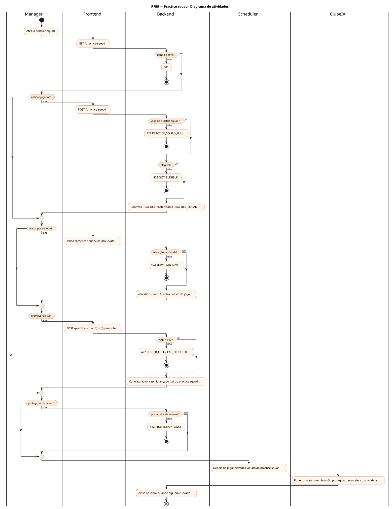
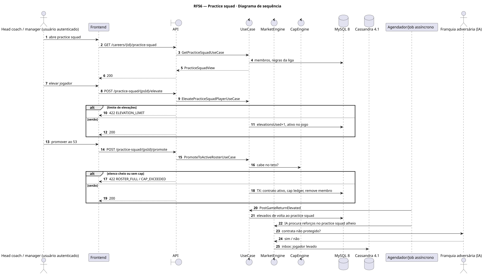
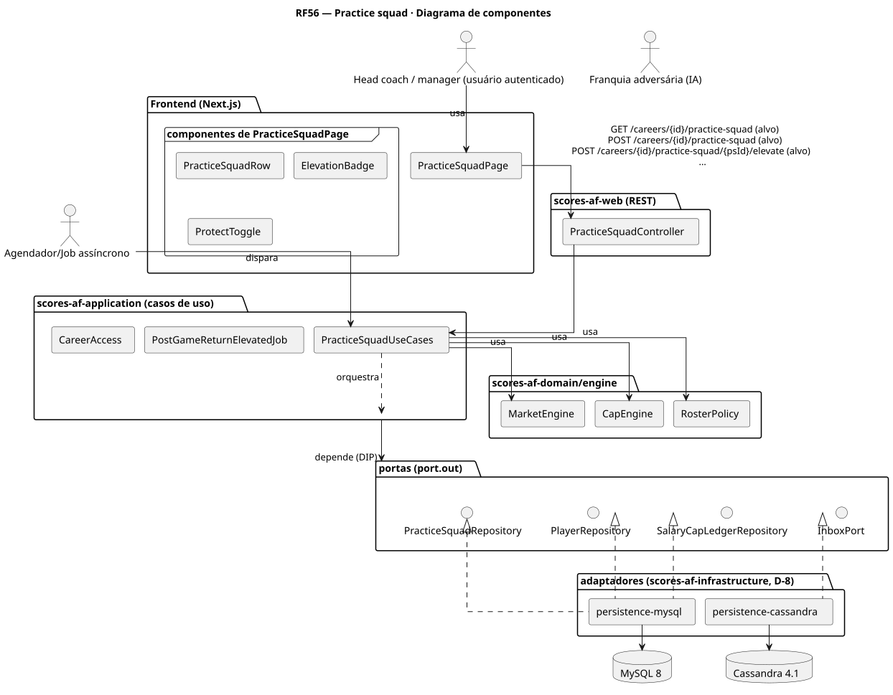
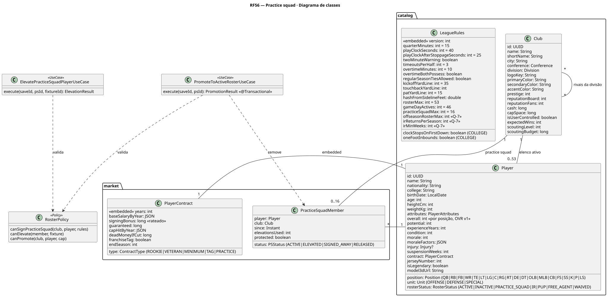
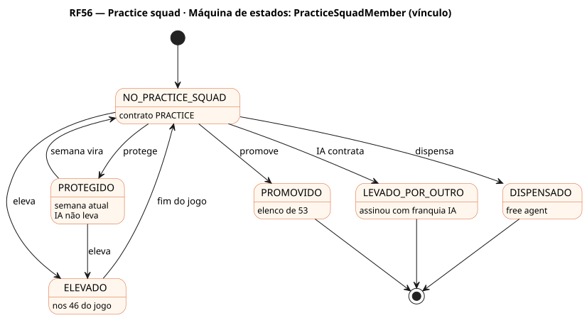

# RF56 — Practice squad

## História de usuário

> HU-RF56 — COMO head coach QUERO manter até 16 jogadores no practice squad, protegê-los, elevá-los para o dia de jogo e promovê-los ao elenco de 53 PARA desenvolver talentos e cobrir lesões

Sprint: 11 · Atores: Manager, ClubeIA, Scheduler · Tela: Elenco (RF4) → aba Practice squad (/c/{careerId}/squad#practice)

## Diagramas

### Atividades

Fonte: [`RF56-act.puml`](RF56-act.puml)

### Sequência

Fonte: [`RF56-seq.puml`](RF56-seq.puml)

### Componentes

Fonte: [`RF56-cmp.puml`](RF56-cmp.puml)

### Classes

Fonte: [`RF56-cls.puml`](RF56-cls.puml)

### Máquina de estados: PracticeSquadMember (vínculo)

Fonte: [`RF56-stm.puml`](RF56-stm.puml)

## Endpoints

✅ = existe num controller do `scores-af-web` · ⛔ alvo = previsto no modelo, ainda sem controller (lista em `generator/endpoints_code.json`).

| Estado | Método | Rota | Caso de uso | Autorização | Descrição |
|---|---|---|---|---|---|
| ⛔ alvo | `GET` | `/api/v1/careers/{id}/practice-squad` | `GetPracticeSquadUseCase` | JWT · dono do save | Membros, elevações usadas, protegidos da semana |
| ⛔ alvo | `POST` | `/api/v1/careers/{id}/practice-squad` | `SignPracticeSquadPlayerUseCase` | JWT · dono do save | Assina free agent ou jogador dispensado para o practice squad |
| ⛔ alvo | `POST` | `/api/v1/careers/{id}/practice-squad/{psId}/elevate` | `ElevatePracticeSquadPlayerUseCase` | JWT · dono do save | Eleva para o próximo jogo (volta sozinho depois) |
| ⛔ alvo | `POST` | `/api/v1/careers/{id}/practice-squad/{psId}/promote` | `PromoteToActiveRosterUseCase` | JWT · dono do save | Promove ao elenco de 53 com contrato ativo |
| ⛔ alvo | `PUT` | `/api/v1/careers/{id}/practice-squad/{psId}/protection` | `ProtectPracticeSquadPlayerUseCase` | JWT · dono do save | Protege na semana (até 4) |
| ⛔ alvo | `DELETE` | `/api/v1/careers/{id}/practice-squad/{psId}` | `ReleasePracticeSquadPlayerUseCase` | JWT · dono do save | Dispensa do practice squad |

## Pontos de decisão

| Gateway | Regra | Se falso |
|---|---|---|
| Dono do save? | save.userId == jwt.sub | 403 |
| Vaga no practice squad? | membros < LeagueRules.practiceSquadMax (16) | 422 PRACTICE_SQUAD_FULL |
| Elegível? | experienceYears ≤ 2 ou vaga de veterano (até 6) | 422 NOT_ELIGIBLE |
| Elevação permitida? | elevationsUsed < 3 na temporada e ≤ 2 elevações por jogo | 422 ELEVATION_LIMIT |
| Vaga no 53? | ativos < rosterMax e cap space para o contrato ativo | 422 ROSTER_FULL / CAP_EXCEEDED |
| Protegidos da semana? | ≤ 4 protegidos | 422 PROTECTION_LIMIT |

---
Gerado por `../generator/generate.py` a partir de `../generator/model/*.py` e `../generator/common.py`; não edite os .puml à mão.
