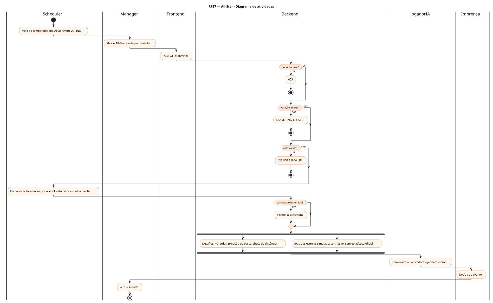
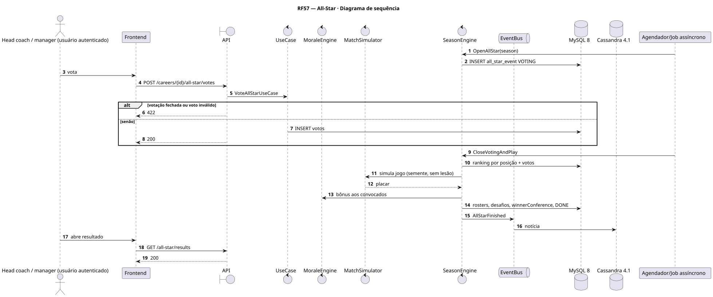
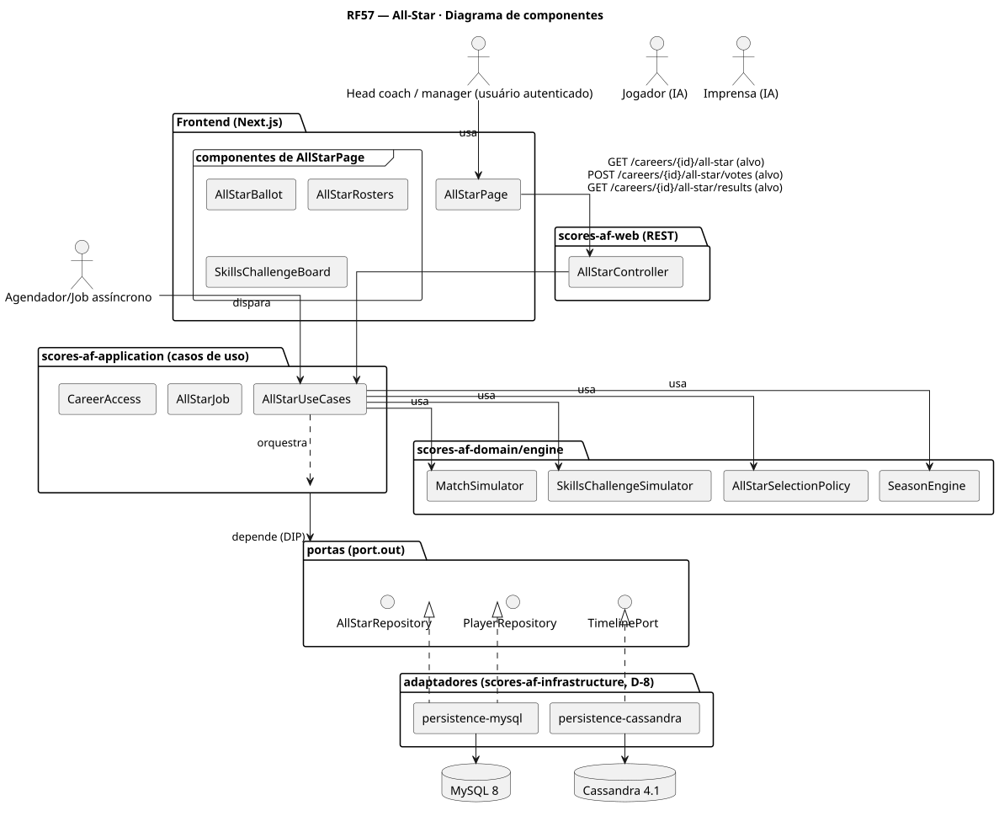
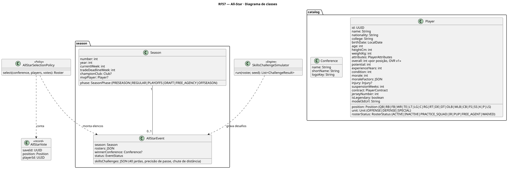
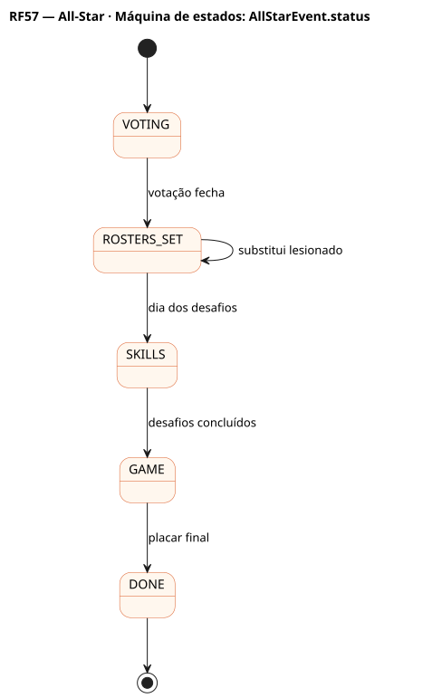

# RF57 — All-Star

## História de usuário

> HU-RF57 — COMO head coach QUERO indicar meus jogadores, acompanhar o jogo das estrelas entre conferências e os desafios de habilidade PARA ganhar moral e reputação sem afetar a temporada

Sprint: 11 · Atores: Manager, Scheduler, JogadorIA, Imprensa · Tela: All-Star (/c/{careerId}/all-star): votação · elencos · desafios · resultado

## Diagramas

### Atividades

Fonte: [`RF57-act.puml`](RF57-act.puml)

### Sequência

Fonte: [`RF57-seq.puml`](RF57-seq.puml)

### Componentes

Fonte: [`RF57-cmp.puml`](RF57-cmp.puml)

### Classes

Fonte: [`RF57-cls.puml`](RF57-cls.puml)

### Máquina de estados: AllStarEvent.status

Fonte: [`RF57-stm.puml`](RF57-stm.puml)

## Endpoints

✅ = existe num controller do `scores-af-web` · ⛔ alvo = previsto no modelo, ainda sem controller (lista em `generator/endpoints_code.json`).

| Estado | Método | Rota | Caso de uso | Autorização | Descrição |
|---|---|---|---|---|---|
| ⛔ alvo | `GET` | `/api/v1/careers/{id}/all-star` | `GetAllStarEventUseCase` | JWT · dono do save | Status, elencos por conferência, desafios e resultado |
| ⛔ alvo | `POST` | `/api/v1/careers/{id}/all-star/votes` | `VoteAllStarUseCase` | JWT · dono do save | Voto do head coach: 1 por posição, sem o próprio clube em mais de 3 posições |
| ⛔ alvo | `GET` | `/api/v1/careers/{id}/all-star/results` | `GetAllStarResultsUseCase` | JWT · dono do save | Placar do jogo, vencedores dos desafios (40 jardas, precisão de passe, chute de distância) |

## Pontos de decisão

| Gateway | Regra | Se falso |
|---|---|---|
| Dono do save? | save.userId == jwt.sub | 403 |
| Votação aberta? | AllStarEvent.status VOTING | 422 VOTING_CLOSED |
| Voto válido? | 1 por posição, jogador ativo, até 3 do próprio clube | 422 VOTE_INVALID |
| Convocado lesionado? | InjuryReport OUT ou IR na semana do evento | segue |

---
Gerado por `../generator/generate.py` a partir de `../generator/model/*.py` e `../generator/common.py`; não edite os .puml à mão.
