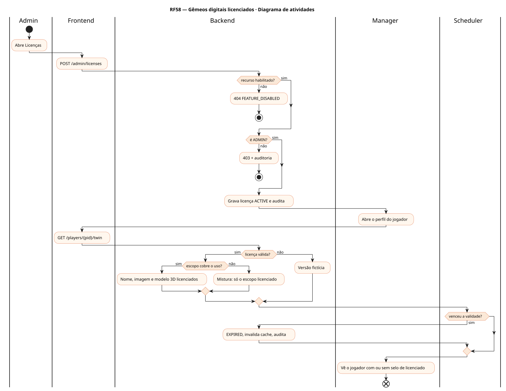
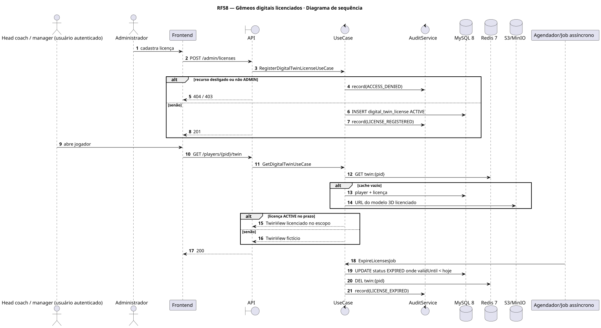
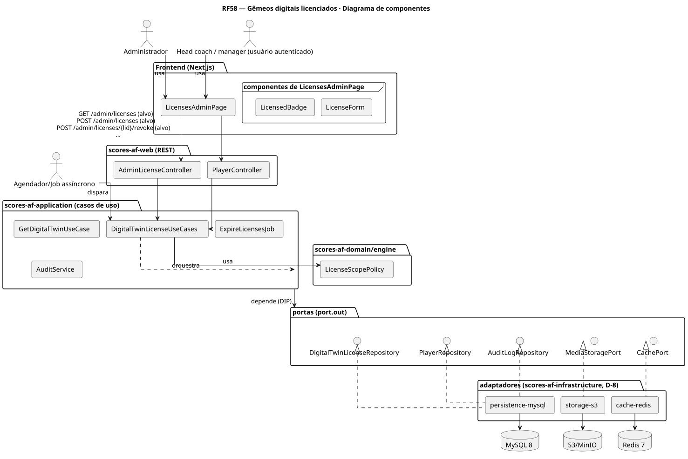
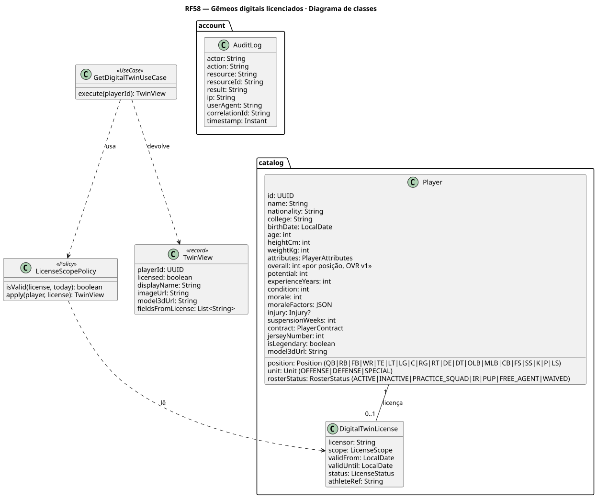
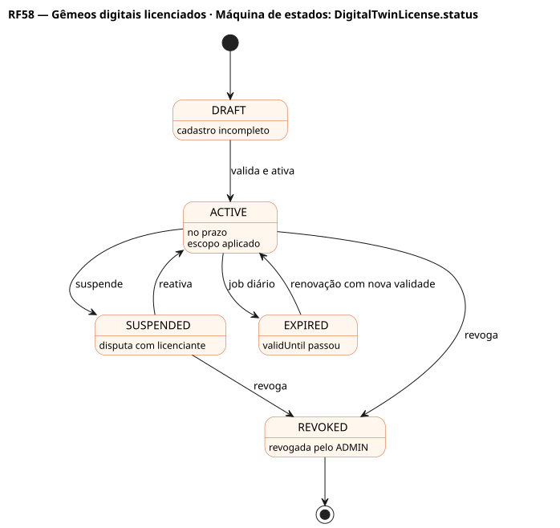

# RF58 — Gêmeos digitais licenciados

## História de usuário

> HU-RF58 — COMO administrador QUERO cadastrar licenças de atletas reais (nome, imagem, estatísticas) com escopo e validade PARA exibir gêmeos digitais só enquanto a licença vale (depende da Q-4)

Sprint: 11 · Atores: Admin, Manager, Scheduler · Tela: Admin → Licenças (/admin/licenses) · perfil do jogador (RF22) com selo de licenciado

## Diagramas

### Atividades

Fonte: [`RF58-act.puml`](RF58-act.puml)

### Sequência

Fonte: [`RF58-seq.puml`](RF58-seq.puml)

### Componentes

Fonte: [`RF58-cmp.puml`](RF58-cmp.puml)

### Classes

Fonte: [`RF58-cls.puml`](RF58-cls.puml)

### Máquina de estados: DigitalTwinLicense.status

Fonte: [`RF58-stm.puml`](RF58-stm.puml)

## Endpoints

✅ = existe num controller do `scores-af-web` · ⛔ alvo = previsto no modelo, ainda sem controller (lista em `generator/endpoints_code.json`).

| Estado | Método | Rota | Caso de uso | Autorização | Descrição |
|---|---|---|---|---|---|
| ⛔ alvo | `GET` | `/api/v1/admin/licenses` | `ListDigitalTwinLicensesUseCase` | JWT · ADMIN | Licenças por status e validade |
| ⛔ alvo | `POST` | `/api/v1/admin/licenses` | `RegisterDigitalTwinLicenseUseCase` | JWT · ADMIN | Cadastra licença (licenciante, escopo, validade, atleta) |
| ⛔ alvo | `POST` | `/api/v1/admin/licenses/{lid}/revoke` | `RevokeDigitalTwinLicenseUseCase` | JWT · ADMIN | Revoga; o jogador volta ao fictício |
| ⛔ alvo | `GET` | `/api/v1/players/{pid}/twin` | `GetDigitalTwinUseCase` | JWT | Dados licenciados dentro do escopo, ou versão fictícia |

## Pontos de decisão

| Gateway | Regra | Se falso |
|---|---|---|
| Recurso habilitado? | flag digitalTwins.enabled (Q-4 decidida) | 404 FEATURE_DISABLED |
| É ADMIN? | jwt.role == ADMIN | 403 + AuditLog ACCESS_DENIED |
| Licença válida? | status ACTIVE e hoje entre validFrom e validUntil | mostra a versão fictícia |
| Escopo cobre o uso? | scope inclui NOME, IMAGEM ou ESTATISTICA pedido | campo fora do escopo fica fictício |
| Venceu a validade? | job diário: validUntil < hoje | segue ACTIVE |

---
Gerado por `../generator/generate.py` a partir de `../generator/model/*.py` e `../generator/common.py`; não edite os .puml à mão.
