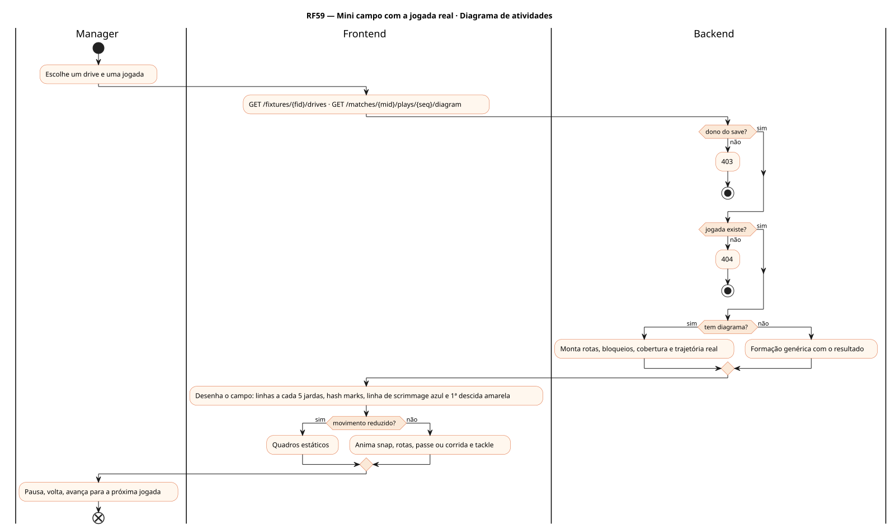
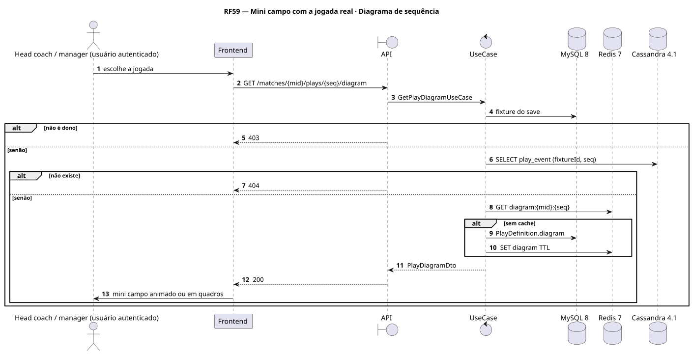
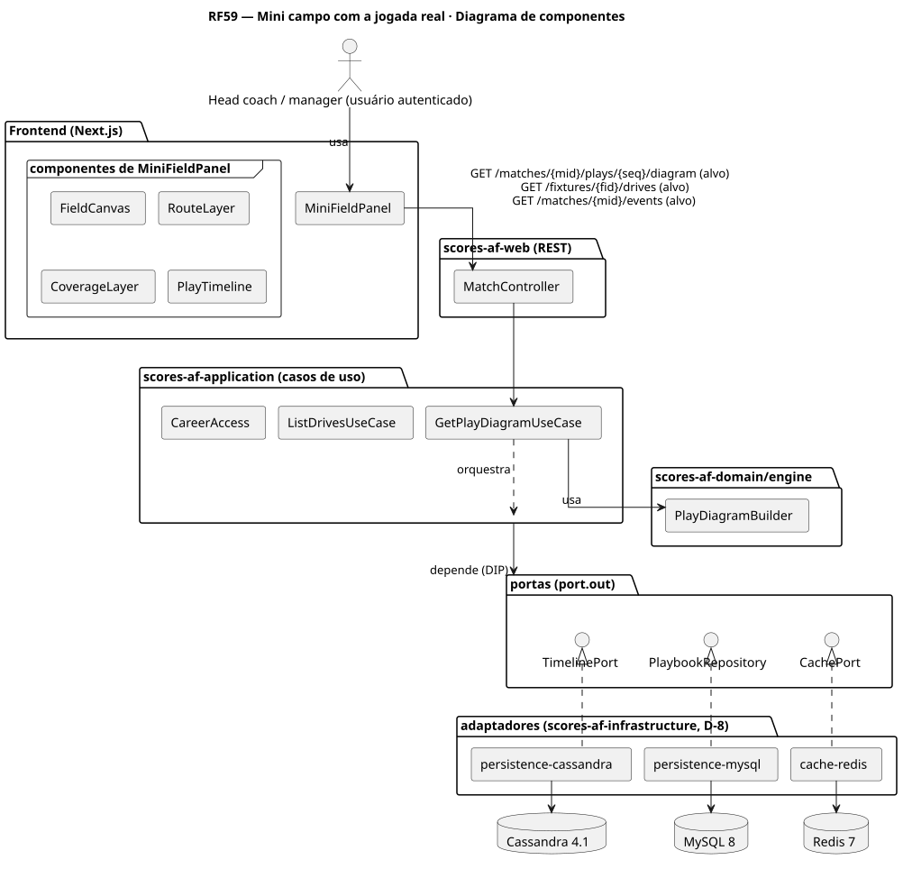
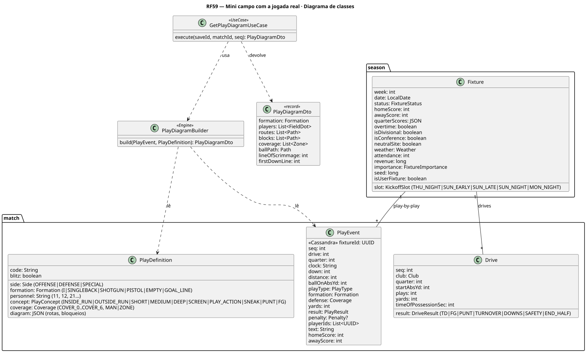
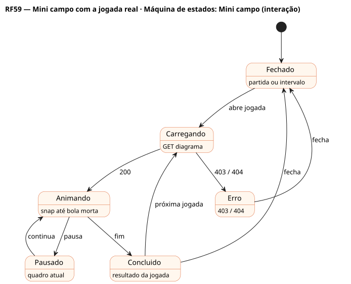

# RF59 — Mini campo com a jogada real

## História de usuário

> HU-RF59 — COMO head coach QUERO ver no mini campo a jogada real desenhada (formação, rotas, bloqueios, cobertura e o caminho da bola) PARA entender o que funcionou e ajustar o plano no intervalo

Sprint: 11 · Atores: Manager · Tela: Partida (RF27) e intervalo (RF29) → Mini campo (/c/{careerId}/match/{mid}#field)

## Diagramas

### Atividades

Fonte: [`RF59-act.puml`](RF59-act.puml)

### Sequência

Fonte: [`RF59-seq.puml`](RF59-seq.puml)

### Componentes

Fonte: [`RF59-cmp.puml`](RF59-cmp.puml)

### Classes

Fonte: [`RF59-cls.puml`](RF59-cls.puml)

### Máquina de estados: Mini campo (interação)

Fonte: [`RF59-stm.puml`](RF59-stm.puml)

## Endpoints

✅ = existe num controller do `scores-af-web` · ⛔ alvo = previsto no modelo, ainda sem controller (lista em `generator/endpoints_code.json`).

| Estado | Método | Rota | Caso de uso | Autorização | Descrição |
|---|---|---|---|---|---|
| ⛔ alvo | `GET` | `/api/v1/matches/{mid}/plays/{seq}/diagram` | `GetPlayDiagramUseCase` | JWT · dono do save | Formação, rotas, bloqueios, cobertura e trajetória real da jogada |
| ⛔ alvo | `GET` | `/api/v1/fixtures/{fid}/drives` | `ListDrivesUseCase` | JWT · dono do save | Drives com jogadas para navegar no mini campo |
| ✅ | `GET` | `/api/v1/matches/{mid}/events` | `ListMatchEventsUseCase` | JWT · dono do save | Jogadas do drive escolhido (RF54) |

## Pontos de decisão

| Gateway | Regra | Se falso |
|---|---|---|
| Dono do save? | fixture do save de jwt.sub | 403 |
| Jogada existe? | PlayEvent (fixtureId, seq) gravado | 404 PLAY_NOT_FOUND |
| Tem diagrama? | PlayDefinition.diagram e trajetória gravados | desenho genérico da formação com o resultado |
| Movimento reduzido? | UserSettings.reducedMotion | anima a jogada |

---
Gerado por `../generator/generate.py` a partir de `../generator/model/*.py` e `../generator/common.py`; não edite os .puml à mão.
