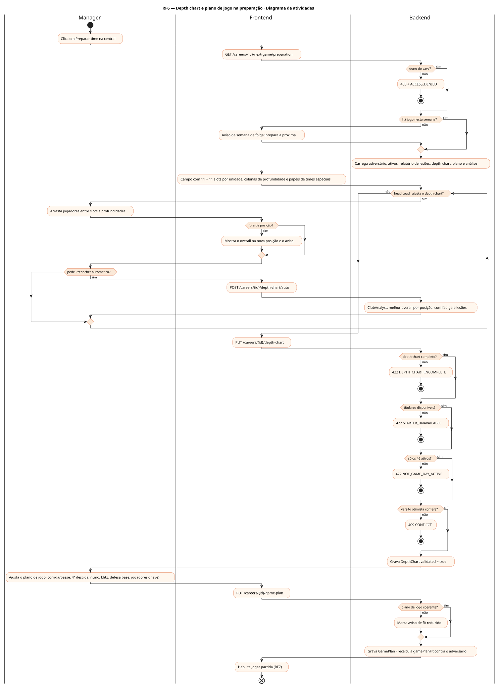
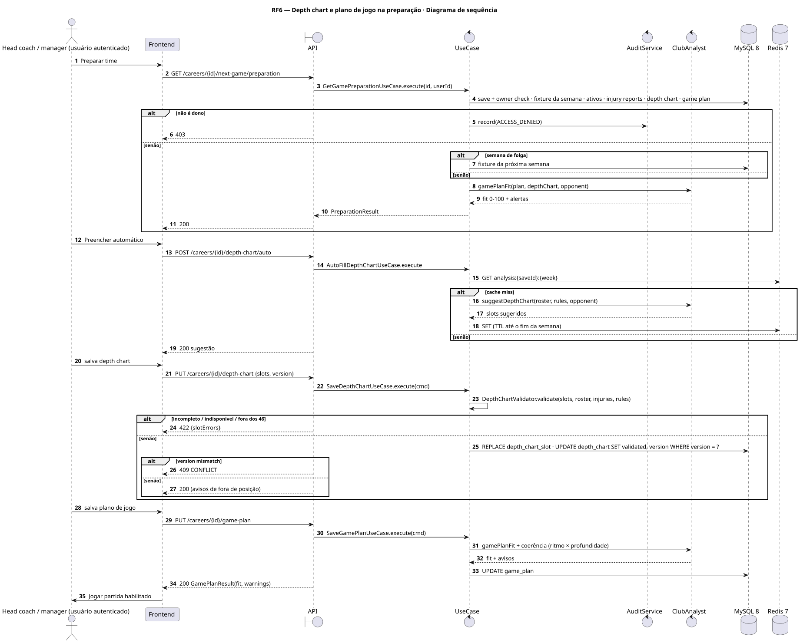
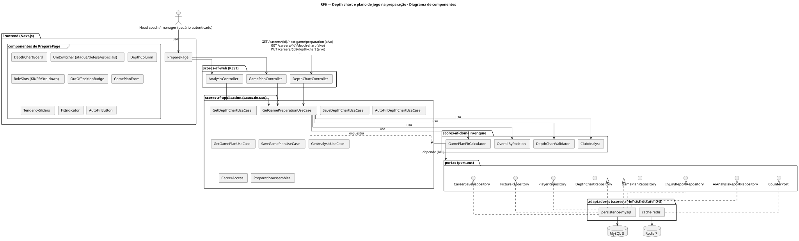
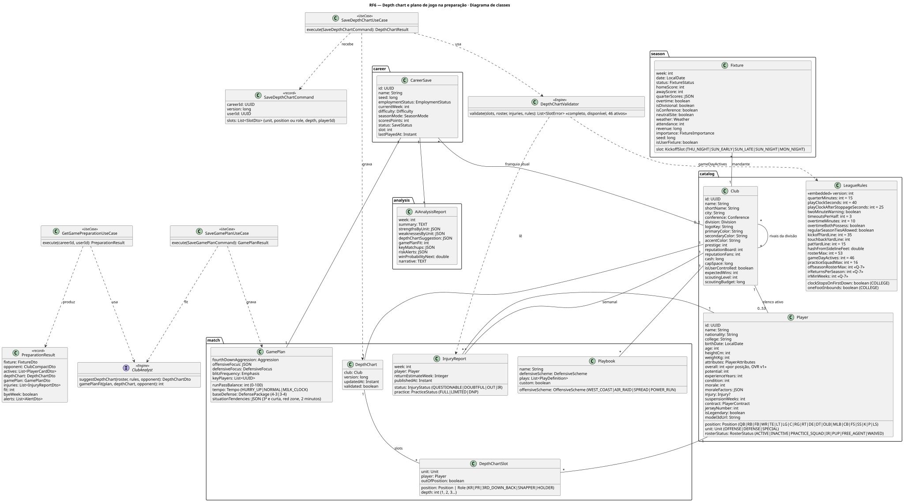
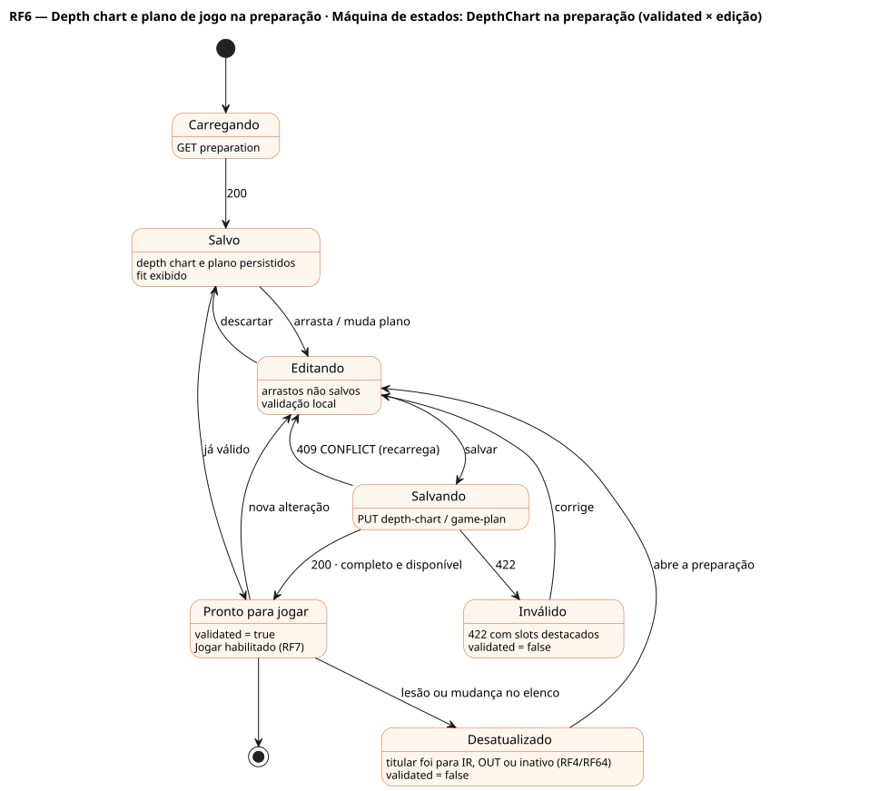

# RF6 — Depth chart e plano de jogo na preparação

## História de usuário

> HU-RF6 — COMO head coach dentro do painel da franquia POSSO acessar 'Preparação para a partida' PARA montar o depth chart por posição e unidade (titulares, reservas, KR, PR, 3rd-down back) e o plano de jogo (tendência corrida/passe, agressividade na 4ª descida, ritmo, foco defensivo, jogadores-chave)

Sprint: 6 · Atores: Manager · Tela: Preparar time — depth chart e plano de jogo (/c/{careerId}/prepare)

## Diagramas

### Atividades

Fonte: [`RF6-act.puml`](RF6-act.puml)

### Sequência

Fonte: [`RF6-seq.puml`](RF6-seq.puml)

### Componentes

Fonte: [`RF6-cmp.puml`](RF6-cmp.puml)

### Classes

Fonte: [`RF6-cls.puml`](RF6-cls.puml)

### Máquina de estados: DepthChart na preparação (validated × edição)

Fonte: [`RF6-stm.puml`](RF6-stm.puml)

## Endpoints

✅ = existe num controller do `scores-af-web` · ⛔ alvo = previsto no modelo, ainda sem controller (lista em `generator/endpoints_code.json`).

| Estado | Método | Rota | Caso de uso | Autorização | Descrição |
|---|---|---|---|---|---|
| ⛔ alvo | `GET` | `/api/v1/careers/{id}/next-game/preparation` | `GetGamePreparationUseCase` | JWT · dono do save | Próximo jogo da semana, adversário, 46 ativos disponíveis, depth chart e plano atuais, relatório de lesões, fit e sugestão do analista |
| ⛔ alvo | `GET` | `/api/v1/careers/{id}/depth-chart` | `GetDepthChartUseCase` | JWT · dono do save | Slots por unidade e posição (depth 1, 2, 3) e papéis (KR, PR, 3RD_DOWN_BACK, HOLDER, SNAPPER) |
| ⛔ alvo | `PUT` | `/api/v1/careers/{id}/depth-chart` | `SaveDepthChartUseCase` | JWT · dono do save | Salva depth chart validado (version otimista) |
| ⛔ alvo | `POST` | `/api/v1/careers/{id}/depth-chart/auto` | `AutoFillDepthChartUseCase` | JWT · dono do save | Preenche pelo overall na posição, condição e lesões (ClubAnalyst) |
| ⛔ alvo | `GET` | `/api/v1/careers/{id}/game-plan` | `GetGamePlanUseCase` | JWT · dono do save | GamePlan atual e playbook ativo |
| ⛔ alvo | `PUT` | `/api/v1/careers/{id}/game-plan` | `SaveGamePlanUseCase` | JWT · dono do save | runPassBalance, fourthDownAggression, tempo, foco ofensivo e defensivo, blitz, defesa base 4-3/3-4, jogadores-chave, tendências por situação |
| ⛔ alvo | `GET` | `/api/v1/careers/{id}/analysis` | `GetAnalysisUseCase` | JWT · dono do save | Relatório do ClubAnalyst: depth chart sugerido, gamePlanFit, alertas (fora de posição, fadiga, lesão) |

## Pontos de decisão

| Gateway | Regra | Se falso |
|---|---|---|
| Dono do save? | save.userId == jwt.sub (CareerAccess.requireOwner) | 403 FORBIDDEN + AuditLog ACCESS_DENIED |
| Há jogo nesta semana? | existe Fixture SCHEDULED do clube na semana atual (Week.byeClubs não contém o clube) | semana de folga: edita para a próxima semana (aviso BYE_WEEK) · fim de temporada → 409 NO_NEXT_GAME (RF35) |
| Depth chart completo? | depth 1 em todas as posições da formação base do ataque (11) e da defesa base (11) + K, P, LS, KR, PR · QB com depth ≥ 2 | 422 DEPTH_CHART_INCOMPLETE (slots destacados) |
| Titulares disponíveis? | nenhum jogador OUT, IR ou suspenso em depth 1 · QUESTIONABLE/DOUBTFUL geram aviso | 422 STARTER_UNAVAILABLE |
| Só os 46 ativos? | todo jogador do depth chart tem rosterStatus ACTIVE (≤ gameDayActives) | 422 NOT_GAME_DAY_ACTIVE |
| Fora de posição? | OverallByPosition.outOfPosition(player, slot.position) | sem aviso · se sim: aviso com o overall na posição, não bloqueia |
| Plano de jogo coerente? | tempo HURRY_UP exige profundidade ≥ 2 em WR e RB · runPassBalance 0–100 · jogadores-chave entre os ativos | aviso de fit reduzido (não bloqueia) · jogador-chave inativo = 422 KEY_PLAYER_INVALID |
| Versão otimista confere? | DepthChart.version (ou GamePlan) == versão enviada | 409 CONFLICT · recarrega |

---
Gerado por `../generator/generate.py` a partir de `../generator/model/*.py` e `../generator/common.py`; não edite os .puml à mão.
