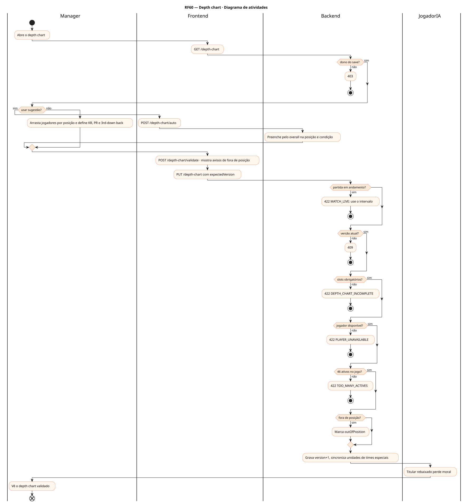
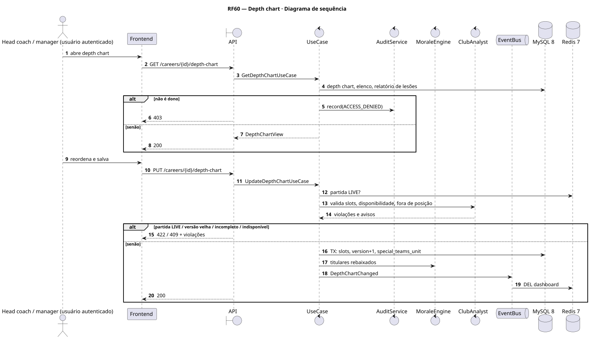
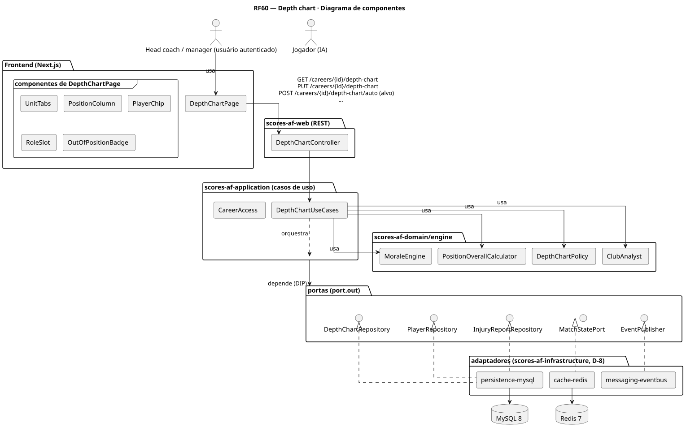
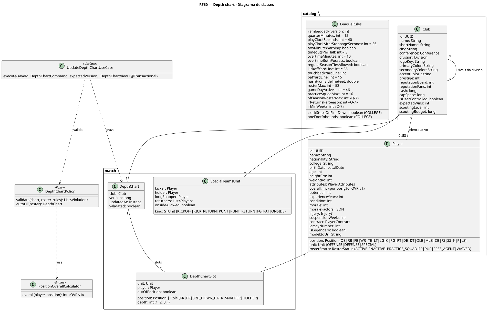
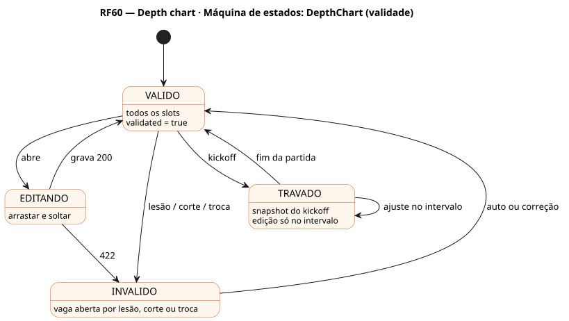

# RF60 — Depth chart

## História de usuário

> HU-RF60 — COMO head coach QUERO montar o depth chart por posição e unidade (titulares, reservas e papéis KR, PR e 3rd-down back) PARA definir quem entra em cada situação do jogo

Sprint: 6 · Atores: Manager, JogadorIA · Tela: Escalação (/c/{careerId}/depth-chart): Ataque · Defesa · Times especiais

## Diagramas

### Atividades

Fonte: [`RF60-act.puml`](RF60-act.puml)

### Sequência

Fonte: [`RF60-seq.puml`](RF60-seq.puml)

### Componentes

Fonte: [`RF60-cmp.puml`](RF60-cmp.puml)

### Classes

Fonte: [`RF60-cls.puml`](RF60-cls.puml)

### Máquina de estados: DepthChart (validade)

Fonte: [`RF60-stm.puml`](RF60-stm.puml)

## Endpoints

✅ = existe num controller do `scores-af-web` · ⛔ alvo = previsto no modelo, ainda sem controller (lista em `generator/endpoints_code.json`).

| Estado | Método | Rota | Caso de uso | Autorização | Descrição |
|---|---|---|---|---|---|
| ✅ | `GET` | `/api/v1/careers/{id}/depth-chart` | `GetDepthChartUseCase` | JWT · dono do save | Slots por unidade e posição, overall na posição, avisos |
| ✅ | `PUT` | `/api/v1/careers/{id}/depth-chart` | `UpdateDepthChartUseCase` | JWT · dono do save | Grava slots (expectedVersion) |
| ⛔ alvo | `POST` | `/api/v1/careers/{id}/depth-chart/auto` | `AutoFillDepthChartUseCase` | JWT · dono do save | Sugestão pelo overall na posição e condição |
| ⛔ alvo | `POST` | `/api/v1/careers/{id}/depth-chart/validate` | `ValidateDepthChartUseCase` | JWT · dono do save | Valida sem gravar |

## Pontos de decisão

| Gateway | Regra | Se falso |
|---|---|---|
| Dono do save? | save.userId == jwt.sub | 403 + AuditLog ACCESS_DENIED |
| Versão atual? | expectedVersion == depthChart.version | 409 DEPTH_CHART_VERSION_CONFLICT |
| Slots obrigatórios? | 11 titulares no ataque e na defesa, K, P, LS, holder, KR e PR | 422 DEPTH_CHART_INCOMPLETE |
| Jogador disponível? | ACTIVE (ou elevado do practice squad), sem suspensão, não OUT nem IR | 422 PLAYER_UNAVAILABLE |
| Fora de posição? | overall na posição < overall na posição natural − 5 | sem aviso |
| 46 ativos no jogo? | jogadores únicos no depth chart ≤ gameDayActives | 422 TOO_MANY_ACTIVES |
| Partida em andamento? | MatchSession LIVE | grava |

---
Gerado por `../generator/generate.py` a partir de `../generator/model/*.py` e `../generator/common.py`; não edite os .puml à mão.
