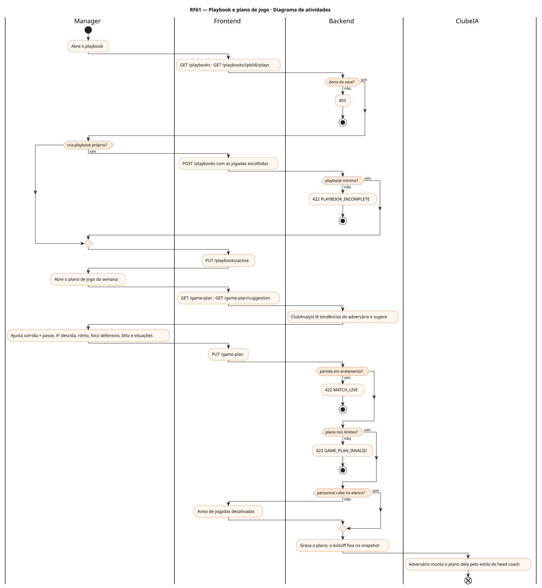
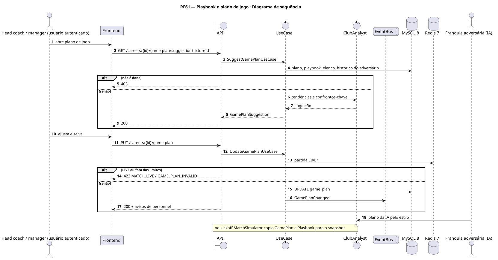
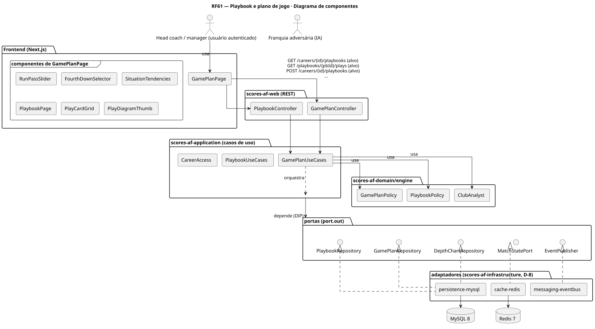
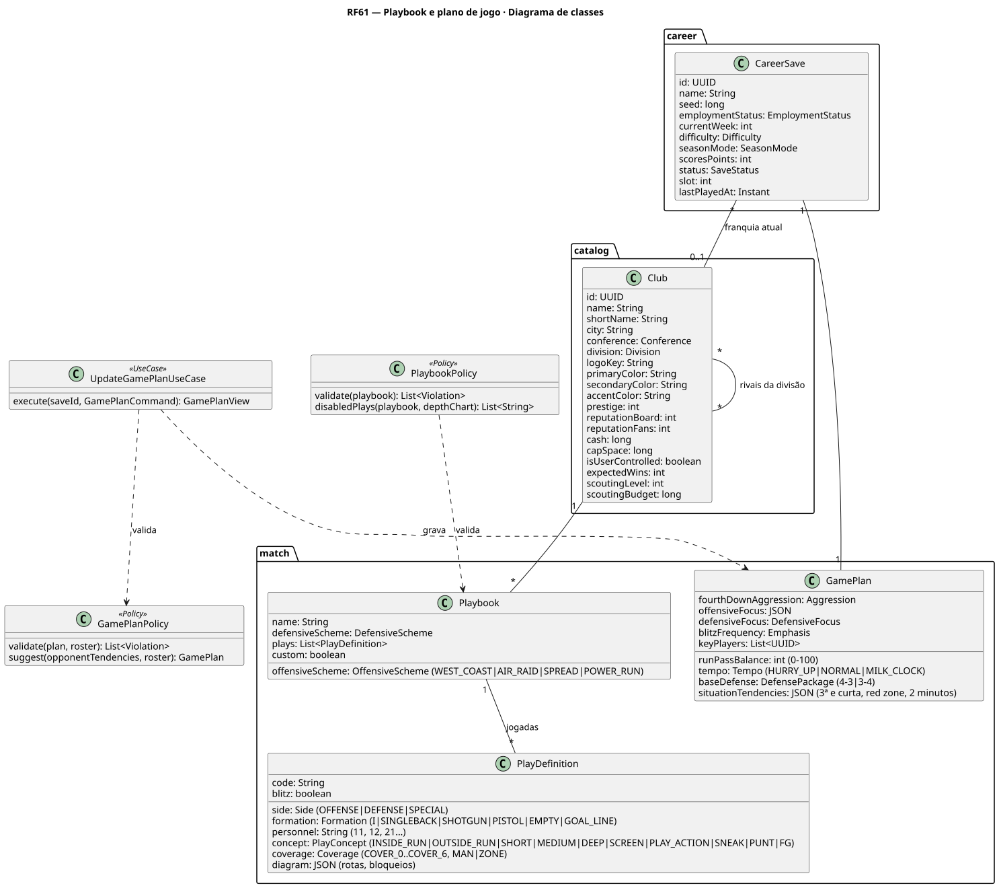
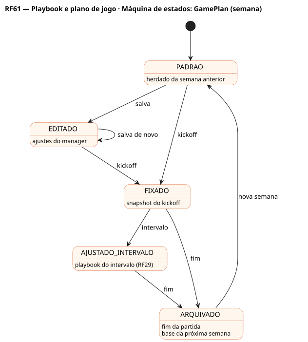

# RF61 — Playbook e plano de jogo

## História de usuário

> HU-RF61 — COMO head coach QUERO escolher o playbook (formações, conceitos e coberturas) e o plano de jogo da semana (corrida × passe, 4ª descida, ritmo, foco defensivo, tendências por situação) PARA preparar a partida contra o adversário

Sprint: 6 · Atores: Manager, ClubeIA · Tela: Plano de jogo (/c/{careerId}/game-plan) · Playbook (/c/{careerId}/playbook)

## Diagramas

### Atividades

Fonte: [`RF61-act.puml`](RF61-act.puml)

### Sequência

Fonte: [`RF61-seq.puml`](RF61-seq.puml)

### Componentes

Fonte: [`RF61-cmp.puml`](RF61-cmp.puml)

### Classes

Fonte: [`RF61-cls.puml`](RF61-cls.puml)

### Máquina de estados: GamePlan (semana)

Fonte: [`RF61-stm.puml`](RF61-stm.puml)

## Endpoints

✅ = existe num controller do `scores-af-web` · ⛔ alvo = previsto no modelo, ainda sem controller (lista em `generator/endpoints_code.json`).

| Estado | Método | Rota | Caso de uso | Autorização | Descrição |
|---|---|---|---|---|---|
| ⛔ alvo | `GET` | `/api/v1/careers/{id}/playbooks` | `ListPlaybooksUseCase` | JWT · dono do save | Playbooks por esquema (West Coast, Air Raid, Spread, Power Run) e o ativo |
| ⛔ alvo | `GET` | `/api/v1/playbooks/{pbId}/plays` | `ListPlayDefinitionsUseCase` | JWT | Jogadas com filtros (lado, formação, conceito, cobertura) |
| ⛔ alvo | `POST` | `/api/v1/careers/{id}/playbooks` | `CreateCustomPlaybookUseCase` | JWT · dono do save | Cria playbook próprio a partir de um esquema |
| ⛔ alvo | `PUT` | `/api/v1/careers/{id}/playbooks/active` | `SetActivePlaybookUseCase` | JWT · dono do save | Define o playbook ativo |
| ⛔ alvo | `GET` | `/api/v1/careers/{id}/game-plan` | `GetGamePlanUseCase` | JWT · dono do save | Plano da semana |
| ⛔ alvo | `PUT` | `/api/v1/careers/{id}/game-plan` | `UpdateGamePlanUseCase` | JWT · dono do save | Grava tendências, 4ª descida, ritmo, foco, blitz, jogadores-chave |
| ⛔ alvo | `GET` | `/api/v1/careers/{id}/game-plan/suggestion` | `SuggestGamePlanUseCase` | JWT · dono do save | Sugestão contra o próximo adversário (fixtureId) |

## Pontos de decisão

| Gateway | Regra | Se falso |
|---|---|---|
| Dono do save? | save.userId == jwt.sub | 403 |
| Playbook mínimo? | jogadas por situação: corrida, passe curto e fundo, red zone, goal line, 2 minutos, punt, FG | 422 PLAYBOOK_INCOMPLETE |
| Plano nos limites? | runPassBalance 0–100, enums válidos, até 5 jogadores-chave do elenco | 422 GAME_PLAN_INVALID |
| Personnel cabe no elenco? | agrupamentos usados (12, 21…) têm jogadores no depth chart | aviso: jogadas desativadas |
| Partida em andamento? | MatchSession LIVE | vale no kickoff |

---
Gerado por `../generator/generate.py` a partir de `../generator/model/*.py` e `../generator/common.py`; não edite os .puml à mão.
