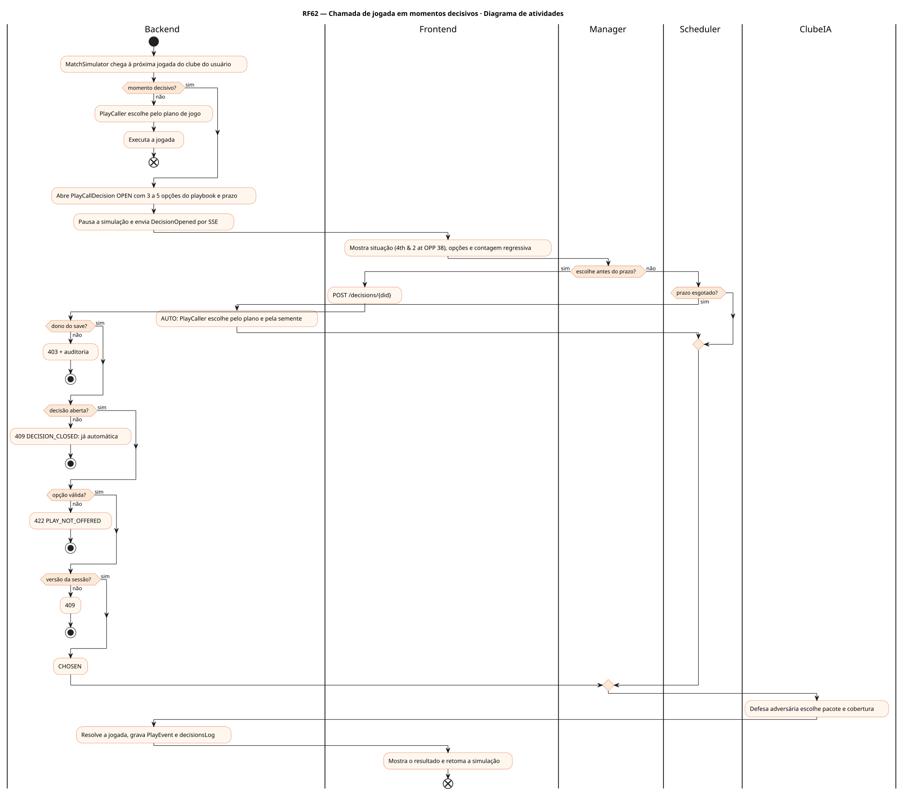
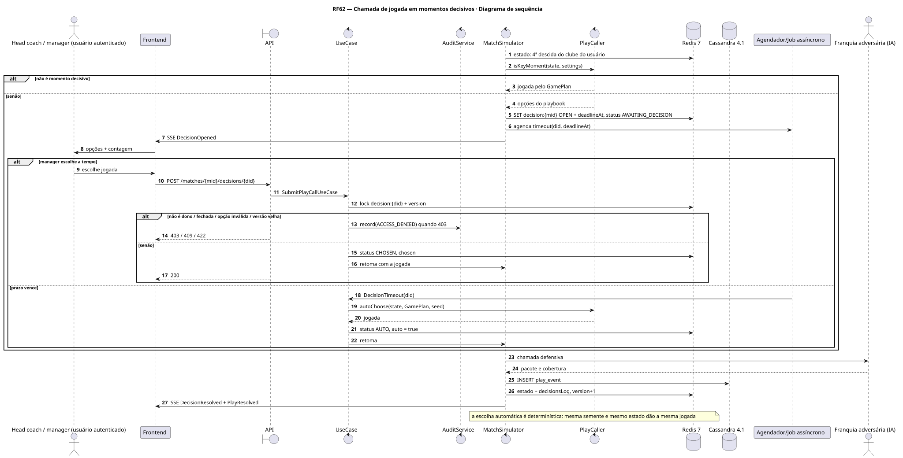
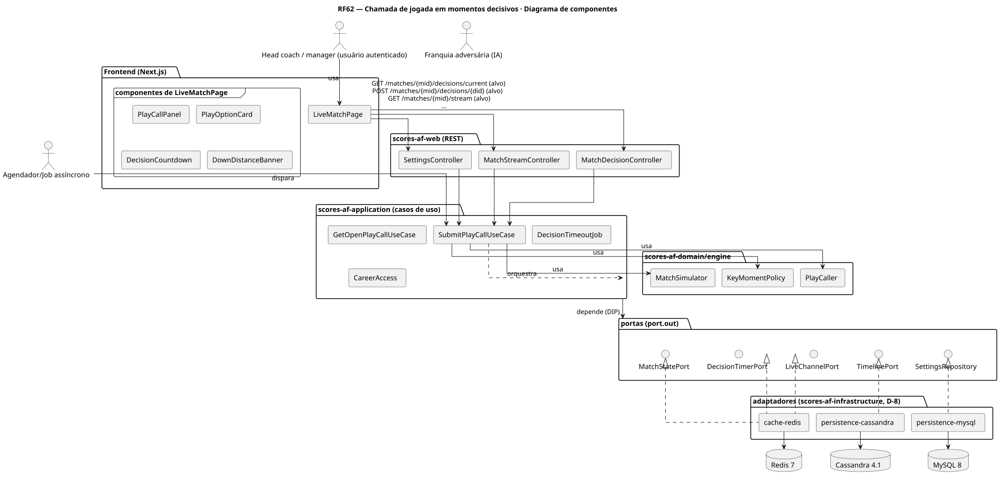
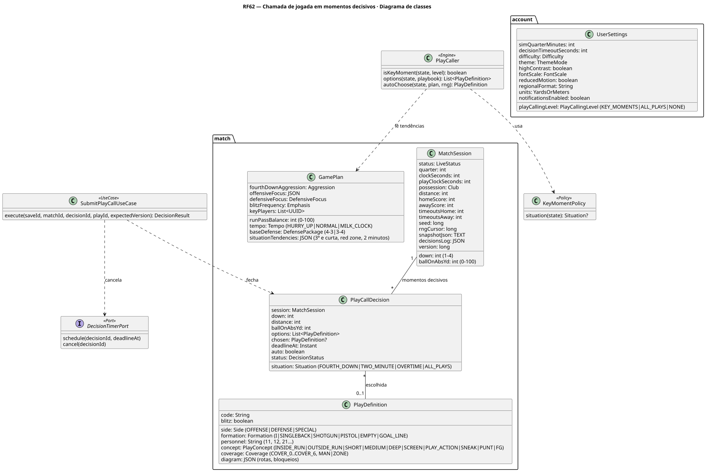
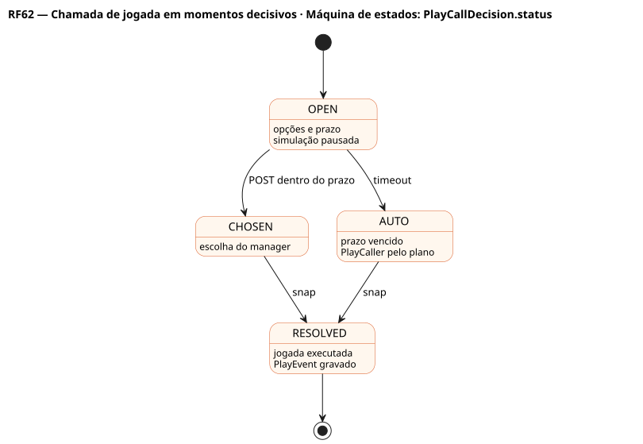
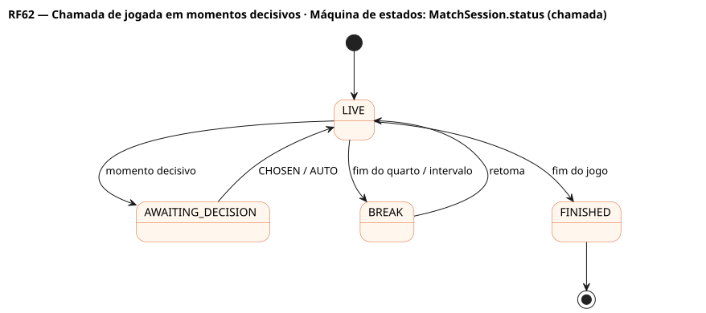

# RF62 — Chamada de jogada em momentos decisivos

## História de usuário

> HU-RF62 — COMO head coach QUERO escolher a jogada nos momentos decisivos (4ª descida, últimos 2 minutos e prorrogação) dentro de um tempo limite, com decisão automática se o tempo acabar, PARA controlar o jogo quando mais importa

Sprint: 6 · Atores: Manager, ClubeIA, Scheduler · Tela: Partida ao vivo (RF27) → painel de chamada de jogada (/c/{careerId}/match/{mid}#call)

## Diagramas

### Atividades

Fonte: [`RF62-act.puml`](RF62-act.puml)

### Sequência

Fonte: [`RF62-seq.puml`](RF62-seq.puml)

### Componentes

Fonte: [`RF62-cmp.puml`](RF62-cmp.puml)

### Classes

Fonte: [`RF62-cls.puml`](RF62-cls.puml)

### Máquina de estados: PlayCallDecision.status

Fonte: [`RF62-stm.puml`](RF62-stm.puml)

### Máquina de estados: MatchSession.status (chamada)

Fonte: [`RF62-stm-matchsession-status-chamada.puml`](RF62-stm-matchsession-status-chamada.puml)

## Endpoints

✅ = existe num controller do `scores-af-web` · ⛔ alvo = previsto no modelo, ainda sem controller (lista em `generator/endpoints_code.json`).

| Estado | Método | Rota | Caso de uso | Autorização | Descrição |
|---|---|---|---|---|---|
| ⛔ alvo | `GET` | `/api/v1/matches/{mid}/decisions/current` | `GetOpenPlayCallUseCase` | JWT · dono do save | Decisão aberta: situação, descida e distância, 3 a 5 opções, prazo |
| ⛔ alvo | `POST` | `/api/v1/matches/{mid}/decisions/{did}` | `SubmitPlayCallUseCase` | JWT · dono do save | Escolhe a jogada (expectedVersion da sessão) |
| ⛔ alvo | `GET` | `/api/v1/matches/{mid}/stream` | `MatchStreamUseCase` | JWT · dono do save | SSE: DecisionOpened, DecisionResolved, PlayResolved |
| ✅ | `PUT` | `/api/v1/me/settings` | `UpdateUserSettingsUseCase` | JWT | Nível de chamada (KEY_MOMENTS, ALL_PLAYS, NONE) e tempo limite (RF10) |

## Pontos de decisão

| Gateway | Regra | Se falso |
|---|---|---|
| Dono do save? | fixture do save de jwt.sub | 403 + AuditLog ACCESS_DENIED |
| Momento decisivo? | KEY_MOMENTS: 4ª descida, últimos 2 minutos de cada tempo ou prorrogação · ALL_PLAYS: toda jogada · NONE: nunca | PlayCaller escolhe pelo plano de jogo |
| Decisão aberta? | status OPEN e now < deadlineAt | 409 DECISION_CLOSED |
| Opção válida? | playId ∈ options | 422 PLAY_NOT_OFFERED |
| Versão da sessão? | expectedVersion == MatchSession.version | 409 MATCH_VERSION_CONFLICT |
| Prazo esgotado? | now ≥ deadlineAt sem escolha | aguarda |

---
Gerado por `../generator/generate.py` a partir de `../generator/model/*.py` e `../generator/common.py`; não edite os .puml à mão.
