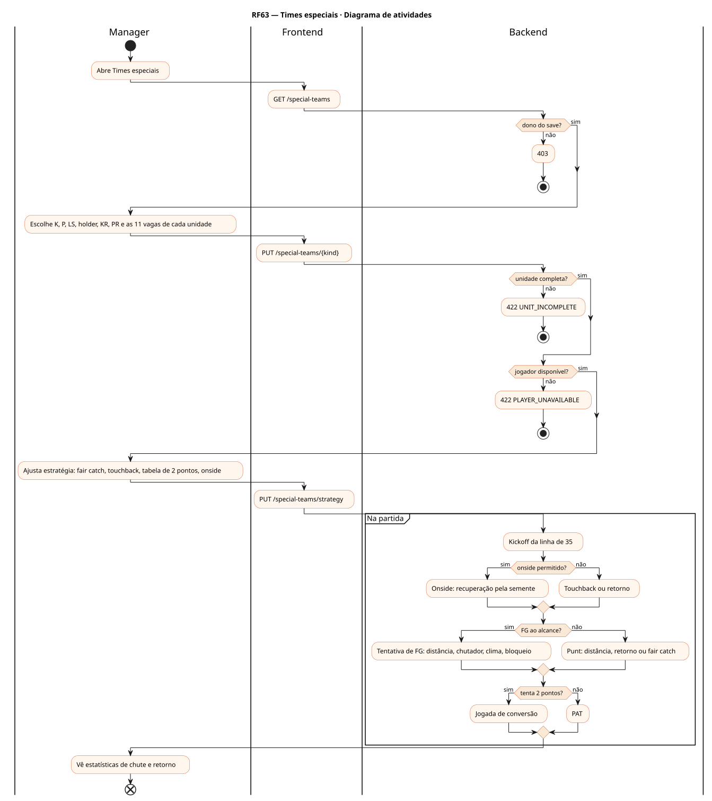
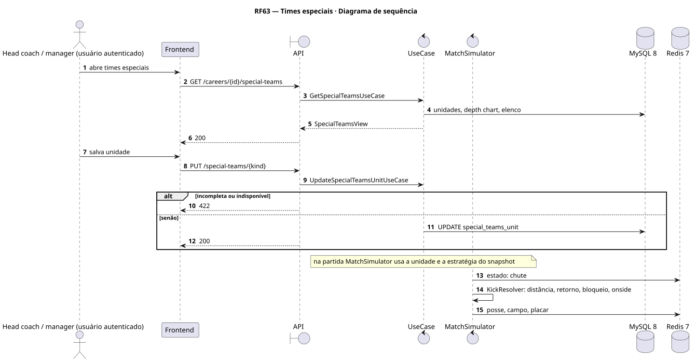
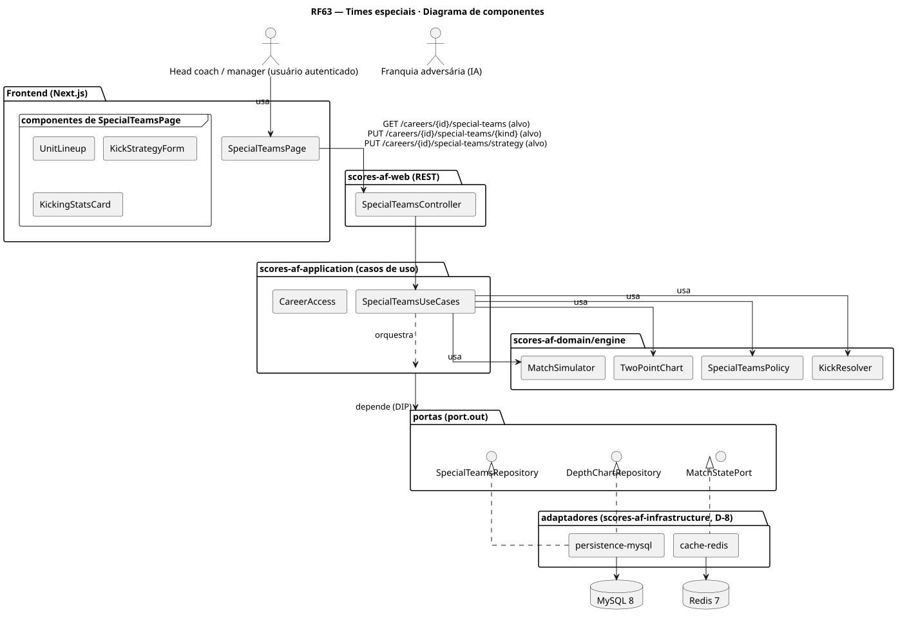
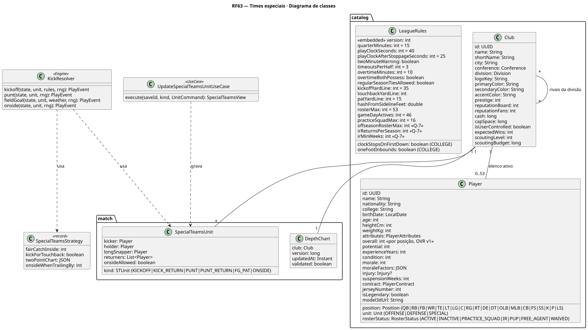
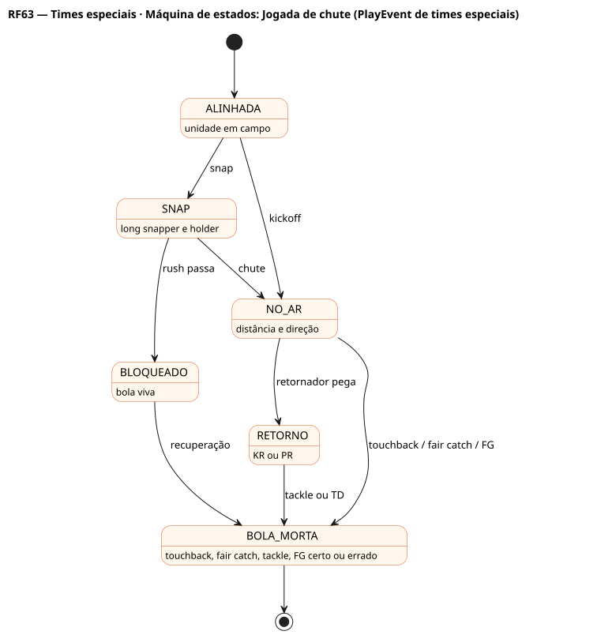

# RF63 — Times especiais

## História de usuário

> HU-RF63 — COMO head coach QUERO montar as unidades de times especiais (kickoff, retorno, punt, FG e PAT, onside) e definir a estratégia de chutes PARA ganhar campo e pontos nas jogadas de chute

Sprint: 11 · Atores: Manager, ClubeIA · Tela: Depth chart (RF60) → aba Times especiais (/c/{careerId}/depth-chart#special)

## Diagramas

### Atividades

Fonte: [`RF63-act.puml`](RF63-act.puml)

### Sequência

Fonte: [`RF63-seq.puml`](RF63-seq.puml)

### Componentes

Fonte: [`RF63-cmp.puml`](RF63-cmp.puml)

### Classes

Fonte: [`RF63-cls.puml`](RF63-cls.puml)

### Máquina de estados: Jogada de chute (PlayEvent de times especiais)

Fonte: [`RF63-stm.puml`](RF63-stm.puml)

## Endpoints

✅ = existe num controller do `scores-af-web` · ⛔ alvo = previsto no modelo, ainda sem controller (lista em `generator/endpoints_code.json`).

| Estado | Método | Rota | Caso de uso | Autorização | Descrição |
|---|---|---|---|---|---|
| ⛔ alvo | `GET` | `/api/v1/careers/{id}/special-teams` | `GetSpecialTeamsUseCase` | JWT · dono do save | Unidades, chutador, holder, long snapper, retornadores, estatísticas |
| ⛔ alvo | `PUT` | `/api/v1/careers/{id}/special-teams/{kind}` | `UpdateSpecialTeamsUnitUseCase` | JWT · dono do save | Grava a unidade (KICKOFF, KICK_RETURN, PUNT, PUNT_RETURN, FG_PAT, ONSIDE) |
| ⛔ alvo | `PUT` | `/api/v1/careers/{id}/special-teams/strategy` | `UpdateSpecialTeamsStrategyUseCase` | JWT · dono do save | Fair catch, touchback, tabela de conversão de 2, onside por placar |

## Pontos de decisão

| Gateway | Regra | Se falso |
|---|---|---|
| Dono do save? | save.userId == jwt.sub | 403 |
| Unidade completa? | 11 jogadores; K ou P, holder e LS definidos quando a unidade pede | 422 UNIT_INCOMPLETE |
| Jogador disponível? | ativo no dia de jogo, não OUT nem IR | 422 PLAYER_UNAVAILABLE |
| Onside permitido? | onsideAllowed e regra da liga (aviso ao adversário conforme LeagueRules) | kickoff normal |
| Tenta 2 pontos? | tabela de conversão por diferença no placar e tempo restante | PAT da linha de 15 |
| FG ao alcance? | distância ≤ alcance pela potência do chutador e clima | punt ou tentativa na 4ª descida (RF62) |

---
Gerado por `../generator/generate.py` a partir de `../generator/model/*.py` e `../generator/common.py`; não edite os .puml à mão.
