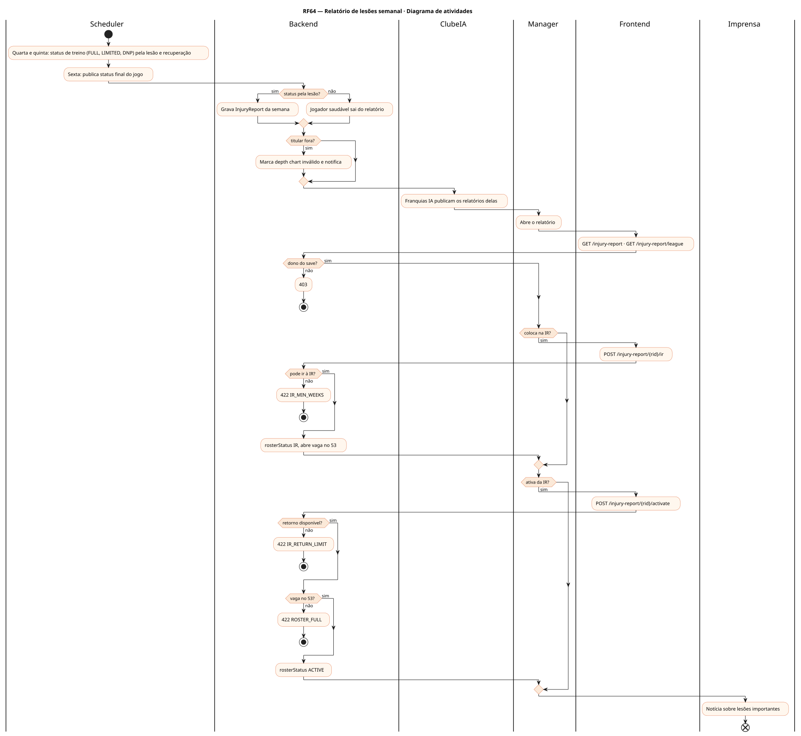
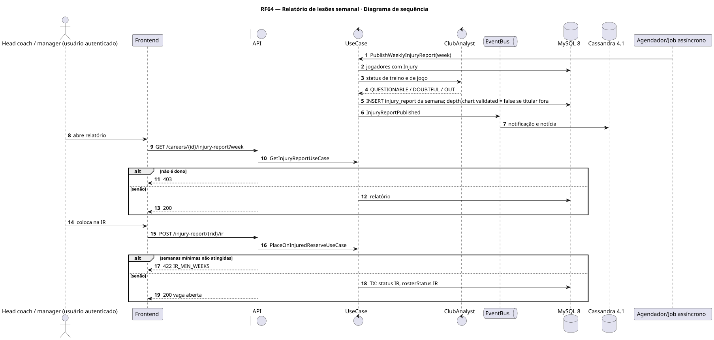
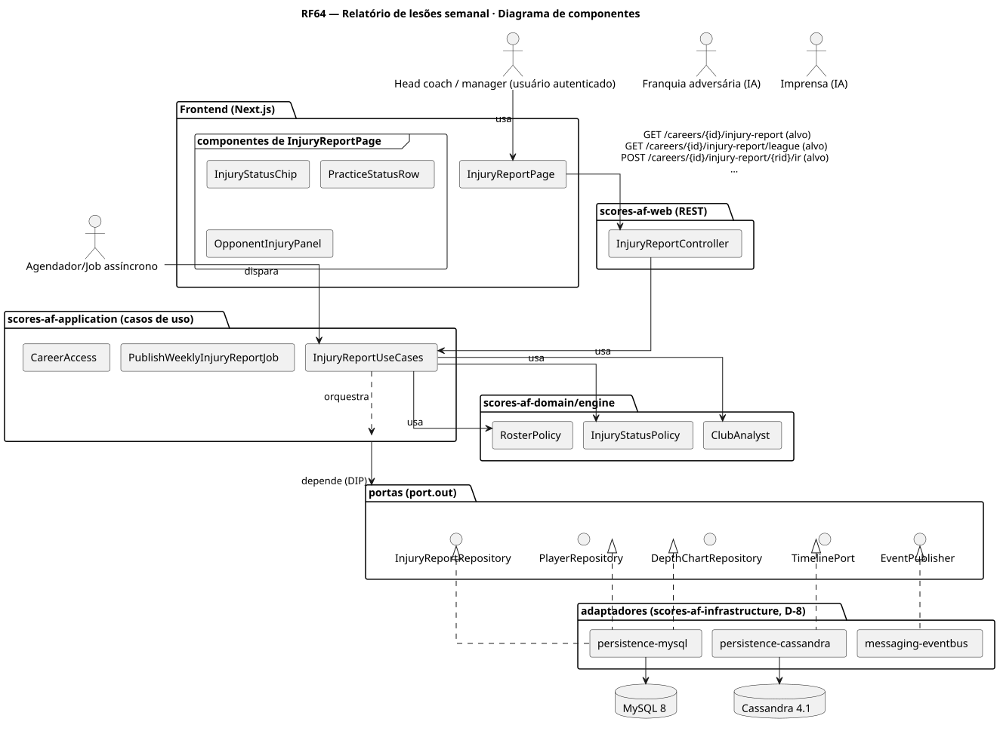
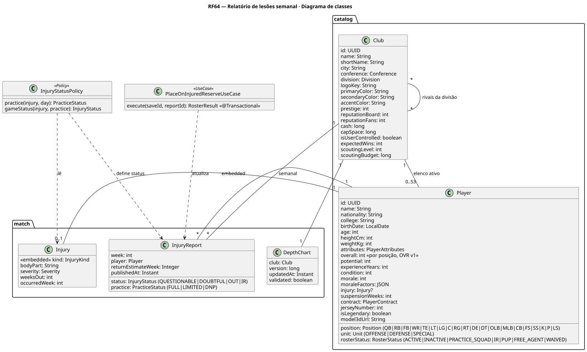
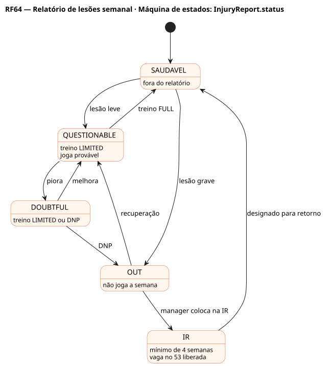

# RF64 — Relatório de lesões semanal

## História de usuário

> HU-RF64 — COMO head coach QUERO ver o relatório de lesões semanal do meu time e dos adversários (questionável, duvidoso, fora, IR) e mover jogadores para a IR PARA planejar o depth chart e liberar vagas no elenco

Sprint: 11 · Atores: Manager, Scheduler, ClubeIA, Imprensa · Tela: Elenco (RF4) → Relatório de lesões (/c/{careerId}/injuries) · prévia do adversário (RF7)

## Diagramas

### Atividades

Fonte: [`RF64-act.puml`](RF64-act.puml)

### Sequência

Fonte: [`RF64-seq.puml`](RF64-seq.puml)

### Componentes

Fonte: [`RF64-cmp.puml`](RF64-cmp.puml)

### Classes

Fonte: [`RF64-cls.puml`](RF64-cls.puml)

### Máquina de estados: InjuryReport.status

Fonte: [`RF64-stm.puml`](RF64-stm.puml)

## Endpoints

✅ = existe num controller do `scores-af-web` · ⛔ alvo = previsto no modelo, ainda sem controller (lista em `generator/endpoints_code.json`).

| Estado | Método | Rota | Caso de uso | Autorização | Descrição |
|---|---|---|---|---|---|
| ⛔ alvo | `GET` | `/api/v1/careers/{id}/injury-report` | `GetInjuryReportUseCase` | JWT · dono do save | Relatório da semana do clube (week) |
| ⛔ alvo | `GET` | `/api/v1/careers/{id}/injury-report/league` | `GetLeagueInjuryReportUseCase` | JWT · dono do save | Relatórios publicados das outras franquias (week, clubId) |
| ⛔ alvo | `POST` | `/api/v1/careers/{id}/injury-report/{rid}/ir` | `PlaceOnInjuredReserveUseCase` | JWT · dono do save | Coloca na IR (mínimo de semanas) e abre vaga no 53 |
| ⛔ alvo | `POST` | `/api/v1/careers/{id}/injury-report/{rid}/activate` | `ActivateFromInjuredReserveUseCase` | JWT · dono do save | Volta da IR (designações de retorno por temporada) |

## Pontos de decisão

| Gateway | Regra | Se falso |
|---|---|---|
| Dono do save? | save.userId == jwt.sub | 403 |
| Status pela lesão? | weeksOut ≥ 1 e DNP → OUT · LIMITED e gravidade média → DOUBTFUL · LIMITED leve → QUESTIONABLE | sai do relatório (saudável) |
| Pode ir à IR? | weeksOut ≥ 4 | 422 IR_MIN_WEEKS |
| Retorno disponível? | semanas mínimas cumpridas e designações de retorno < 8 na temporada | 422 IR_RETURN_LIMIT |
| Vaga no 53? | ativos < rosterMax ao ativar | 422 ROSTER_FULL (dispense alguém) |
| Titular fora? | jogador OUT ou IR está num slot do depth chart | segue |

---
Gerado por `../generator/generate.py` a partir de `../generator/model/*.py` e `../generator/common.py`; não edite os .puml à mão.
