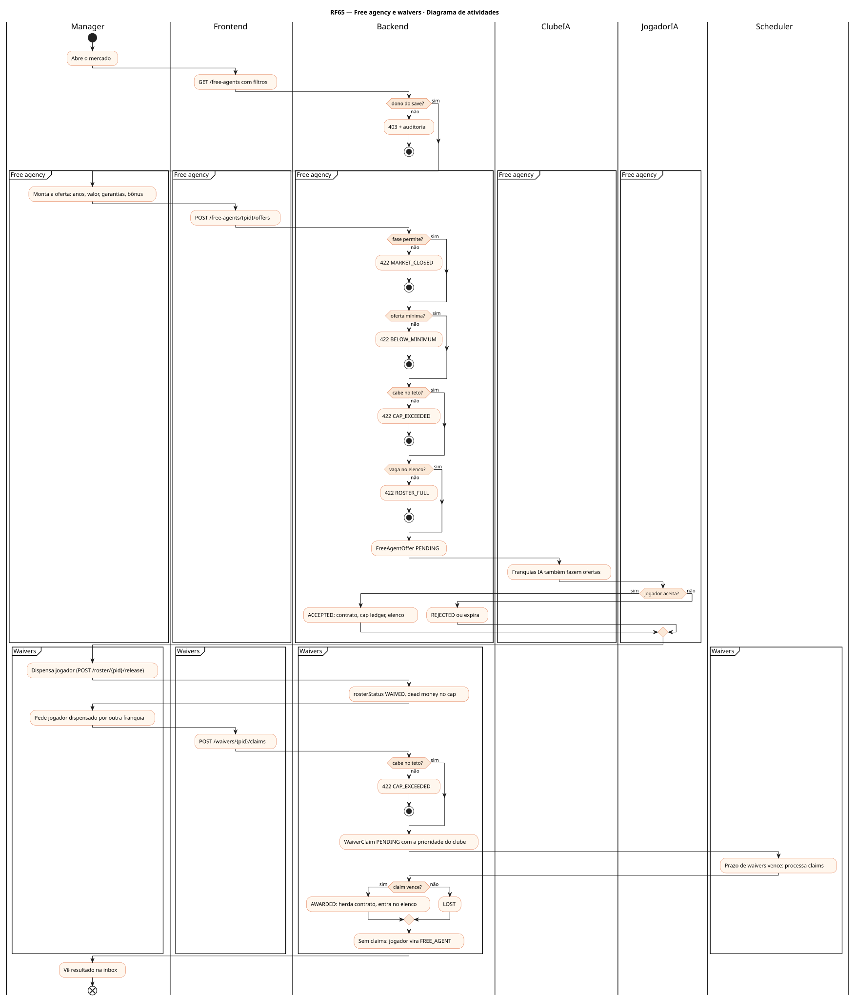
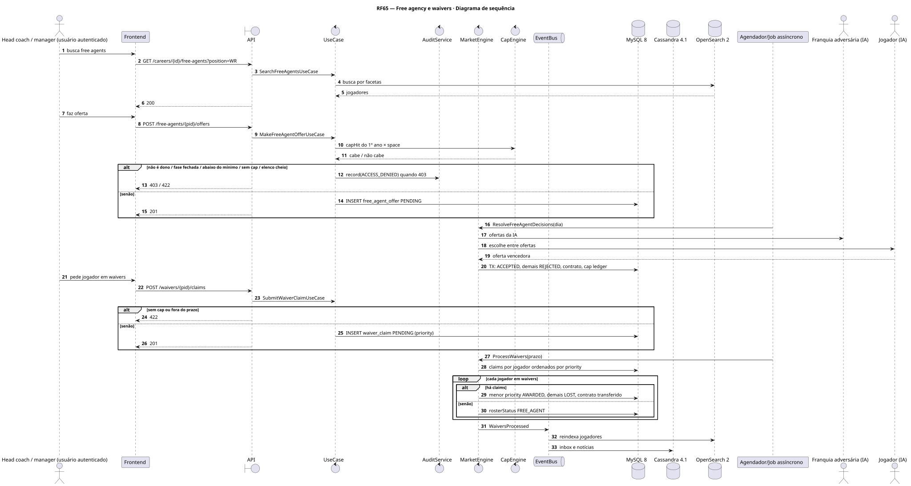
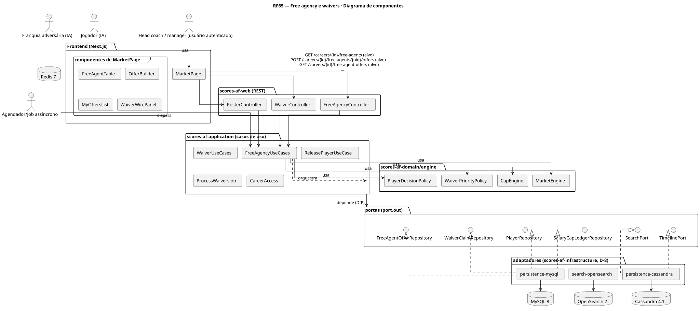
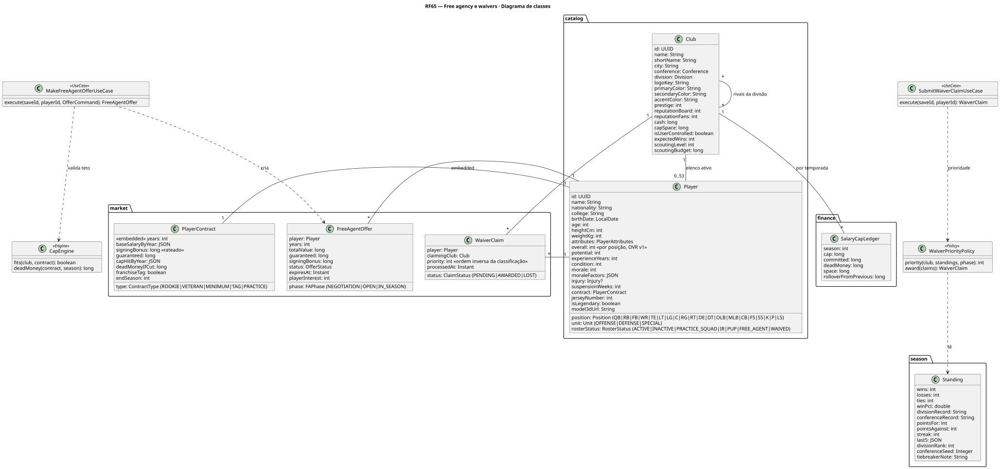
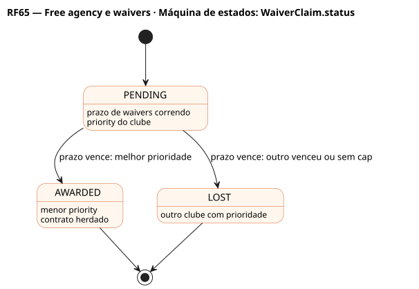
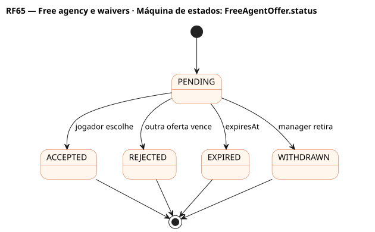

# RF65 — Free agency e waivers

## História de usuário

> HU-RF65 — COMO head coach QUERO fazer ofertas a free agents, dispensar jogadores e pedir jogadores dispensados por outras franquias pela ordem de prioridade PARA reforçar o elenco dentro do teto salarial

Sprint: 7 · Atores: Manager, ClubeIA, JogadorIA, Scheduler · Tela: Mercado (/c/{careerId}/market): Free agents · Minhas ofertas · Waivers

## Diagramas

### Atividades

Fonte: [`RF65-act.puml`](RF65-act.puml)

### Sequência

Fonte: [`RF65-seq.puml`](RF65-seq.puml)

### Componentes

Fonte: [`RF65-cmp.puml`](RF65-cmp.puml)

### Classes

Fonte: [`RF65-cls.puml`](RF65-cls.puml)

### Máquina de estados: WaiverClaim.status

Fonte: [`RF65-stm.puml`](RF65-stm.puml)

### Máquina de estados: FreeAgentOffer.status

Fonte: [`RF65-stm-freeagentoffer-status.puml`](RF65-stm-freeagentoffer-status.puml)

## Endpoints

✅ = existe num controller do `scores-af-web` · ⛔ alvo = previsto no modelo, ainda sem controller (lista em `generator/endpoints_code.json`).

| Estado | Método | Rota | Caso de uso | Autorização | Descrição |
|---|---|---|---|---|---|
| ⛔ alvo | `GET` | `/api/v1/careers/{id}/free-agents` | `SearchFreeAgentsUseCase` | JWT · dono do save | Busca com facetas (posição, idade, overall, pedida) |
| ⛔ alvo | `POST` | `/api/v1/careers/{id}/free-agents/{pid}/offers` | `MakeFreeAgentOfferUseCase` | JWT · dono do save | Oferta: anos, valor total, garantias, bônus de assinatura |
| ⛔ alvo | `GET` | `/api/v1/careers/{id}/free-agent-offers` | `ListFreeAgentOffersUseCase` | JWT · dono do save | Minhas ofertas e status |
| ⛔ alvo | `DELETE` | `/api/v1/careers/{id}/free-agent-offers/{oid}` | `WithdrawFreeAgentOfferUseCase` | JWT · dono do save | Retira oferta pendente |
| ⛔ alvo | `POST` | `/api/v1/careers/{id}/roster/{pid}/release` | `ReleasePlayerUseCase` | JWT · dono do save | Dispensa: vai a waivers e gera dead money |
| ⛔ alvo | `GET` | `/api/v1/careers/{id}/waivers` | `ListWaiverWireUseCase` | JWT · dono do save | Jogadores em waivers, prazo e minha prioridade |
| ⛔ alvo | `POST` | `/api/v1/careers/{id}/waivers/{pid}/claims` | `SubmitWaiverClaimUseCase` | JWT · dono do save | Pede o jogador (herda o contrato) |

## Pontos de decisão

| Gateway | Regra | Se falso |
|---|---|---|
| Dono do save? | save.userId == jwt.sub | 403 + AuditLog ACCESS_DENIED |
| Fase permite? | Season.phase FREE_AGENCY ou temporada regular antes do prazo; NEGOTIATION só com os próprios jogadores | 422 MARKET_CLOSED |
| Cabe no teto? | cap hit do 1º ano ≤ SalaryCapLedger.space | 422 CAP_EXCEEDED |
| Vaga no elenco? | ativos < rosterMax (offseason: limite ampliado da fase) | 422 ROSTER_FULL |
| Oferta mínima? | salário ≥ mínimo da liga por experiência | 422 BELOW_MINIMUM |
| Jogador aceita? | JogadorIA compara valor, garantias, chance de título e papel no depth chart | REJECTED (ou outra oferta vence) |
| Claim vence? | menor priority entre os claims do jogador (ordem inversa da classificação; pré-temporada: ordem do draft) | LOST |

---
Gerado por `../generator/generate.py` a partir de `../generator/model/*.py` e `../generator/common.py`; não edite os .puml à mão.
