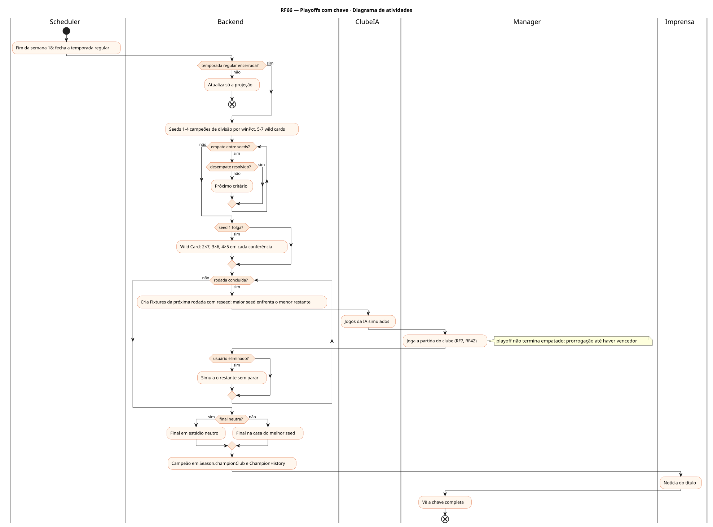
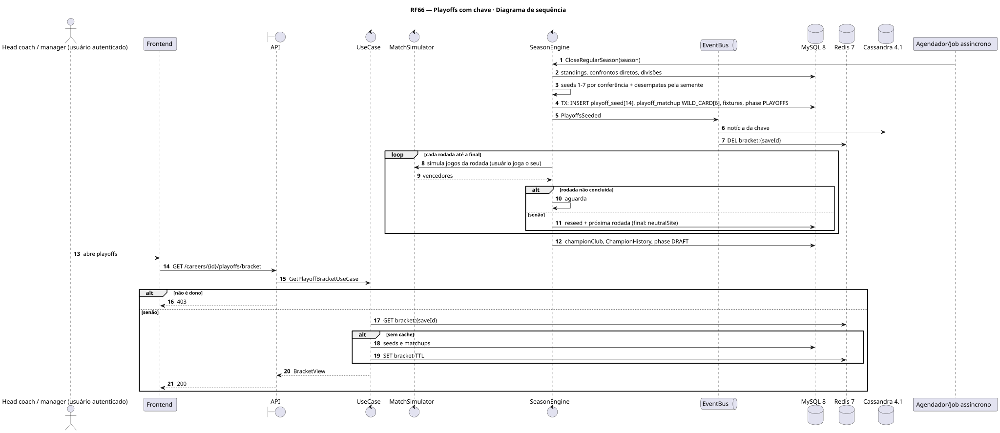
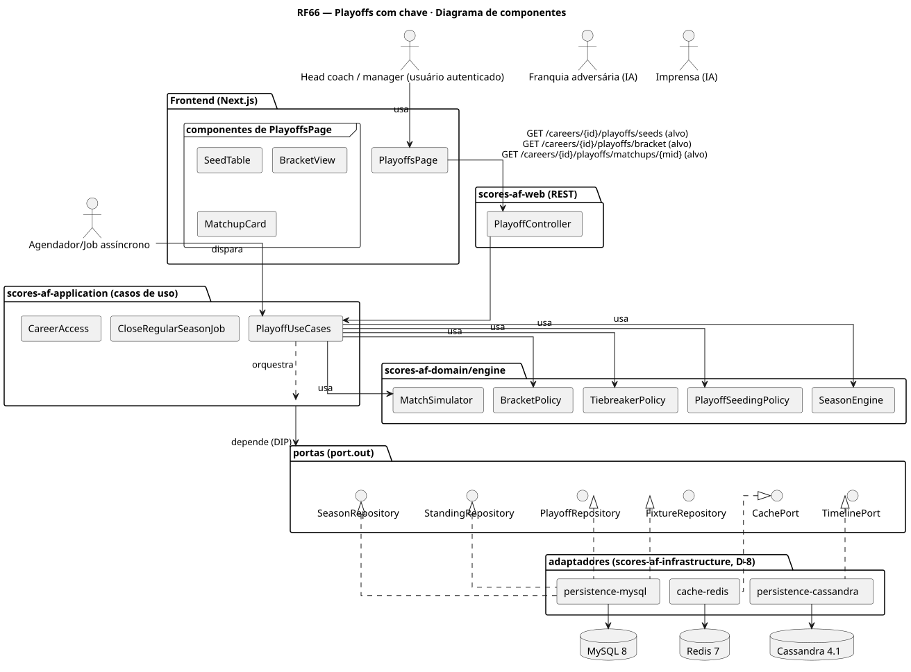
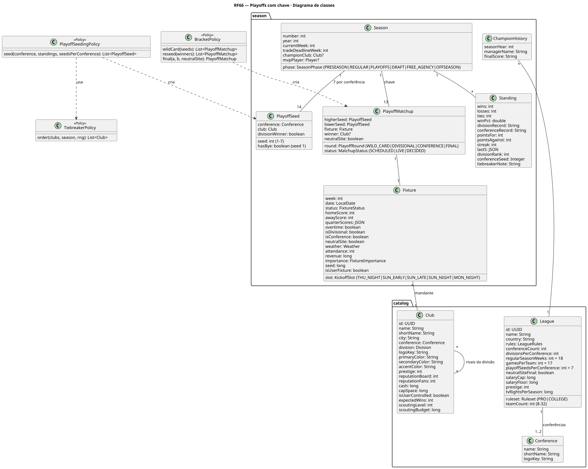
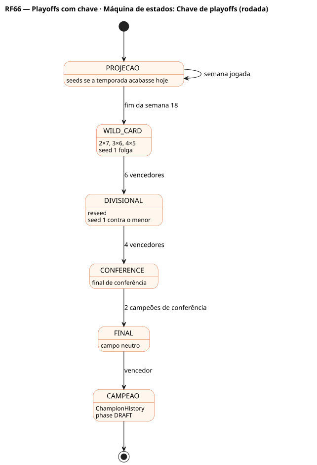
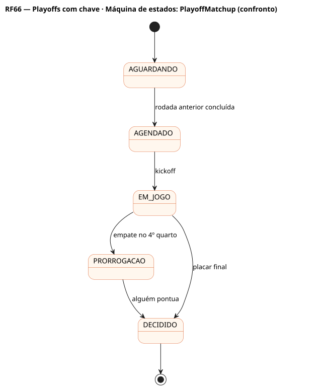

# RF66 — Playoffs com chave

## História de usuário

> HU-RF66 — COMO head coach QUERO ver a chave dos playoffs (7 por conferência, folga do 1º, reseed a cada rodada e final em campo neutro) PARA acompanhar o caminho até o título

Sprint: 6 · Atores: Manager, Scheduler, ClubeIA, Imprensa · Tela: Playoffs (/c/{careerId}/playoffs): seeds projetados · chave · confronto

## Diagramas

### Atividades

Fonte: [`RF66-act.puml`](RF66-act.puml)

### Sequência

Fonte: [`RF66-seq.puml`](RF66-seq.puml)

### Componentes

Fonte: [`RF66-cmp.puml`](RF66-cmp.puml)

### Classes

Fonte: [`RF66-cls.puml`](RF66-cls.puml)

### Máquina de estados: Chave de playoffs (rodada)

Fonte: [`RF66-stm.puml`](RF66-stm.puml)

### Máquina de estados: PlayoffMatchup (confronto)

Fonte: [`RF66-stm-playoffmatchup-confronto.puml`](RF66-stm-playoffmatchup-confronto.puml)

## Endpoints

✅ = existe num controller do `scores-af-web` · ⛔ alvo = previsto no modelo, ainda sem controller (lista em `generator/endpoints_code.json`).

| Estado | Método | Rota | Caso de uso | Autorização | Descrição |
|---|---|---|---|---|---|
| ⛔ alvo | `GET` | `/api/v1/careers/{id}/playoffs/seeds` | `GetPlayoffSeedsUseCase` | JWT · dono do save | Seeds por conferência (projeção na temporada, oficial no fim) |
| ✅ | `GET` | `/api/v1/careers/{id}/playoffs/bracket` | `GetPlayoffBracketUseCase` | JWT · dono do save | Chave por rodada (Wild Card, Divisional, Conferência, Final) |
| ⛔ alvo | `GET` | `/api/v1/careers/{id}/playoffs/matchups/{mid}` | `GetPlayoffMatchupUseCase` | JWT · dono do save | Confronto: seeds, local, placar, vencedor |

## Pontos de decisão

| Gateway | Regra | Se falso |
|---|---|---|
| Dono do save? | save.userId == jwt.sub | 403 |
| Temporada regular encerrada? | todas as Fixtures REGULAR FINISHED | mostra só a projeção |
| Desempate resolvido? | confronto direto, divisão, adversários comuns, conferência, força da tabela, sorteio pela semente | aplica o próximo critério |
| Seed 1 folga? | seed == 1 → hasBye na Wild Card (com 7 por conferência) | joga a Wild Card |
| Rodada concluída? | todos os PlayoffMatchup da rodada com winner | aguarda |
| Final neutra? | League.neutralSiteFinal | mando do melhor seed |
| Usuário eliminado? | clube do save perdeu | segue na chave |

---
Gerado por `../generator/generate.py` a partir de `../generator/model/*.py` e `../generator/common.py`; não edite os .puml à mão.
