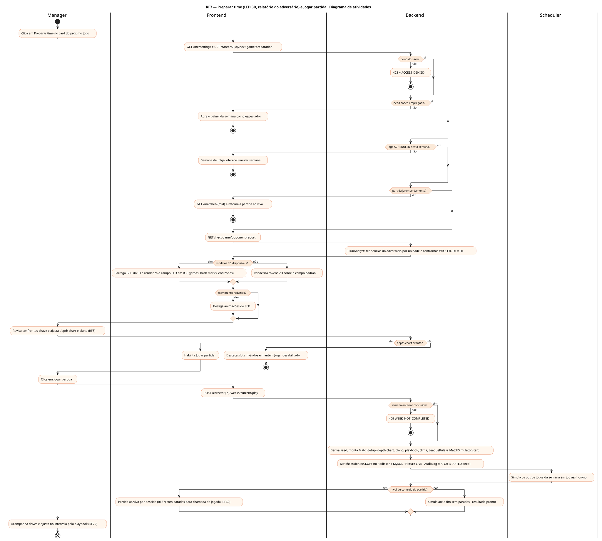
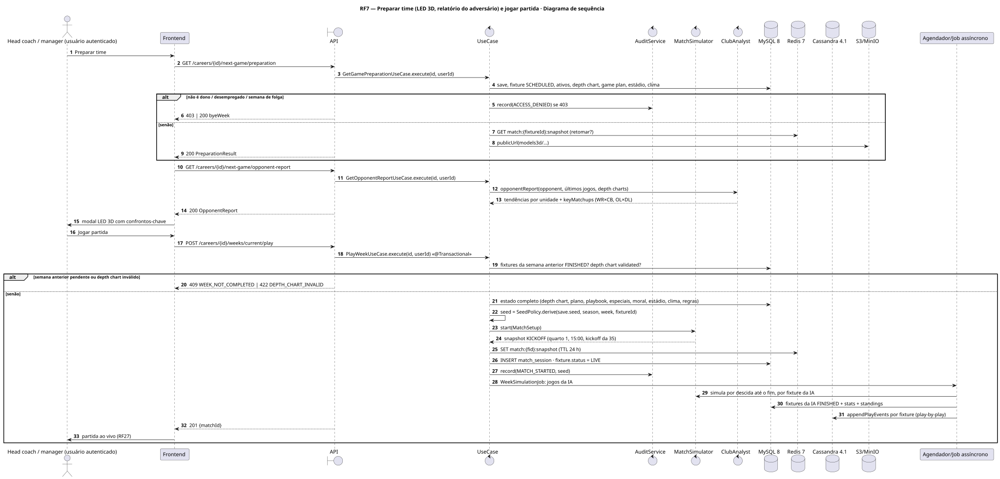
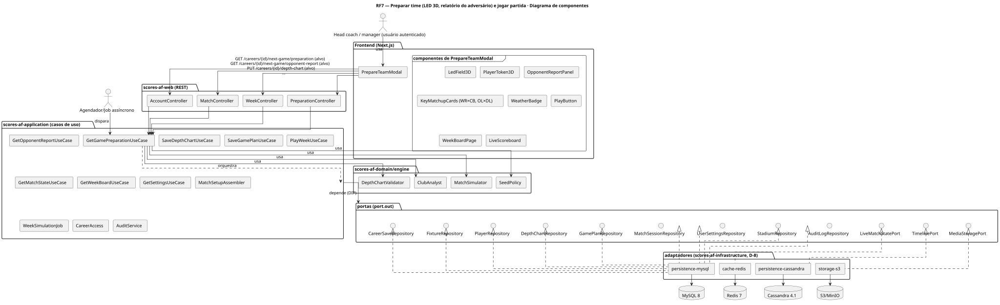
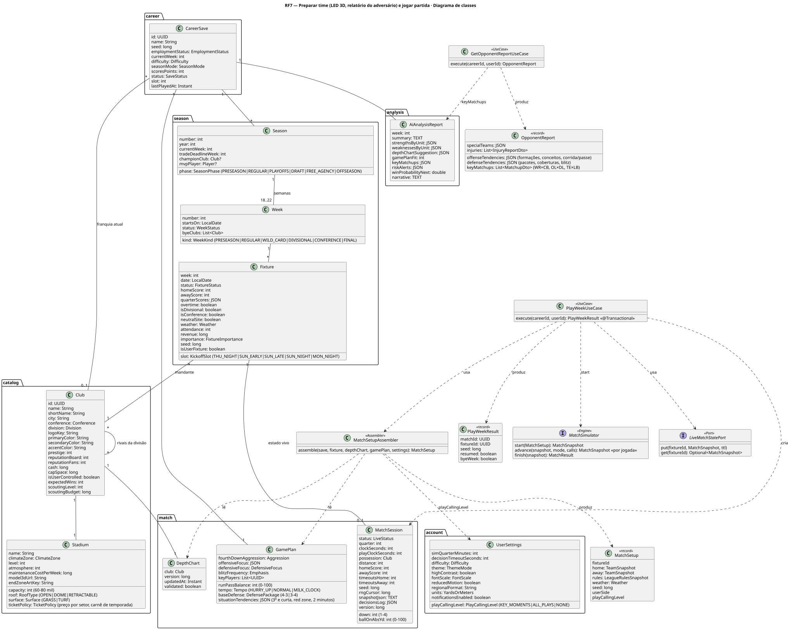
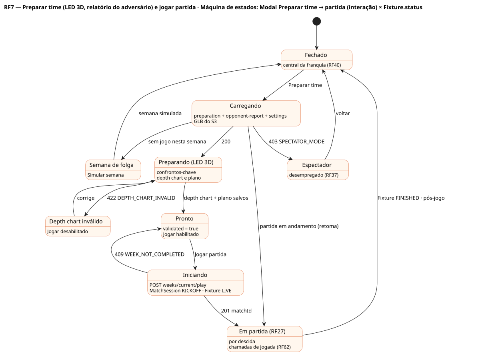

# RF7 — Preparar time (LED 3D, relatório do adversário) e jogar partida

## História de usuário

> HU-RF7 — COMO head coach dentro do painel da franquia POSSO clicar em 'preparar time' no modal do próximo jogo PARA ver o relatório do adversário por unidade e os confrontos-chave (WR × CB, OL × DL) no painel LED 3D, e clicar em 'jogar partida' quando estiver pronto

Sprint: 6 · Atores: Manager, Scheduler · Tela: Central da franquia → modal Preparar time (LED 3D) → Partida ao vivo (/c/{careerId}/game)

## Diagramas

### Atividades

Fonte: [`RF7-act.puml`](RF7-act.puml)

### Sequência

Fonte: [`RF7-seq.puml`](RF7-seq.puml)

### Componentes

Fonte: [`RF7-cmp.puml`](RF7-cmp.puml)

### Classes

Fonte: [`RF7-cls.puml`](RF7-cls.puml)

### Máquina de estados: Modal Preparar time → partida (interação) × Fixture.status

Fonte: [`RF7-stm.puml`](RF7-stm.puml)

## Endpoints

✅ = existe num controller do `scores-af-web` · ⛔ alvo = previsto no modelo, ainda sem controller (lista em `generator/endpoints_code.json`).

| Estado | Método | Rota | Caso de uso | Autorização | Descrição |
|---|---|---|---|---|---|
| ⛔ alvo | `GET` | `/api/v1/careers/{id}/next-game/preparation` | `GetGamePreparationUseCase` | JWT · dono do save | Dados do modal: fixture, adversário, ativos, depth chart, plano, clima e modelos 3D |
| ⛔ alvo | `GET` | `/api/v1/careers/{id}/next-game/opponent-report` | `GetOpponentReportUseCase` | JWT · dono do save | Relatório do adversário por unidade (ataque, defesa, especiais): tendências, formações e coberturas mais usadas, lesões e confrontos-chave WR × CB, OL × DL, TE × LB |
| ⛔ alvo | `PUT` | `/api/v1/careers/{id}/depth-chart` | `SaveDepthChartUseCase` | JWT · dono do save | Salva o depth chart montado no painel LED (RF6) |
| ⛔ alvo | `PUT` | `/api/v1/careers/{id}/game-plan` | `SaveGamePlanUseCase` | JWT · dono do save | Salva o plano de jogo (RF6) |
| ⛔ alvo | `GET` | `/api/v1/me/settings` | `GetSettingsUseCase` | JWT | simQuarterMinutes, playCallingLevel, decisionTimeoutSeconds e reducedMotion aplicados à partida (RF10) |
| ⛔ alvo | `POST` | `/api/v1/careers/{id}/weeks/current/play` | `PlayWeekUseCase` | JWT · dono do save | Jogar partida: cria MatchSession (seed derivada) e dispara a simulação dos outros jogos da semana |
| ⛔ alvo | `GET` | `/api/v1/matches/{mid}` | `GetMatchStateUseCase` | JWT · dono do save | Estado vivo (quarto, relógio, descida e distância, posse, placar) para retomar a partida |
| ⛔ alvo | `GET` | `/api/v1/careers/{id}/weeks/{n}` | `GetWeekBoardUseCase` | JWT · dono do save | Painel da semana com todos os placares (RF16/RF27) |

## Pontos de decisão

| Gateway | Regra | Se falso |
|---|---|---|
| Dono do save? | save.userId == jwt.sub (CareerAccess.requireOwner) | 403 FORBIDDEN + AuditLog ACCESS_DENIED |
| Head coach empregado? | save.employmentStatus == EMPLOYED && save.club != null | 403 SPECTATOR_MODE (só leitura, RF37) |
| Jogo SCHEDULED nesta semana? | fixture do clube na semana atual com status SCHEDULED | semana de folga: Jogar vira Simular semana (só jogos da IA) · fim de temporada: 409 NO_NEXT_GAME |
| Partida já em andamento? | existe MatchSession não FINISHED para a fixture | cria nova sessão |
| Semana anterior concluída? | todas as fixtures da semana anterior FINISHED (job da IA terminou) | 409 WEEK_NOT_COMPLETED · aguarda job |
| Depth chart pronto? | DepthChart.validated == true (RF6), sem titular OUT/IR | 422 DEPTH_CHART_INVALID · Jogar desabilitado |
| Modelos 3D disponíveis? | player.model3dUrl e stadium.model3dUrl resolvem no S3 | fallback: tokens 2D com número e campo padrão |
| Nível de controle da partida? | settings.playCallingLevel: NONE → simula sem paradas · KEY_MOMENTS → para em 4ª descida, 2 minutos e prorrogação (RF62) · ALL_PLAYS → chama toda jogada (Q-2) | padrão KEY_MOMENTS |
| Movimento reduzido? | settings.reducedMotion == true ou prefers-reduced-motion | LED com animações e transições |

---
Gerado por `../generator/generate.py` a partir de `../generator/model/*.py` e `../generator/common.py`; não edite os .puml à mão.
