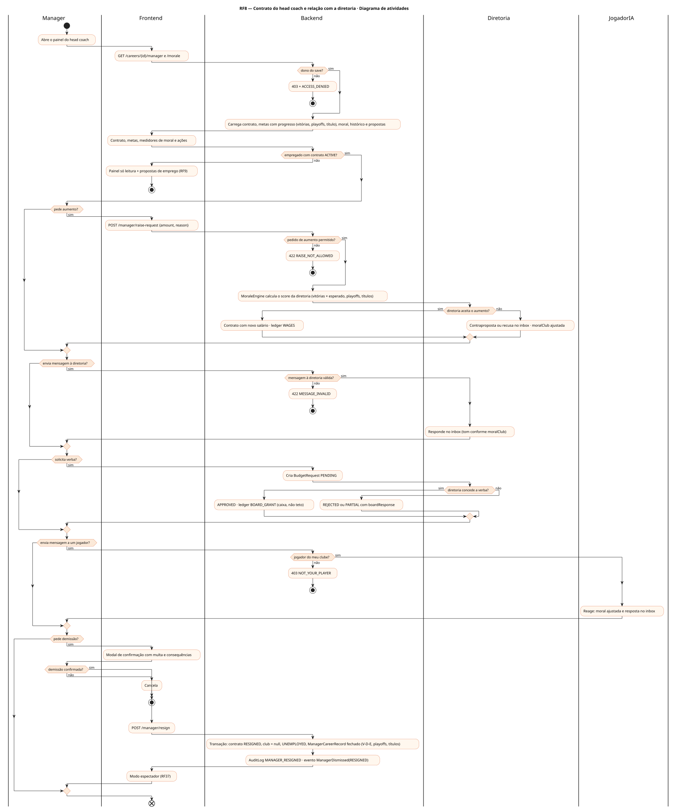
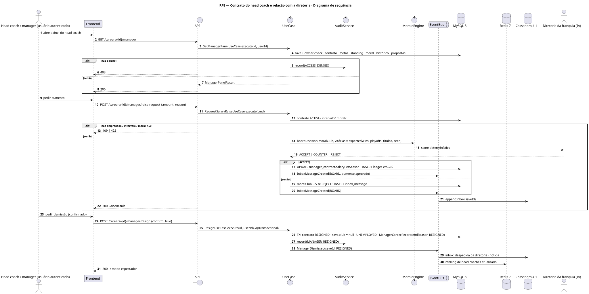
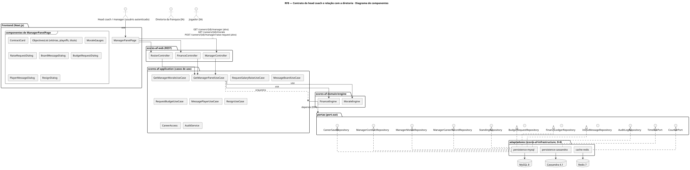
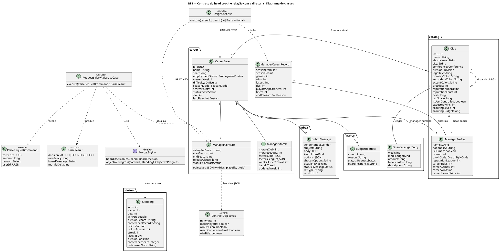
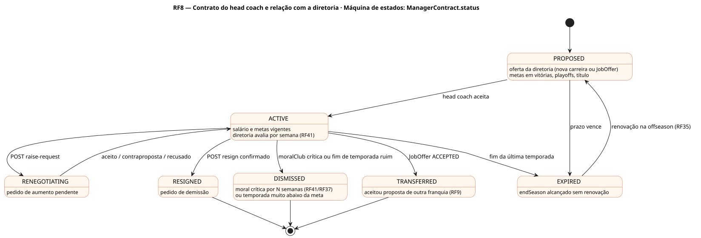

# RF8 — Contrato do head coach e relação com a diretoria

## História de usuário

> HU-RF8 — COMO head coach autenticado POSSO abrir o painel do manager PARA gerenciar meu contrato com a diretoria (metas em vitórias, playoffs e título), propor aumento salarial, enviar mensagem à diretoria ou a um jogador, solicitar verbas e pedir demissão

Sprint: 7 · Atores: Manager, Diretoria, JogadorIA · Tela: Head coach (contrato/diretoria) (/c/{careerId}/manager)

## Diagramas

### Atividades

Fonte: [`RF8-act.puml`](RF8-act.puml)

### Sequência

Fonte: [`RF8-seq.puml`](RF8-seq.puml)

### Componentes

Fonte: [`RF8-cmp.puml`](RF8-cmp.puml)

### Classes

Fonte: [`RF8-cls.puml`](RF8-cls.puml)

### Máquina de estados: ManagerContract.status

Fonte: [`RF8-stm.puml`](RF8-stm.puml)

## Endpoints

✅ = existe num controller do `scores-af-web` · ⛔ alvo = previsto no modelo, ainda sem controller (lista em `generator/endpoints_code.json`).

| Estado | Método | Rota | Caso de uso | Autorização | Descrição |
|---|---|---|---|---|---|
| ⛔ alvo | `GET` | `/api/v1/careers/{id}/manager` | `GetManagerPanelUseCase` | JWT · dono do save | Perfil, contrato ativo, metas (vitórias, vaga nos playoffs, título de divisão/conferência, campeão) e progresso, moral com a franquia e com a liga, histórico, propostas pendentes |
| ✅ | `GET` | `/api/v1/careers/{id}/morale` | `GetManagerMoraleUseCase` | JWT · dono do save | Moral com a franquia e com a liga + fatores |
| ⛔ alvo | `POST` | `/api/v1/careers/{id}/manager/raise-request` | `RequestSalaryRaiseUseCase` | JWT · dono do save | Pede aumento (valor e justificativa) · diretoria decide |
| ⛔ alvo | `POST` | `/api/v1/careers/{id}/manager/message-board` | `MessageBoardUseCase` | JWT · dono do save | Mensagem à diretoria (assunto de lista + texto) · resposta no inbox |
| ⛔ alvo | `POST` | `/api/v1/careers/{id}/finance/budget-request` | `RequestBudgetUseCase` | JWT · dono do save | Solicita verba operacional (estrutura, scouting, staff) · não mexe no teto salarial (RF14/RF49) |
| ⛔ alvo | `POST` | `/api/v1/careers/{id}/players/{pid}/message` | `MessagePlayerUseCase` | JWT · dono do save | Mensagem a um jogador do elenco (elogio, cobrança, promessa de snaps) |
| ⛔ alvo | `POST` | `/api/v1/careers/{id}/manager/resign` | `ResignUseCase` | JWT · dono do save | Pede demissão: contrato RESIGNED, save UNEMPLOYED, registro de carreira fechado |

## Pontos de decisão

| Gateway | Regra | Se falso |
|---|---|---|
| Dono do save? | save.userId == jwt.sub (CareerAccess.requireOwner) | 403 FORBIDDEN + AuditLog ACCESS_DENIED |
| Empregado com contrato ACTIVE? | save.employmentStatus == EMPLOYED && contract.status == ACTIVE | 409 NOT_EMPLOYED (painel só leitura + propostas RF9) |
| Pedido de aumento permitido? | ≥ 4 semanas desde o último pedido, nenhum pendente e moralClub ≥ 50 · fora dos playoffs em andamento | 422 RAISE_NOT_ALLOWED |
| Diretoria aceita o aumento? | score = 0,5·moralClub + 0,3·(vitórias − expectedWins)·10 + 0,2·(playoffs e títulos) ≥ 65 e caixa cabe | score ≥ 50 → contraproposta (metade) · < 50 → recusa e moralClub −5 |
| Mensagem à diretoria válida? | assunto ∈ lista (metas, elenco, teto salarial, estádio, apoio), texto ≤ 500 chars, 1 por semana | 422 MESSAGE_INVALID |
| Diretoria concede a verba? | amount ≤ 20 % do caixa × moralClub/100, metas em dia e sem pedido nas últimas 4 semanas | BudgetRequest REJECTED (ou PARTIAL) com resposta no inbox |
| Jogador do meu clube? | player.clubId == save.clubId (inclui practice squad e IR) | 403 NOT_YOUR_PLAYER |
| Demissão confirmada? | confirm == true e ciente da multa (releaseClause se restam ≥ 2 temporadas) | cancela sem efeito |

---
Gerado por `../generator/generate.py` a partir de `../generator/model/*.py` e `../generator/common.py`; não edite os .puml à mão.
