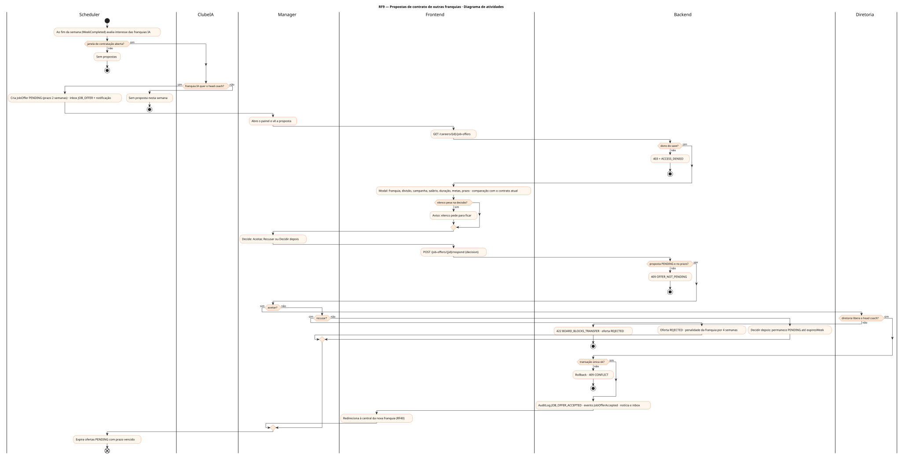
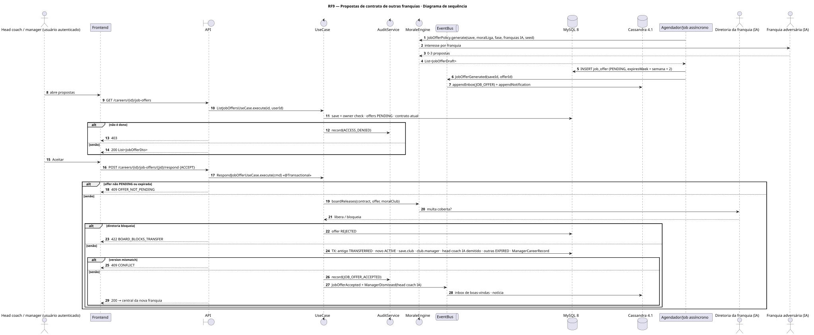
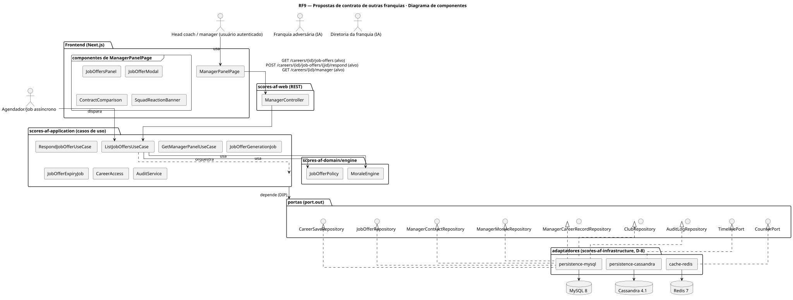
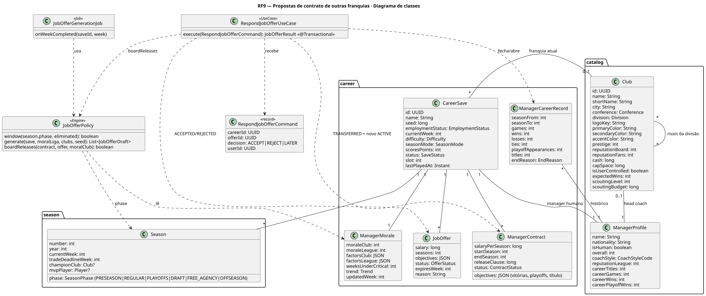
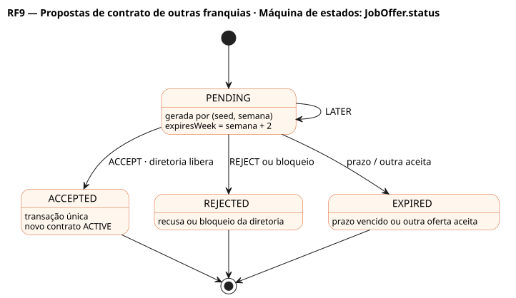

# RF9 — Propostas de contrato de outras franquias

## História de usuário

> HU-RF9 — COMO head coach autenticado POSSO receber propostas de contrato de outras franquias PARA avaliar a proposta e decidir, junto à diretoria e aos jogadores, se aceito a transferência

Sprint: 7 · Atores: Manager, ClubeIA, Diretoria, Scheduler · Tela: Head coach (contrato/diretoria) → Propostas de emprego · modal de proposta (/c/{careerId}/manager)

## Diagramas

### Atividades

Fonte: [`RF9-act.puml`](RF9-act.puml)

### Sequência

Fonte: [`RF9-seq.puml`](RF9-seq.puml)

### Componentes

Fonte: [`RF9-cmp.puml`](RF9-cmp.puml)

### Classes

Fonte: [`RF9-cls.puml`](RF9-cls.puml)

### Máquina de estados: JobOffer.status

Fonte: [`RF9-stm.puml`](RF9-stm.puml)

## Endpoints

✅ = existe num controller do `scores-af-web` · ⛔ alvo = previsto no modelo, ainda sem controller (lista em `generator/endpoints_code.json`).

| Estado | Método | Rota | Caso de uso | Autorização | Descrição |
|---|---|---|---|---|---|
| ⛔ alvo | `GET` | `/api/v1/careers/{id}/job-offers` | `ListJobOffersUseCase` | JWT · dono do save | Propostas PENDING com franquia, conferência e divisão, salário, duração, metas, prazo e motivo |
| ⛔ alvo | `POST` | `/api/v1/careers/{id}/job-offers/{jid}/respond` | `RespondJobOfferUseCase` | JWT · dono do save | ACCEPT | REJECT | LATER · aceitar em transação única |
| ⛔ alvo | `GET` | `/api/v1/careers/{id}/manager` | `GetManagerPanelUseCase` | JWT · dono do save | Contrato atual e multa para comparar |

## Pontos de decisão

| Gateway | Regra | Se falso |
|---|---|---|
| Dono do save? | save.userId == jwt.sub (CareerAccess.requireOwner) | 403 FORBIDDEN + AuditLog ACCESS_DENIED |
| Janela de contratação aberta? | propostas só entre o fim da temporada regular da franquia (eliminada) e o início da FREE_AGENCY, ou após demissão de head coach IA na temporada | sem propostas nesta semana |
| Franquia IA quer o head coach? | franquia sem head coach forte, prestígio ≤ f(moralLiga), sem penalidade de recusa (50 % por 4 semanas), sorteio por seed | nenhuma proposta nesta semana |
| Proposta PENDING e no prazo? | offer.status == PENDING && offer.expiresWeek ≥ save.currentWeek | 409 OFFER_NOT_PENDING |
| Diretoria libera o head coach? | se EMPLOYED: oferta cobre a multa (salary × seasons ≥ releaseClause) ou moralClub < 40 | 422 BOARD_BLOCKS_TRANSFER · proposta REJECTED |
| Elenco pesa na decisão? | moral média do elenco ≥ 70 → aviso: jogadores pedem para ficar | sem alerta |
| Transação única ok? | novo contrato ACTIVE, antigo TRANSFERRED, save.club, club.manager, head coach IA demitido, demais ofertas EXPIRED · versões conferem | rollback · 409 CONFLICT |

---
Gerado por `../generator/generate.py` a partir de `../generator/model/*.py` e `../generator/common.py`; não edite os .puml à mão.
