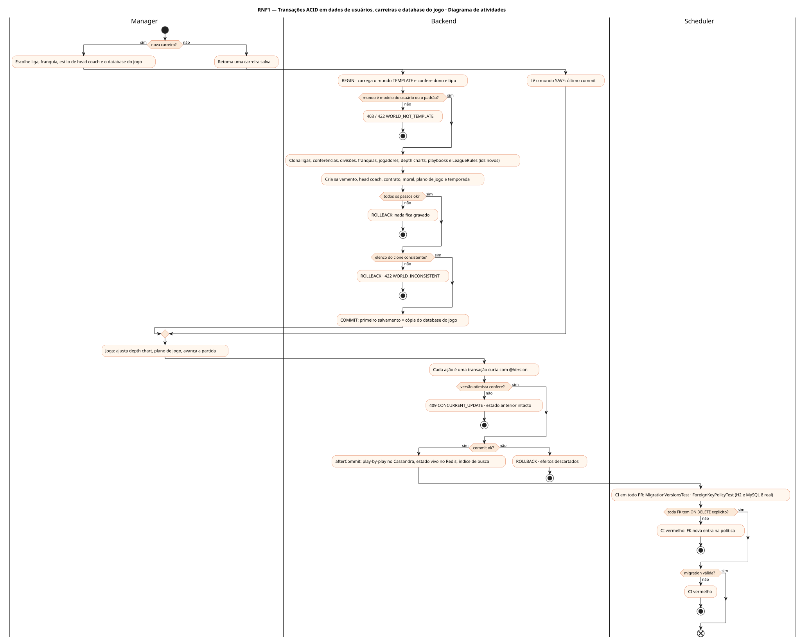
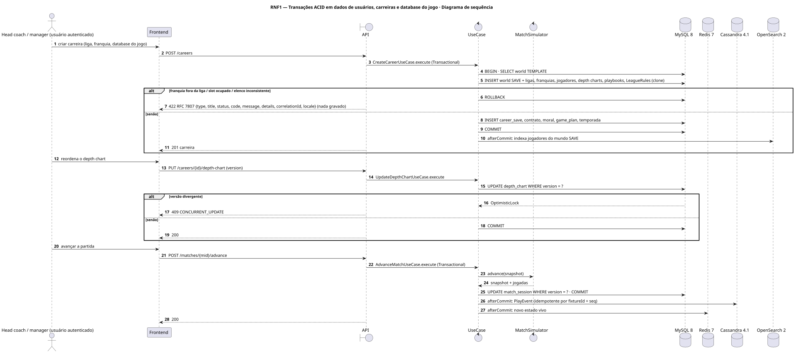
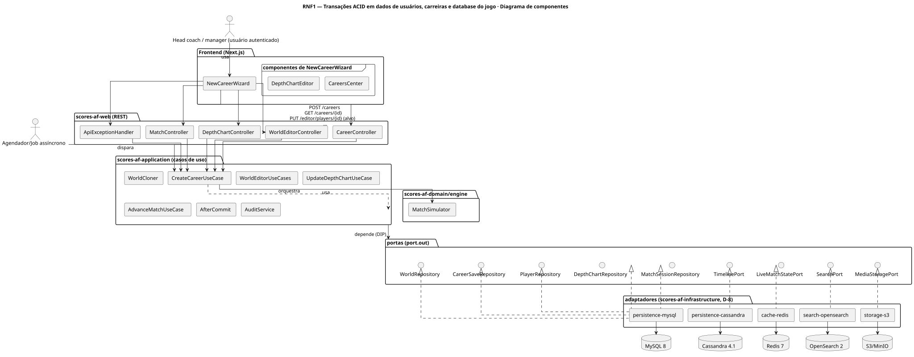
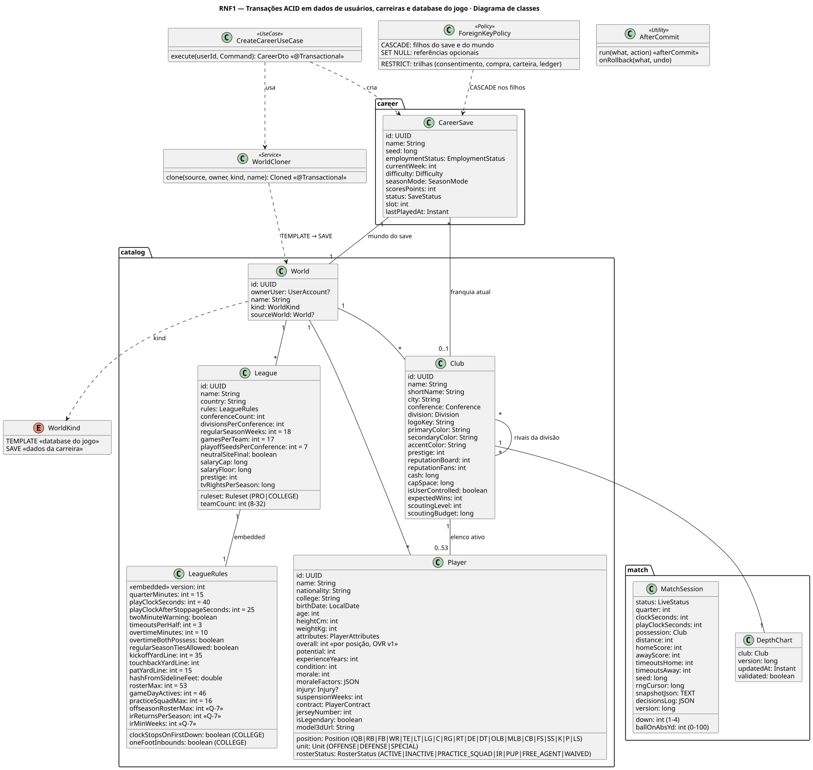
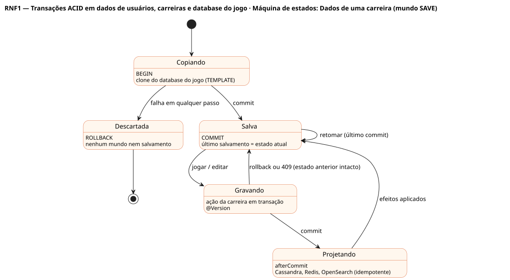

# RNF1 — Transações ACID em dados de usuários, carreiras e database do jogo

## História de usuário

> RNF1 — O sistema deve garantir transações ACID em dados de usuários, carreiras e database do jogo completo. Carreira nova = cópia do database do jogo vigente (padrão ou editado no menu inicial: ligas, conferências, divisões, 32 franquias, elencos de 53 + practice squad, depth charts, playbooks e LeagueRules). Retomar = último salvamento.

Sprint: 4 · Atores: Manager, Scheduler · Tela: Transversal: nova carreira (RF34), editor do menu inicial (RF5), carreiras salvas (RF11) e toda escrita de save

## Diagramas

### Atividades

Fonte: [`RNF1-act.puml`](RNF1-act.puml)

### Sequência

Fonte: [`RNF1-seq.puml`](RNF1-seq.puml)

### Componentes

Fonte: [`RNF1-cmp.puml`](RNF1-cmp.puml)

### Classes

Fonte: [`RNF1-cls.puml`](RNF1-cls.puml)

### Máquina de estados: Dados de uma carreira (mundo SAVE)

Fonte: [`RNF1-stm.puml`](RNF1-stm.puml)

## Endpoints

✅ = existe num controller do `scores-af-web` · ⛔ alvo = previsto no modelo, ainda sem controller (lista em `generator/endpoints_code.json`).

| Estado | Método | Rota | Caso de uso | Autorização | Descrição |
|---|---|---|---|---|---|
| ✅ | `POST` | `/api/v1/careers` | `CreateCareerUseCase` | JWT | Clona o mundo TEMPLATE para um mundo SAVE e cria o salvamento numa só transação |
| ✅ | `GET` | `/api/v1/careers/{id}` | `CareerQueries` | JWT · dono do save | Retomar: lê o último commit do mundo SAVE |
| ⛔ alvo | `PUT` | `/api/v1/editor/players/{id}` | `WorldEditorUseCases` | JWT | Edita o database do jogo do usuário (TEMPLATE); carreiras existentes não mudam |
| ✅ | `PUT` | `/api/v1/careers/{id}/depth-chart` | `UpdateDepthChartUseCase` | JWT · dono do save | Escrita típica de carreira: DepthChart com @Version (409 em conflito) |
| ✅ | `POST` | `/api/v1/matches/{mid}/advance` | `AdvanceMatchUseCase` | JWT · dono do save | MatchSession com @Version · play-by-play no Cassandra e estado no Redis só depois do commit |

## Pontos de decisão

| Gateway | Regra | Se falso |
|---|---|---|
| Mundo é modelo do usuário ou o padrão? | World.kind = TEMPLATE e (padrão ou ownerUser = jwt.sub) | 403 FORBIDDEN / 422 WORLD_NOT_TEMPLATE |
| Todos os passos ok? | clone completo + franquia na liga + slot livre + contrato + moral + plano de jogo + temporada | ROLLBACK total: nenhum mundo SAVE nem salvamento |
| Elenco do clone consistente? | cada franquia com ≤ 53 ativos, ≤ 16 no practice squad e depth chart válido para as posições | ROLLBACK · 422 WORLD_INCONSISTENT |
| Versão otimista confere? | @Version lida == versão gravada (DepthChart, MatchSession, CareerSave) | 409 CONCURRENT_UPDATE · cliente relê |
| Commit ok? | COMMIT no MySQL sem erro | efeitos pós-commit descartados: nada em Cassandra, Redis, OpenSearch ou S3 |
| Toda FK tem ON DELETE explícito? | política gerada (CASCADE nos filhos do save e do mundo, RESTRICT nas trilhas, SET NULL nas opcionais) e testada em H2 e MySQL 8 real | ForeignKeyPolicyTest vermelho no CI |
| Migration válida? | versões únicas · migration aplicada nunca é editada · FOREIGN_KEY_CHECKS nunca desligado | CI vermelho |

---
Gerado por `../generator/generate.py` a partir de `../generator/model/*.py` e `../generator/common.py`; não edite os .puml à mão.
