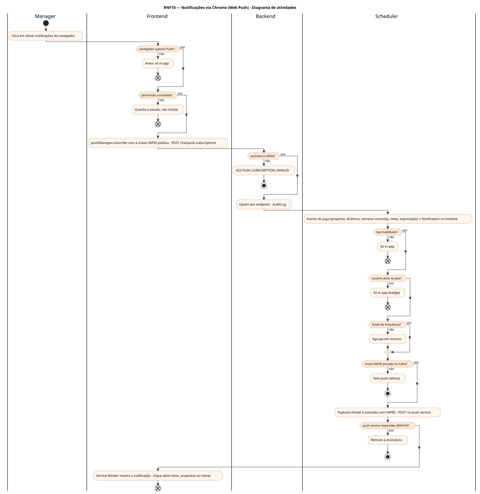
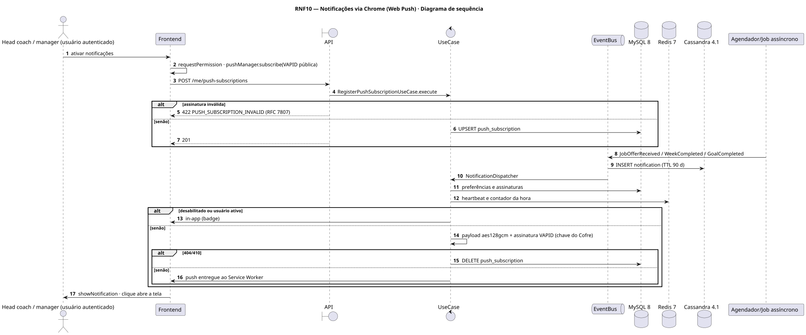
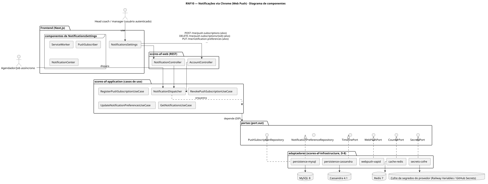
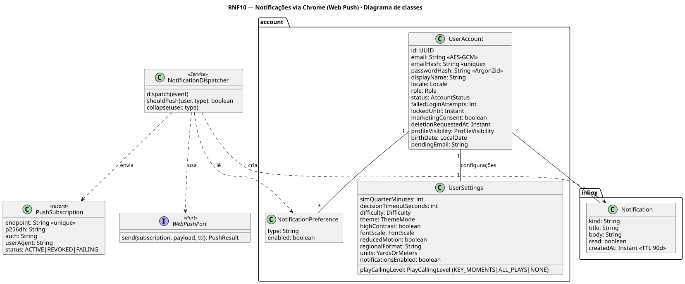
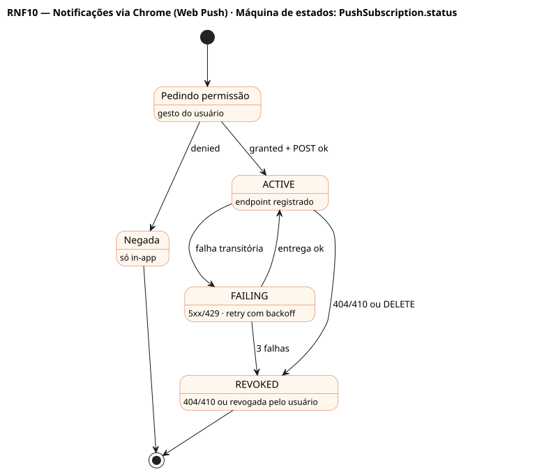

# RNF10 — Notificações via Chrome (Web Push)

## História de usuário

> RNF10 — O sistema deve enviar notificações pelo navegador (Web Push API + Service Worker, VAPID) para eventos do jogo (proposta recebida, diretoria quer falar, semana da IA concluída, meta concluída, exportação pronta), respeitando a permissão do navegador, as preferências por tipo e limites de frequência.

Sprint: 11 · Atores: Manager, Scheduler · Tela: Configurações → Notificações · Service Worker

## Diagramas

### Atividades

Fonte: [`RNF10-act.puml`](RNF10-act.puml)

### Sequência

Fonte: [`RNF10-seq.puml`](RNF10-seq.puml)

### Componentes

Fonte: [`RNF10-cmp.puml`](RNF10-cmp.puml)

### Classes

Fonte: [`RNF10-cls.puml`](RNF10-cls.puml)

### Máquina de estados: PushSubscription.status

Fonte: [`RNF10-stm.puml`](RNF10-stm.puml)

## Endpoints

✅ = existe num controller do `scores-af-web` · ⛔ alvo = previsto no modelo, ainda sem controller (lista em `generator/endpoints_code.json`).

| Estado | Método | Rota | Caso de uso | Autorização | Descrição |
|---|---|---|---|---|---|
| ⛔ alvo | `POST` | `/api/v1/me/push-subscriptions` | `RegisterPushSubscriptionUseCase` | JWT | Registra {endpoint, keys.p256dh, keys.auth, userAgent} · idempotente por endpoint |
| ⛔ alvo | `DELETE` | `/api/v1/me/push-subscriptions/{sid}` | `RevokePushSubscriptionUseCase` | JWT | Revoga a assinatura |
| ⛔ alvo | `PUT` | `/api/v1/me/notification-preferences` | `UpdateNotificationPreferencesUseCase` | JWT | Liga ou desliga por tipo |
| ⛔ alvo | `GET` | `/api/v1/me/notifications` | `GetNotificationsUseCase` | JWT | Central in-app (Cassandra, TTL 90 d) |

## Pontos de decisão

| Gateway | Regra | Se falso |
|---|---|---|
| Navegador suporta Push? | serviceWorker e PushManager disponíveis | só notificações in-app |
| Permissão concedida? | Notification.permission granted após gesto do usuário | não insiste · guarda o estado |
| Assinatura válida? | endpoint https do push service · p256dh e auth em base64url | 422 PUSH_SUBSCRIPTION_INVALID |
| Tipo habilitado? | notificationsEnabled e NotificationPreference(tipo).enabled · MARKETING exige consentimento (RNF8) | só in-app |
| Usuário ativo na aba? | heartbeat < 60 s no Redis | envia push · se ativo: só in-app |
| Limite de frequência? | ≤ 10 push por hora por usuário · collapse key por evento | agrupa em resumo |
| Push service respondeu 404/410? | assinatura expirada ou revogada | entregue · se 404/410: remove a assinatura |
| Chave VAPID privada no Cofre? | VAPID_PRIVATE_KEY só no Cofre · pública exposta ao front | produção recusa subir |

---
Gerado por `../generator/generate.py` a partir de `../generator/model/*.py` e `../generator/common.py`; não edite os .puml à mão.
