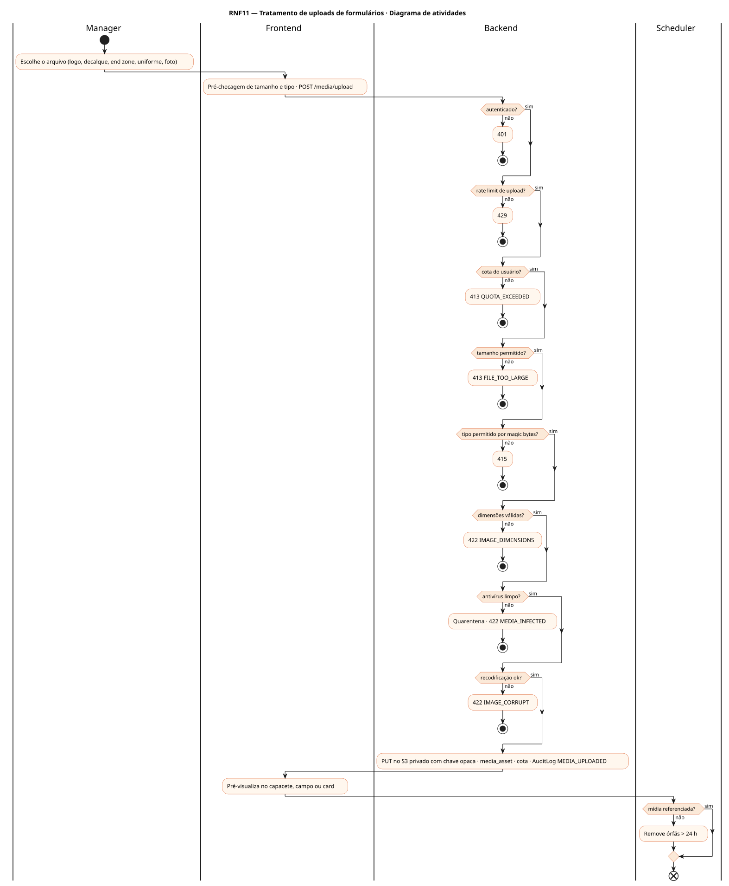
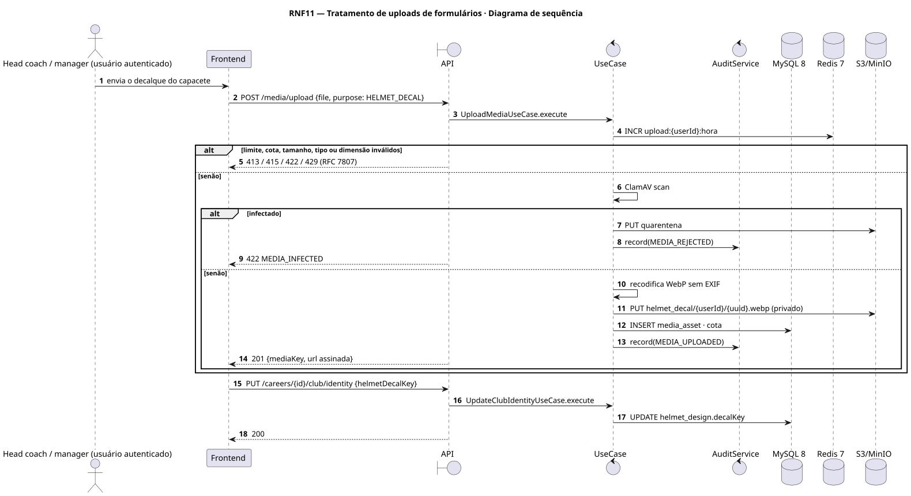
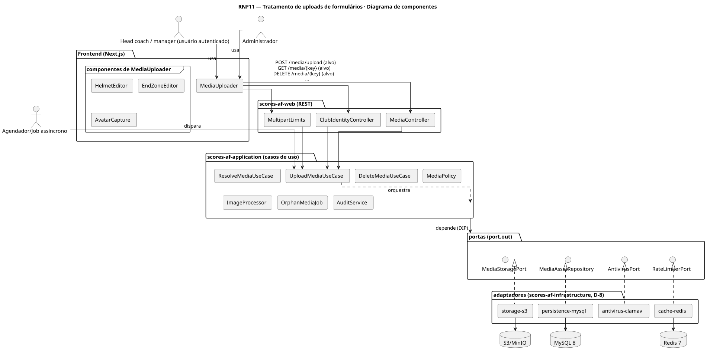
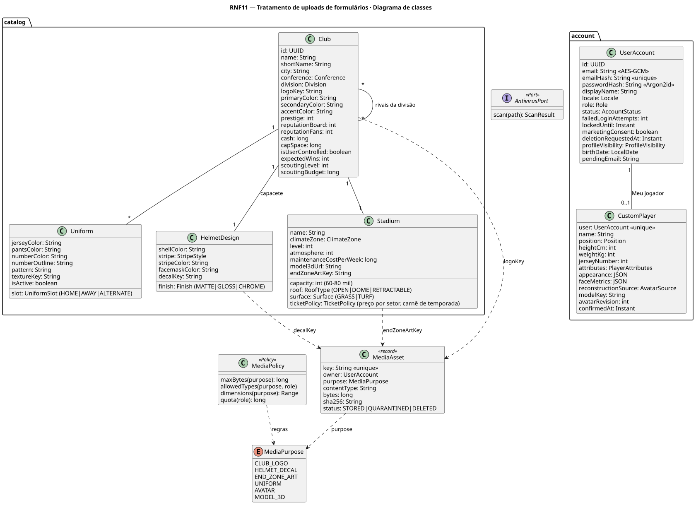
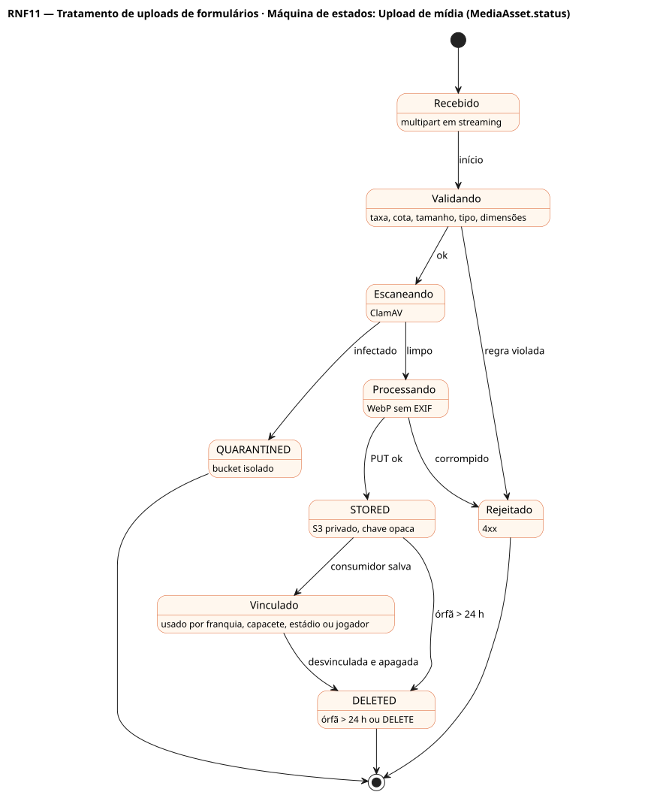

# RNF11 — Tratamento de uploads de formulários

## História de usuário

> RNF11 — Todo arquivo enviado por formulário (logo da franquia, decalque do capacete, arte da end zone, uniforme, foto do Meu jogador, GLB no editor) deve ser validado (magic bytes, tamanho, dimensões), verificado por antivírus, recodificado sem metadados, guardado em bucket privado com chave opaca e servido por URL assinada, com limite de taxa, cota por usuário e auditoria.

Sprint: 11 · Atores: Manager, Admin, Scheduler · Tela: Editor de identidade (RF28) · Meu jogador (RF44) · Editor do menu inicial (RF5) · Admin → Animações

## Diagramas

### Atividades

Fonte: [`RNF11-act.puml`](RNF11-act.puml)

### Sequência

Fonte: [`RNF11-seq.puml`](RNF11-seq.puml)

### Componentes

Fonte: [`RNF11-cmp.puml`](RNF11-cmp.puml)

### Classes

Fonte: [`RNF11-cls.puml`](RNF11-cls.puml)

### Máquina de estados: Upload de mídia (MediaAsset.status)

Fonte: [`RNF11-stm.puml`](RNF11-stm.puml)

## Endpoints

✅ = existe num controller do `scores-af-web` · ⛔ alvo = previsto no modelo, ainda sem controller (lista em `generator/endpoints_code.json`).

| Estado | Método | Rota | Caso de uso | Autorização | Descrição |
|---|---|---|---|---|---|
| ⛔ alvo | `POST` | `/api/v1/media/upload` | `UploadMediaUseCase` | JWT | multipart {file, purpose: CLUB_LOGO\|HELMET_DECAL\|END_ZONE_ART\|UNIFORM\|AVATAR\|MODEL_3D} → {mediaKey, url, width, height} |
| ⛔ alvo | `GET` | `/api/v1/media/{key}` | `ResolveMediaUseCase` | JWT | 302 para URL assinada (15 min) após conferir posse ou visibilidade |
| ⛔ alvo | `DELETE` | `/api/v1/media/{key}` | `DeleteMediaUseCase` | JWT | Remove mídia não referenciada (dono ou ADMIN) |
| ⛔ alvo | `PUT` | `/api/v1/careers/{id}/club/identity` | `UpdateClubIdentityUseCase` | JWT · dono do save | Consumidor: vincula mediaKey ao logo, decalque e end zone |

## Pontos de decisão

| Gateway | Regra | Se falso |
|---|---|---|
| Autenticado? | JWT válido | 401 |
| Rate limit de upload? | ≤ 10 uploads por hora por usuário | 429 UPLOAD_RATE_LIMITED |
| Cota do usuário? | bytes guardados + arquivo ≤ 50 MB (PLAYER) / 500 MB (ADMIN) | 413 QUOTA_EXCEEDED |
| Tamanho permitido? | logo, decalque e avatar ≤ 2 MB · uniforme e end zone ≤ 5 MB · GLB ≤ 15 MB | 413 FILE_TOO_LARGE |
| Tipo permitido por magic bytes? | PNG, JPEG, WebP (SVG proibido) · model/gltf-binary só ADMIN · extensão confere com o conteúdo | 415 UNSUPPORTED_MEDIA_TYPE |
| Dimensões válidas? | 64 a 2048 px · 1:1 para logo, decalque e avatar · end zone 4:1 | 422 IMAGE_DIMENSIONS |
| Antivírus limpo? | ClamAV retorna OK | 422 MEDIA_INFECTED + quarentena + AuditLog MEDIA_REJECTED |
| Recodificação ok? | decodifica e recodifica em WebP, remove EXIF e ICC | 422 IMAGE_CORRUPT |
| Mídia referenciada? | mediaKey usado por Club, Uniform, HelmetDesign, Stadium ou CustomPlayer | job diário remove órfãs > 24 h · se referenciada: DELETE 409 MEDIA_IN_USE |

---
Gerado por `../generator/generate.py` a partir de `../generator/model/*.py` e `../generator/common.py`; não edite os .puml à mão.
