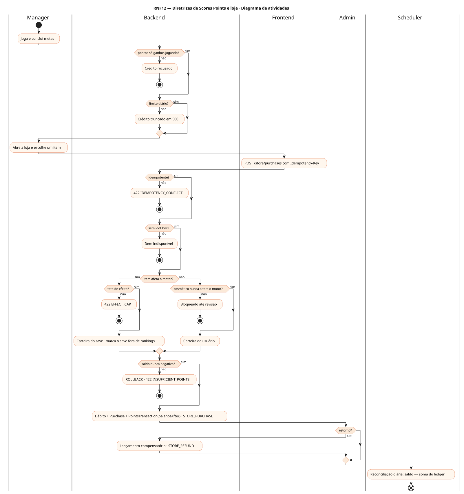
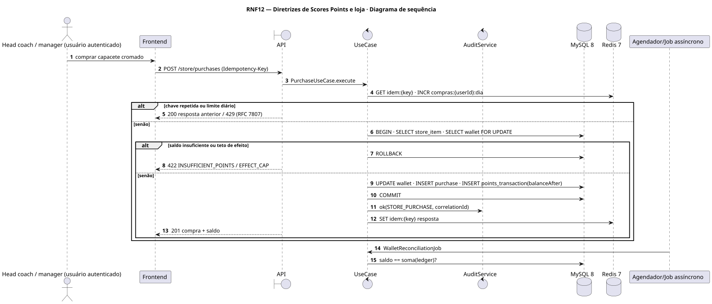
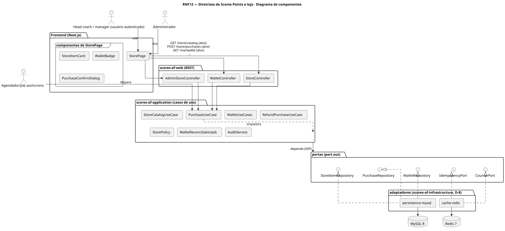
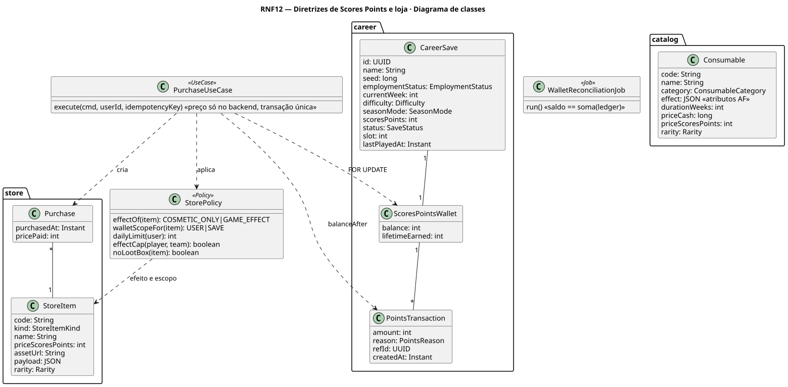
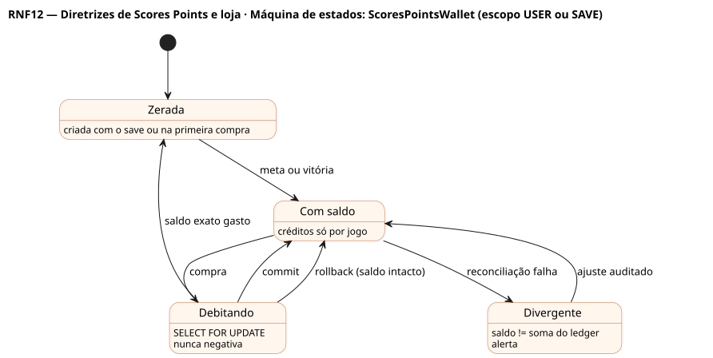

# RNF12 — Diretrizes de Scores Points e loja

## História de usuário

> RNF12 — Diretrizes para ganhar Scores Points e comprar itens: pontos só se ganham jogando (sem venda por dinheiro real); cosméticos (capacete, uniforme, end zone) nunca alteram o motor; itens com efeito no jogo usam a carteira do save, tiram o save dos rankings e aparecem no relatório do adversário; teto de efeito; saldo nunca negativo (transação única com SELECT FOR UPDATE); limites diários; idempotência; sem loot box; auditoria de compra e estorno.

Sprint: 10 · Atores: Manager, Admin, Scheduler · Tela: Loja (/store, RF32) · Metas (RF33) · Admin → Loja

## Diagramas

### Atividades

Fonte: [`RNF12-act.puml`](RNF12-act.puml)

### Sequência

Fonte: [`RNF12-seq.puml`](RNF12-seq.puml)

### Componentes

Fonte: [`RNF12-cmp.puml`](RNF12-cmp.puml)

### Classes

Fonte: [`RNF12-cls.puml`](RNF12-cls.puml)

### Máquina de estados: ScoresPointsWallet (escopo USER ou SAVE)

Fonte: [`RNF12-stm.puml`](RNF12-stm.puml)

## Endpoints

✅ = existe num controller do `scores-af-web` · ⛔ alvo = previsto no modelo, ainda sem controller (lista em `generator/endpoints_code.json`).

| Estado | Método | Rota | Caso de uso | Autorização | Descrição |
|---|---|---|---|---|---|
| ⛔ alvo | `GET` | `/api/v1/store/catalog` | `StoreCatalogUseCase` | JWT | Cada item expõe efeito (COSMETIC_ONLY ou GAME_EFFECT), preço e escopo da carteira |
| ⛔ alvo | `POST` | `/api/v1/store/purchases` | `PurchaseUseCase` | JWT · Idempotency-Key | Compra sob StorePolicy (escopo, limites, teto de efeito, idempotência, auditoria) |
| ⛔ alvo | `GET` | `/api/v1/me/wallet` | `WalletUseCases` | JWT | Saldo e ledger com balanceAfter |
| ⛔ alvo | `POST` | `/api/v1/admin/store/purchases/{id}/refund` | `RefundPurchaseUseCase` | JWT · ADMIN | Lançamento compensatório · nunca edita o ledger |

## Pontos de decisão

| Gateway | Regra | Se falso |
|---|---|---|
| Pontos só ganhos jogando? | crédito só por meta, vitória, título, prêmio, temporada concluída ou online · ADMIN_ADJUST auditado | nenhuma rota vende pontos |
| Cosmético nunca altera o motor? | COSMETIC_ONLY (capacete, uniforme, end zone, comemoração) sem efeito em atributos · raridade só visual | revisão de game design antes de publicar |
| Item afeta o motor? | GAME_EFFECT (consumível, estilo de jogo, estilo de head coach): carteira do save · save fora de rankings · relatório do adversário mostra | carteira do usuário |
| Teto de efeito? | ≤ 1 consumível por categoria por jogador · ≤ 3 estilos por jogador · teto por time | 409 / 422 EFFECT_CAP |
| Saldo nunca negativo? | transação única com SELECT FOR UPDATE + @Version · CHECK balance ≥ 0 · 50 compras paralelas com saldo para 1 → 1 sucesso, 49 INSUFFICIENT_POINTS, nenhum 500 | ROLLBACK · 422 INSUFFICIENT_POINTS |
| Limite diário? | ≤ 10 compras por dia · ≤ 500 pontos ganhos por dia | 429 DAILY_PURCHASE_LIMIT |
| Idempotente? | Idempotency-Key única · mesma chave → mesma resposta | 422 IDEMPOTENCY_CONFLICT |
| Sem loot box? | item e preço conhecidos antes da compra · sem sorteio pago | item não é publicado |

---
Gerado por `../generator/generate.py` a partir de `../generator/model/*.py` e `../generator/common.py`; não edite os .puml à mão.
