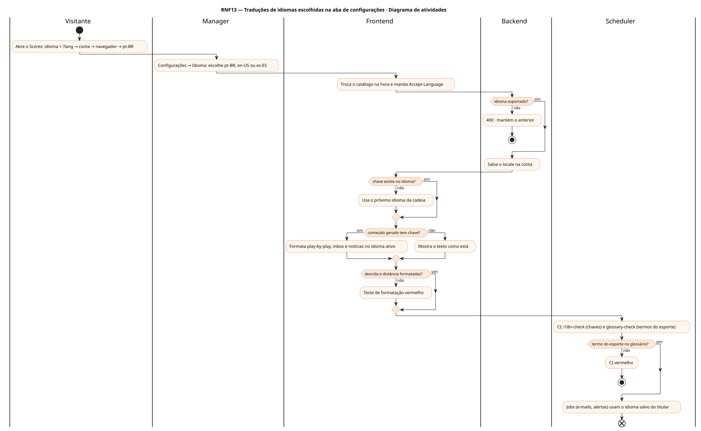
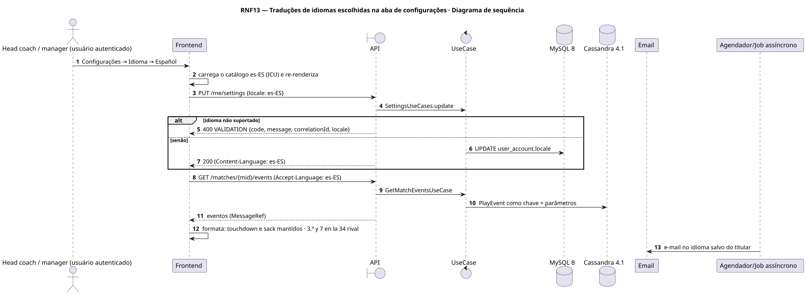
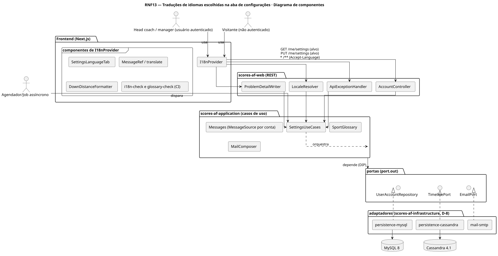
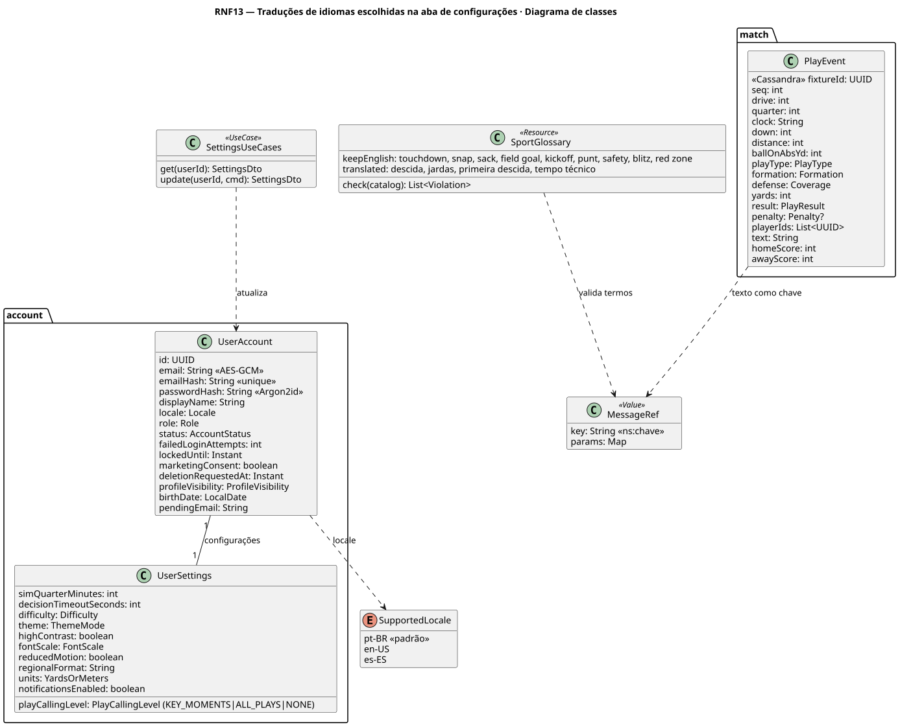
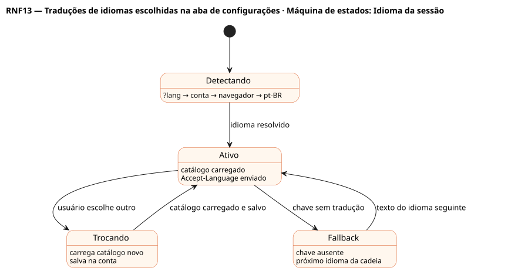

# RNF13 — Traduções de idiomas escolhidas na aba de configurações

## História de usuário

> RNF13 — Traduções pt-BR, en-US e es-ES em 100 % da interface, das mensagens do servidor (erros RFC 7807 com locale, e-mails) e do conteúdo gerado (play-by-play, inbox, notícias), com o idioma salvo na conta. Termos do esporte usados em inglês no Brasil ficam em inglês no pt-BR (touchdown, snap, sack, field goal, kickoff, punt, blitz, red zone), por um glossário único testado.

Sprint: 3 · Atores: Manager, Visitante, Scheduler · Tela: Configurações → Idioma (/settings, RF46) · seletor no login e cadastro · todo o app

## Diagramas

### Atividades

Fonte: [`RNF13-act.puml`](RNF13-act.puml)

### Sequência

Fonte: [`RNF13-seq.puml`](RNF13-seq.puml)

### Componentes

Fonte: [`RNF13-cmp.puml`](RNF13-cmp.puml)

### Classes

Fonte: [`RNF13-cls.puml`](RNF13-cls.puml)

### Máquina de estados: Idioma da sessão

Fonte: [`RNF13-stm.puml`](RNF13-stm.puml)

## Endpoints

✅ = existe num controller do `scores-af-web` · ⛔ alvo = previsto no modelo, ainda sem controller (lista em `generator/endpoints_code.json`).

| Estado | Método | Rota | Caso de uso | Autorização | Descrição |
|---|---|---|---|---|---|
| ✅ | `GET` | `/api/v1/me/settings` | `SettingsUseCases.get` | JWT | Lê locale da conta, regionalFormat e units |
| ✅ | `PUT` | `/api/v1/me/settings` | `SettingsUseCases.update` | JWT | Salva locale (pt-BR \| en-US \| es-ES) · vale para e-mails e conteúdo gerado |
| — | `*` | `/api/v1/** (Accept-Language)` | `LocaleResolver + MessageSource` | — | Erro RFC 7807 e e-mail no idioma da conta ou do cabeçalho, com fallback pt-BR · campo locale no corpo |

## Pontos de decisão

| Gateway | Regra | Se falso |
|---|---|---|
| Idioma suportado? | locale ∈ {pt-BR, en-US, es-ES} | 400 VALIDATION · mantém o idioma atual |
| Chave existe no idioma? | catálogo do idioma tem a chave | fallback es-ES → en-US → pt-BR · no CI a falta de chave reprova o build |
| Termo do esporte no glossário? | SportGlossary: keepEnglish em pt-BR (touchdown, snap, sack, field goal, kickoff, punt, safety, blitz, red zone) · teste compara o catálogo com o glossário | glossary-check vermelho no CI |
| Conteúdo gerado tem chave? | PlayEvent, inbox e notícia gravados como chave + parâmetros (MessageRef) | texto exibido como está |
| Descida e distância formatadas? | pt-BR 3ª e 7 na 34 do adversário · en-US 3rd & 7 at OPP 34 · es-ES 3.ª y 7 en la 34 rival | teste de formatação vermelho |

---
Gerado por `../generator/generate.py` a partir de `../generator/model/*.py` e `../generator/common.py`; não edite os .puml à mão.
