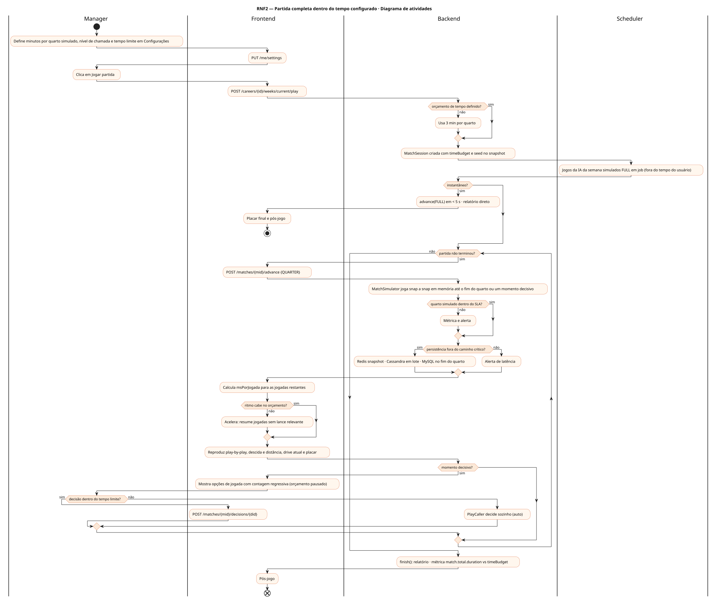
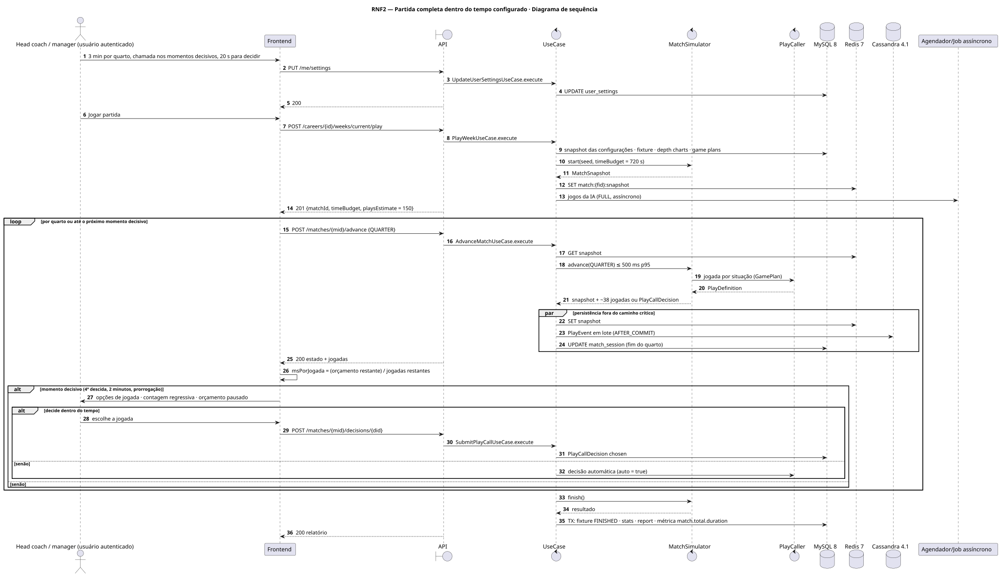
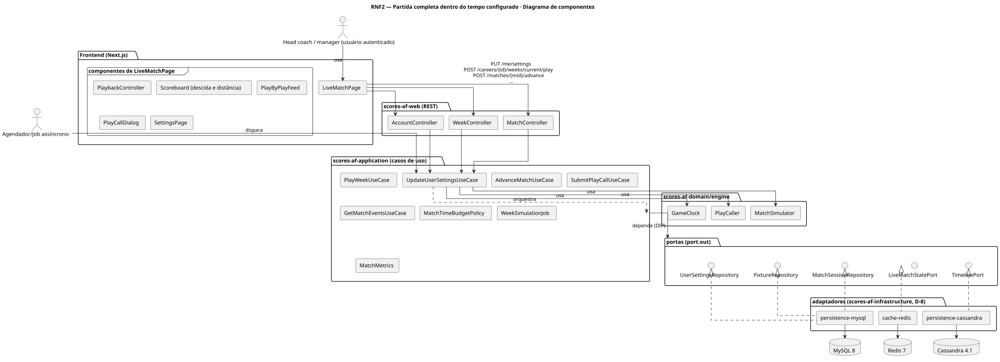
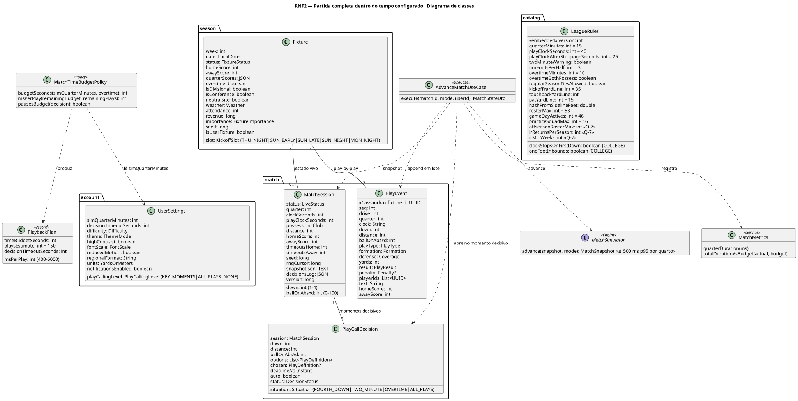
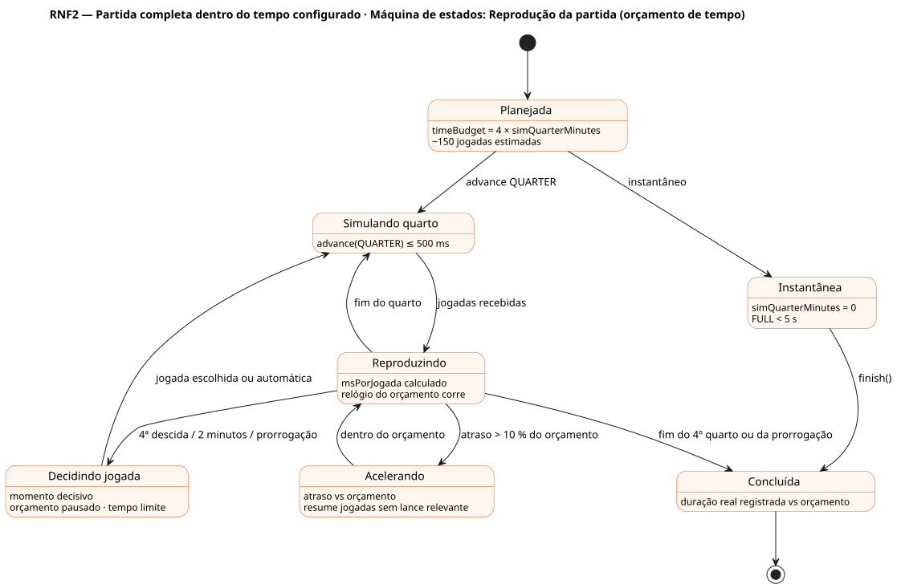

# RNF2 — Partida completa dentro do tempo configurado

## História de usuário

> RNF2 — O sistema deve executar uma partida de futebol americano completa (~150 jogadas: snaps de ataque, chutes e retornos) dentro do tempo definido em configurações (simQuarterMinutes por quarto simulado, nível de chamada de jogada e tempo limite de decisão), com o motor calculando por jogada e o cliente controlando o ritmo de exibição.

Sprint: 5 · Atores: Manager, Scheduler · Tela: Configurações (/settings → partida) · Partida ao vivo (/c/{careerId}/match)

## Diagramas

### Atividades

Fonte: [`RNF2-act.puml`](RNF2-act.puml)

### Sequência

Fonte: [`RNF2-seq.puml`](RNF2-seq.puml)

### Componentes

Fonte: [`RNF2-cmp.puml`](RNF2-cmp.puml)

### Classes

Fonte: [`RNF2-cls.puml`](RNF2-cls.puml)

### Máquina de estados: Reprodução da partida (orçamento de tempo)

Fonte: [`RNF2-stm.puml`](RNF2-stm.puml)

## Endpoints

✅ = existe num controller do `scores-af-web` · ⛔ alvo = previsto no modelo, ainda sem controller (lista em `generator/endpoints_code.json`).

| Estado | Método | Rota | Caso de uso | Autorização | Descrição |
|---|---|---|---|---|---|
| ⛔ alvo | `PUT` | `/api/v1/me/settings` | `UpdateUserSettingsUseCase` | JWT | simQuarterMinutes (0 = instantâneo, 1–15) · playCallingLevel KEY_MOMENTS|ALL_PLAYS|NONE · decisionTimeoutSeconds |
| ⛔ alvo | `POST` | `/api/v1/careers/{id}/weeks/current/play` | `PlayWeekUseCase` | JWT · dono do save | Cria a MatchSession com orçamento de tempo congelado no snapshot das configurações |
| ⛔ alvo | `POST` | `/api/v1/matches/{mid}/advance` | `AdvanceMatchUseCase` | JWT · dono do save | PLAY | DRIVE | QUARTER | FULL · para no próximo momento decisivo |
| ⛔ alvo | `POST` | `/api/v1/matches/{mid}/decisions/{did}` | `SubmitPlayCallUseCase` | JWT · dono do save | Chamada de jogada (4ª descida, 2 minutos, prorrogação) dentro do tempo limite |
| ⛔ alvo | `GET` | `/api/v1/matches/{mid}/events` | `GetMatchEventsUseCase` | JWT · dono do save | Play-by-play paginado (after=seq) no ritmo calculado |

## Pontos de decisão

| Gateway | Regra | Se falso |
|---|---|---|
| Orçamento de tempo definido? | timeBudget = 4 × simQuarterMinutes × 60 s (+ prorrogação proporcional) · congelado no início da partida | usa o padrão (3 min por quarto) |
| Instantâneo? | simQuarterMinutes = 0 → advance(FULL) em < 5 s, sem exibição jogada a jogada | reprodução por quarto |
| Quarto simulado dentro do SLA? | MatchSimulator.advance(QUARTER) ≤ 500 ms p95 (~38 jogadas em memória, sem I/O por jogada) | métrica match.quarter.duration alerta |
| Ritmo cabe no orçamento? | msPorJogada = (timeBudget − pausas de decisão) / jogadas restantes (~150 no jogo) · mínimo 400 ms · máximo 6 s | frontend acelera: resume jogadas sem lance relevante |
| Momento decisivo? | playCallingLevel KEY_MOMENTS: 4ª descida, últimos 2 min de cada tempo, prorrogação · ALL_PLAYS: todo snap | jogada escolhida pelo PlayCaller conforme o GamePlan |
| Decisão dentro do tempo limite? | resposta antes de deadlineAt (decisionTimeoutSeconds) · o relógio do orçamento pausa durante a decisão | decisão automática do PlayCaller (auto = true) |
| Persistência fora do caminho crítico? | jogadas → Cassandra em lote AFTER_COMMIT · snapshot → Redis · MySQL no fim do quarto | alerta de latência |

---
Gerado por `../generator/generate.py` a partir de `../generator/model/*.py` e `../generator/common.py`; não edite os .puml à mão.
