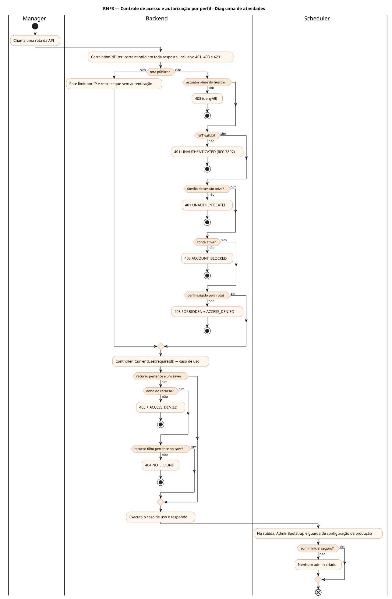
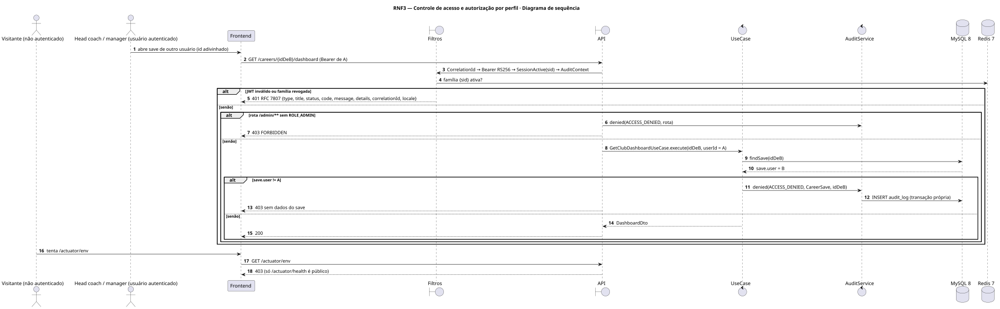
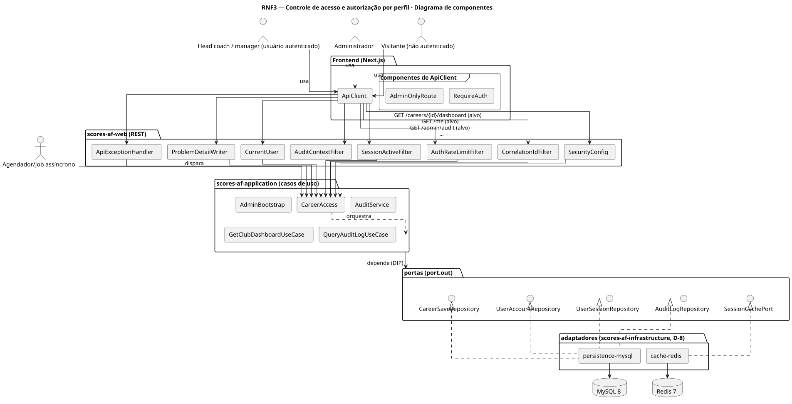
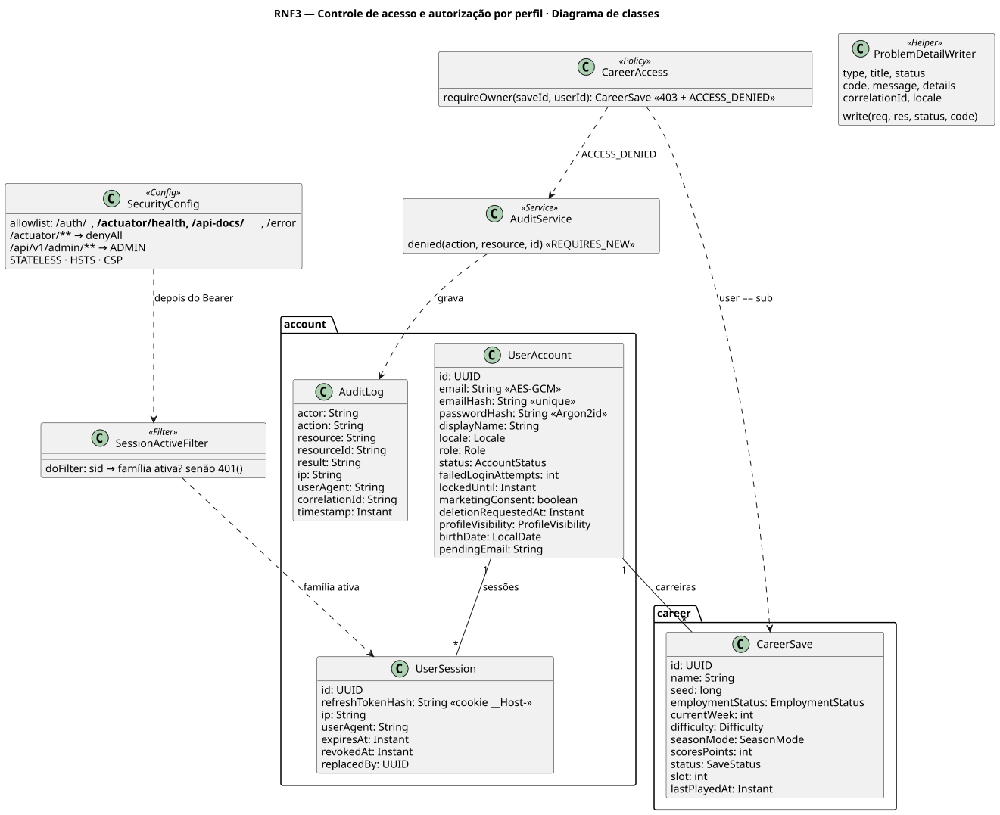
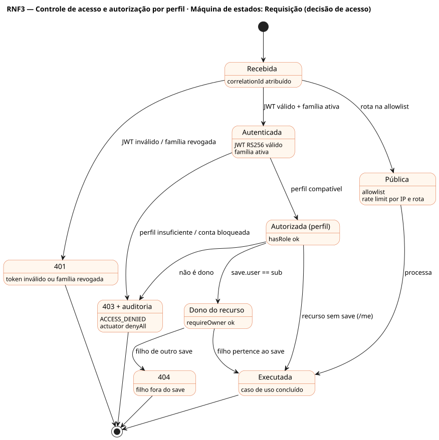

# RNF3 — Controle de acesso e autorização por perfil

## História de usuário

> RNF3 — Controle de acesso e autorização por perfil (PLAYER/ADMIN): um save só é acessível pelo dono; rotas /admin/** exigem ADMIN; o actuator só expõe o health; toda negação devolve o corpo de erro RFC 7807 (code, message, details, correlationId, locale) e é auditada.

Sprint: 3 · Atores: Manager, Admin, Visitante, Scheduler · Tela: Transversal (todas as rotas /api/v1/**)

## Diagramas

### Atividades

Fonte: [`RNF3-act.puml`](RNF3-act.puml)

### Sequência

Fonte: [`RNF3-seq.puml`](RNF3-seq.puml)

### Componentes

Fonte: [`RNF3-cmp.puml`](RNF3-cmp.puml)

### Classes

Fonte: [`RNF3-cls.puml`](RNF3-cls.puml)

### Máquina de estados: Requisição (decisão de acesso)

Fonte: [`RNF3-stm.puml`](RNF3-stm.puml)

## Endpoints

✅ = existe num controller do `scores-af-web` · ⛔ alvo = previsto no modelo, ainda sem controller (lista em `generator/endpoints_code.json`).

| Estado | Método | Rota | Caso de uso | Autorização | Descrição |
|---|---|---|---|---|---|
| ✅ | `GET` | `/api/v1/careers/{id}/dashboard` | `GetClubDashboardUseCase` | JWT · dono do save | Recurso do save: CareerAccess.requireOwner(saveId, userId) no caso de uso |
| ✅ | `GET` | `/api/v1/me` | `AccountUseCases.profile` | JWT | Recurso do próprio usuário: sempre jwt.sub, nunca id vindo do cliente |
| ⛔ alvo | `GET` | `/api/v1/admin/audit` | `QueryAuditLogUseCase` | JWT · ADMIN | Rota administrativa: /api/v1/admin/** exige ADMIN |
| ✅ | `POST` | `/api/v1/auth/login` | `LoginUseCase` | público | Rota pública explícita na allowlist (/auth/**, /actuator/health, /api-docs/**, /error) |

## Pontos de decisão

| Gateway | Regra | Se falso |
|---|---|---|
| Rota pública? | allowlist: /api/v1/auth/** · /actuator/health · /api-docs/** · /swagger-ui/** · /error | exige Bearer JWT |
| Actuator além do health? | /actuator/** → denyAll, só health exposto e sem detalhes | segue; se sim: 403 mesmo para ADMIN |
| JWT válido? | RS256 com a chave pública, iss, aud, exp · roles no claim roles | 401 UNAUTHENTICATED RFC 7807 {type, title, status, code, message, details, correlationId, locale} |
| Família de sessão ativa? | SessionActiveFilter: claim sid → UserSession não revogada (Redis, fallback MySQL) | 401 UNAUTHENTICATED |
| Perfil exigido pela rota? | /api/v1/admin/** → hasRole(ADMIN) · demais → authenticated | 403 FORBIDDEN + AuditLog ACCESS_DENIED |
| Dono do recurso? | CareerAccess.requireOwner: save.user == jwt.sub | 403 + AuditLog ACCESS_DENIED (transação própria) |
| Recurso filho pertence ao save? | jogador, partida, proposta e mensagem carregados por (saveId, id) | 404 NOT_FOUND (não revela existência) |
| Conta ativa? | status != DELETED · PENDING_DELETION só cancela, exporta ou sai | 403 ACCOUNT_BLOCKED |
| Admin inicial seguro? | AdminBootstrap só com e-mail e senha forte vindos do Cofre · nunca senha padrão | nenhum admin criado (aviso no log) |

---
Gerado por `../generator/generate.py` a partir de `../generator/model/*.py` e `../generator/common.py`; não edite os .puml à mão.
