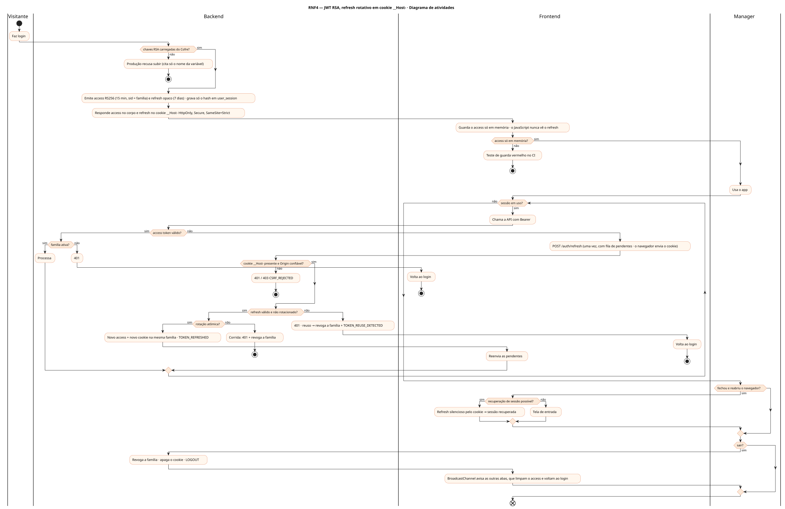
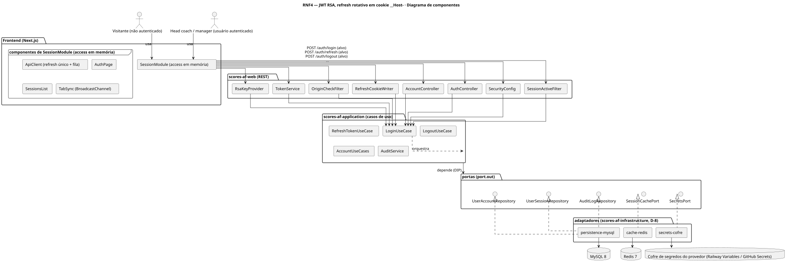
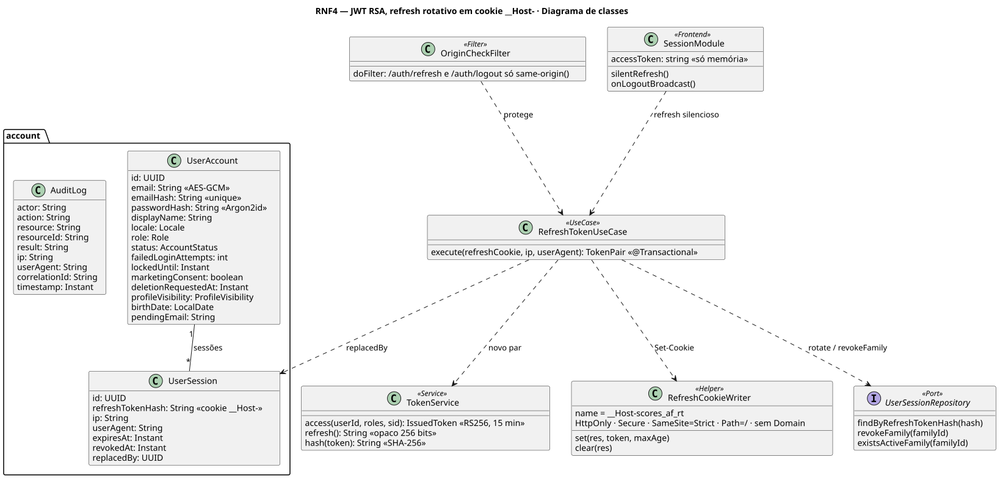
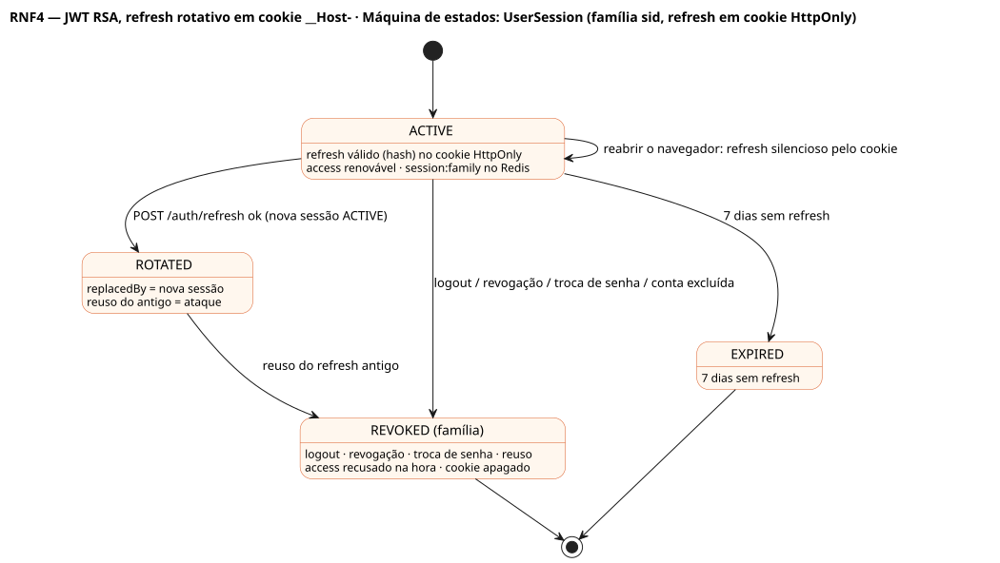

# RNF4 — JWT RSA, refresh rotativo em cookie __Host-

## História de usuário

> RNF4 — Autenticação por JWT RS256 (access 15 min, claims sub, roles, sid, aud) guardado só em memória no front, com refresh opaco rotativo (7 dias, hash em user_session, família sid) entregue desde o início em cookie __Host- HttpOnly, Secure, SameSite=Strict, Path=/; detecção de reuso, revogação imediata da família, recuperação silenciosa ao reabrir o navegador e logout entre abas (D-5).

Sprint: 3 · Atores: Visitante, Manager · Tela: Transversal — Entrar (/auth) · sessão do frontend · Configurações → Sessões

## Diagramas

### Atividades

Fonte: [`RNF4-act.puml`](RNF4-act.puml)

### Sequência

Fonte: [`RNF4-seq.puml`](RNF4-seq.puml)

### Componentes

Fonte: [`RNF4-cmp.puml`](RNF4-cmp.puml)

### Classes

Fonte: [`RNF4-cls.puml`](RNF4-cls.puml)

### Máquina de estados: UserSession (família sid, refresh em cookie HttpOnly)

Fonte: [`RNF4-stm.puml`](RNF4-stm.puml)

## Endpoints

✅ = existe num controller do `scores-af-web` · ⛔ alvo = previsto no modelo, ainda sem controller (lista em `generator/endpoints_code.json`).

| Estado | Método | Rota | Caso de uso | Autorização | Descrição |
|---|---|---|---|---|---|
| ✅ | `POST` | `/api/v1/auth/login` | `LoginUseCase` | público · rate limit por IP | Corpo: accessToken (memória). Set-Cookie: __Host-scores_af_rt HttpOnly Secure SameSite=Strict Path=/ Max-Age 7 d |
| ✅ | `POST` | `/api/v1/auth/refresh` | `RefreshTokenUseCase` | cookie __Host- · Origin conferido | Rotaciona o refresh na mesma família e devolve novo access · reuso revoga a família |
| ✅ | `POST` | `/api/v1/auth/logout` | `LogoutUseCase` | JWT | Revoga a família e apaga o cookie (Max-Age=0) · outras abas saem via BroadcastChannel |
| ✅ | `GET` | `/api/v1/me/sessions` | `AccountUseCases.sessions` | JWT | Famílias ativas (ip, userAgent, criada, expira, atual) |
| ✅ | `DELETE` | `/api/v1/me/sessions/{id}` | `AccountUseCases.revokeSession` | JWT | Revoga outra família do próprio usuário · SESSION_REVOKED |

## Pontos de decisão

| Gateway | Regra | Se falso |
|---|---|---|
| Chaves RSA carregadas do Cofre? | JWT_PRIVATE_KEY_PEM e JWT_PUBLIC_KEY_PEM vindas do Cofre (≥ 2048 bits, par casado) · nunca no repositório | produção recusa subir citando só o nome da variável |
| Access token válido? | RS256 · iss · aud · exp 15 min · claim sid | 401 → frontend tenta /auth/refresh uma vez |
| Família ativa? | SessionActiveFilter: sid com UserSession sem revokedAt (Redis, fallback MySQL) | 401 mesmo com assinatura válida |
| Cookie __Host- presente e Origin confiável? | cookie __Host-scores_af_rt (Secure, Path=/, sem Domain) + Origin ou Sec-Fetch-Site same-origin | 401 · 403 CSRF_REJECTED se Origin estranho |
| Refresh válido e não rotacionado? | hash existe · revokedAt nulo · replacedBy nulo · expiresAt > agora | 401 · reuso: revoga a família + TOKEN_REUSE_DETECTED |
| Rotação atômica? | UPDATE antiga SET replacedBy = nova WHERE replacedBy IS NULL (1 linha) · INSERT nova na mesma família | corrida → 401 e revoga a família |
| Access só em memória? | access fica em variável do módulo de sessão · nada em localStorage ou sessionStorage (teste de guarda no front) | teste vermelho no CI |
| Recuperação de sessão possível? | ao abrir o app sem access em memória: POST /auth/refresh silencioso com o cookie | tela de entrada |

---
Gerado por `../generator/generate.py` a partir de `../generator/model/*.py` e `../generator/common.py`; não edite os .puml à mão.
