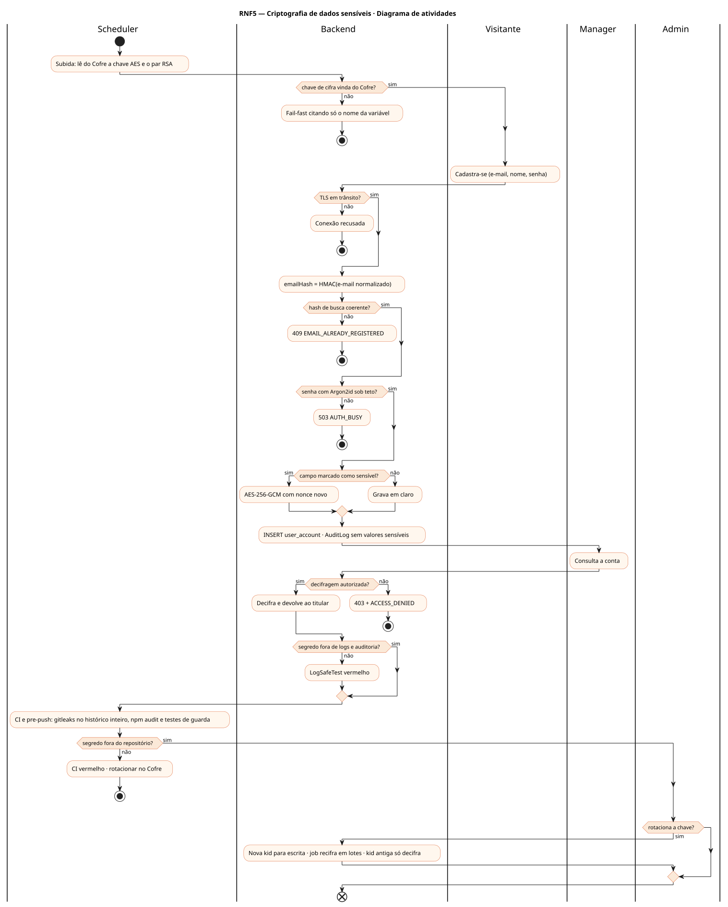
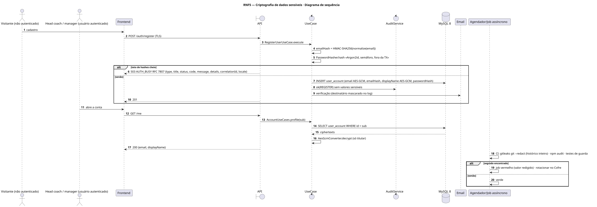
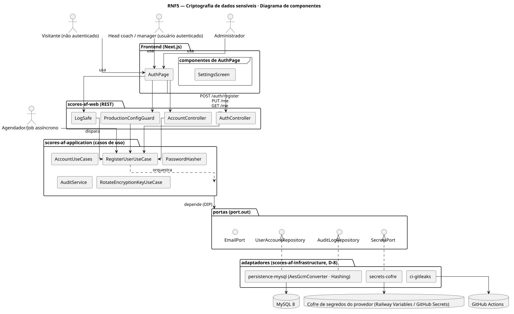
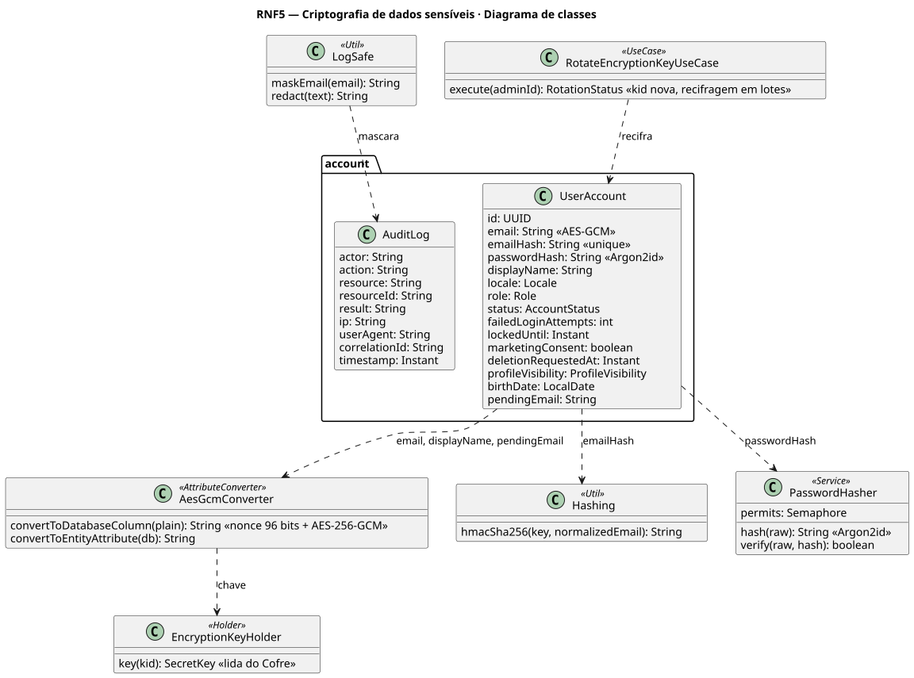
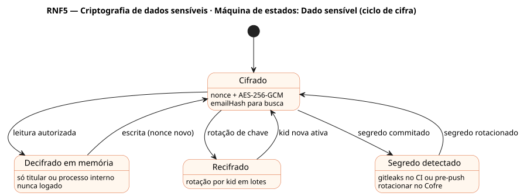

# RNF5 — Criptografia de dados sensíveis

## História de usuário

> RNF5 — Criptografia de dados sensíveis: e-mail, nome e e-mail pendente com AES-256-GCM, senha com Argon2id, hash de busca HMAC, chaves e par RSA só no Cofre (nunca no repositório, na imagem ou em teste), TLS em trânsito, segredo nunca em log ou auditoria e gitleaks no CI e antes de todo push (D-5).

Sprint: 3 · Atores: Visitante, Manager, Admin, Scheduler · Tela: Transversal — Cadastro, Configurações, CI

## Diagramas

### Atividades

Fonte: [`RNF5-act.puml`](RNF5-act.puml)

### Sequência

Fonte: [`RNF5-seq.puml`](RNF5-seq.puml)

### Componentes

Fonte: [`RNF5-cmp.puml`](RNF5-cmp.puml)

### Classes

Fonte: [`RNF5-cls.puml`](RNF5-cls.puml)

### Máquina de estados: Dado sensível (ciclo de cifra)

Fonte: [`RNF5-stm.puml`](RNF5-stm.puml)

## Endpoints

✅ = existe num controller do `scores-af-web` · ⛔ alvo = previsto no modelo, ainda sem controller (lista em `generator/endpoints_code.json`).

| Estado | Método | Rota | Caso de uso | Autorização | Descrição |
|---|---|---|---|---|---|
| ⛔ alvo | `POST` | `/api/v1/auth/register` | `RegisterUserUseCase` | público | email → AES-GCM + emailHash HMAC-SHA256 · senha → Argon2id fora da transação, com teto de hashes simultâneos |
| ⛔ alvo | `PUT` | `/api/v1/me` | `AccountUseCases.updateProfile` | JWT | displayName recifrado · AuditLog SENSITIVE_DATA_CHANGED sem valores |
| ⛔ alvo | `GET` | `/api/v1/me` | `AccountUseCases.profile` | JWT | Decifra só para o titular |
| ⛔ alvo | `POST` | `/api/v1/admin/crypto/rotate` | `RotateEncryptionKeyUseCase` | JWT · ADMIN | Rotação por versão de chave (kid) com recifragem em lotes |

## Pontos de decisão

| Gateway | Regra | Se falso |
|---|---|---|
| Chave de cifra vinda do Cofre? | SCORES_AF_ENCRYPTION_KEY Base64 de 256 bits lida do Cofre na subida | subida recusada citando só o nome da variável |
| Campo marcado como sensível? | AesGcmConverter em email, displayName, pendingEmail · nonce de 96 bits por escrita | grava em claro (dado de jogo) |
| Hash de busca coerente? | emailHash = HMAC-SHA256(chave, lower(trim(email))) · unique · login sem decifrar | 409 EMAIL_ALREADY_REGISTERED / 401 AUTH_FAILED |
| Senha com Argon2id sob teto? | PasswordHasher único ponto de hash · semáforo de hashes simultâneos | 503 AUTH_BUSY + Retry-After |
| Decifragem autorizada? | só o titular (sub == userId) ou processo interno (e-mail transacional) | 403 + ACCESS_DENIED |
| Segredo fora de logs e auditoria? | LogSafe.maskEmail e redact (JWT, tokens, cookies, senhas) | LogSafeTest vermelho |
| Segredo fora do repositório? | gitleaks no histórico inteiro com --redact no CI e no pre-push · senhas de teste geradas na execução · .gitleaksignore só com fingerprints | CI vermelho · o segredo é rotacionado no Cofre, nunca só removido |
| TLS em trânsito? | HTTPS + HSTS 1 ano · bancos com TLS em produção | conexão recusada |

---
Gerado por `../generator/generate.py` a partir de `../generator/model/*.py` e `../generator/common.py`; não edite os .puml à mão.
