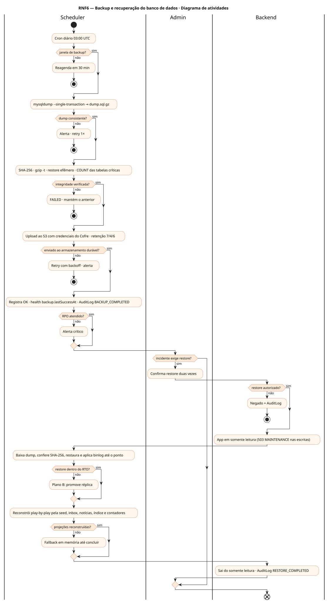
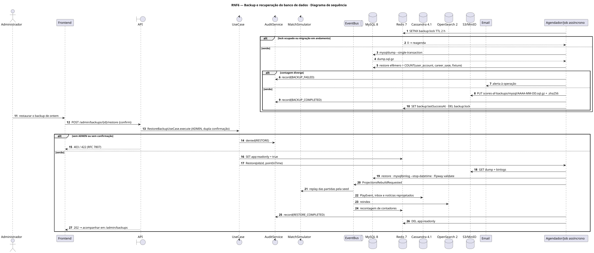
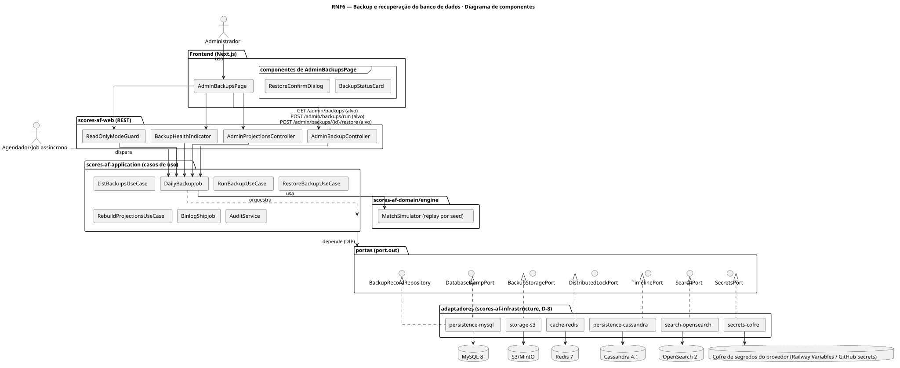
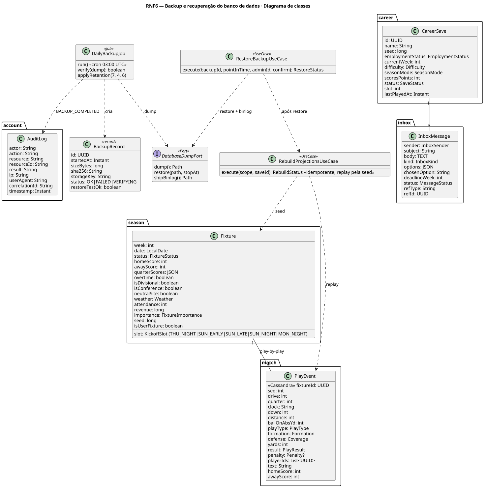
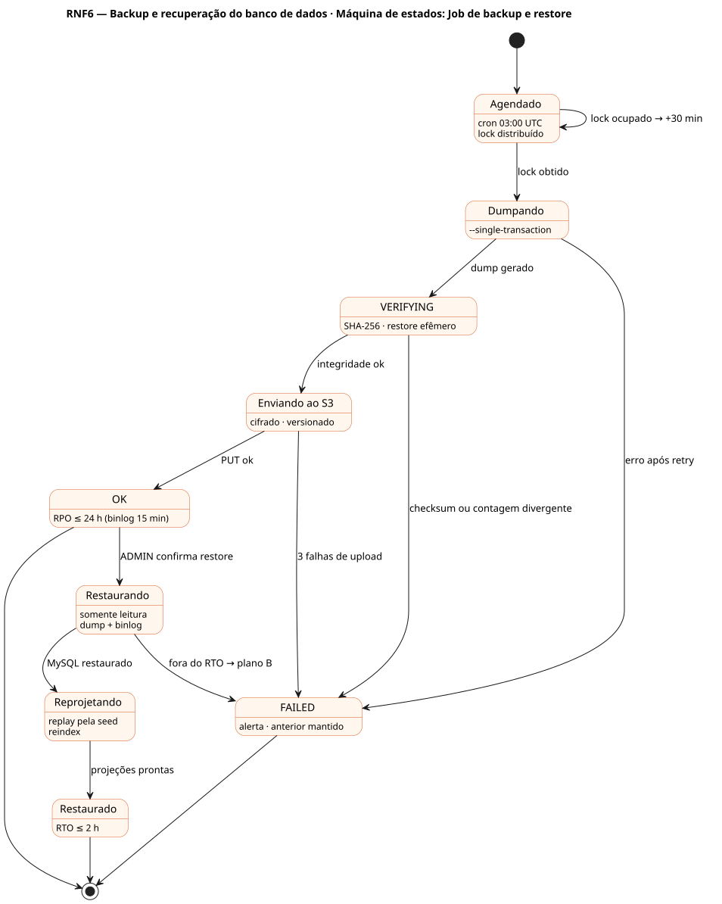

# RNF6 — Backup e recuperação do banco de dados

## História de usuário

> RNF6 — Backup e recuperação: dump diário do MySQL (fonte da verdade) com verificação de integridade e restore de teste, binlog para point-in-time, RPO ≤ 24 h (≤ 15 min com binlog) e RTO ≤ 2 h; Cassandra (play-by-play, inbox, notícias), Redis e OpenSearch reconstruíveis.

Sprint: 3 · Atores: Scheduler, Admin · Tela: Operação — jobs de backup · Admin → Saúde e backups (/admin/backups) · Actuator

## Diagramas

### Atividades

Fonte: [`RNF6-act.puml`](RNF6-act.puml)

### Sequência

Fonte: [`RNF6-seq.puml`](RNF6-seq.puml)

### Componentes

Fonte: [`RNF6-cmp.puml`](RNF6-cmp.puml)

### Classes

Fonte: [`RNF6-cls.puml`](RNF6-cls.puml)

### Máquina de estados: Job de backup e restore

Fonte: [`RNF6-stm.puml`](RNF6-stm.puml)

## Endpoints

✅ = existe num controller do `scores-af-web` · ⛔ alvo = previsto no modelo, ainda sem controller (lista em `generator/endpoints_code.json`).

| Estado | Método | Rota | Caso de uso | Autorização | Descrição |
|---|---|---|---|---|---|
| ⛔ alvo | `GET` | `/api/v1/admin/backups` | `ListBackupsUseCase` | JWT · ADMIN | Backups (data, tamanho, checksum, verificação, último restore de teste) |
| ⛔ alvo | `POST` | `/api/v1/admin/backups/run` | `RunBackupUseCase` | JWT · ADMIN | Backup manual antes de migração ou deploy |
| ⛔ alvo | `POST` | `/api/v1/admin/backups/{id}/restore` | `RestoreBackupUseCase` | JWT · ADMIN | Restore com dupla confirmação e app em somente leitura |
| ⛔ alvo | `POST` | `/api/v1/admin/projections/rebuild` | `RebuildProjectionsUseCase` | JWT · ADMIN | Reconstrói Cassandra, Redis e OpenSearch a partir do MySQL (idempotente) |
| ⛔ alvo | `GET` | `/actuator/health` | `HealthIndicator` | público | backup.lastSuccessAt como indicador (alerta se > 26 h) |

## Pontos de decisão

| Gateway | Regra | Se falso |
|---|---|---|
| Janela de backup? | cron 03:00 UTC · lock distribuído no Redis (TTL 2 h) · sem migração Flyway em andamento | reagenda em 30 min |
| Dump consistente? | mysqldump --single-transaction --routines --triggers + binlog habilitado | falha · alerta · retry 1× |
| Integridade verificada? | SHA-256 · gzip -t · restore em MySQL efêmero e COUNT das tabelas críticas == origem | backup FAILED · alerta · mantém o anterior |
| Enviado ao armazenamento durável? | bucket scores-af-backups cifrado e versionado · credenciais do Cofre · retenção 7 diários, 4 semanais, 6 mensais | retry com backoff · alerta após 3 falhas |
| RPO atendido? | lastSuccessAt ≤ 24 h · binlog a cada 15 min | alerta crítico · health DOWN(backup) |
| Restore autorizado? | ADMIN + dupla confirmação + app em somente leitura | negado + AuditLog |
| Restore dentro do RTO? | dump + binlog até o ponto ≤ 2 h · Flyway validate ok | plano B: promove réplica |
| Projeções reconstruídas? | play-by-play refeito pela seed da partida (motor determinístico), inbox e notícias reprojetadas, reindex no OpenSearch, contadores no Redis | serviço degradado com fallback em memória |

---
Gerado por `../generator/generate.py` a partir de `../generator/model/*.py` e `../generator/common.py`; não edite os .puml à mão.
