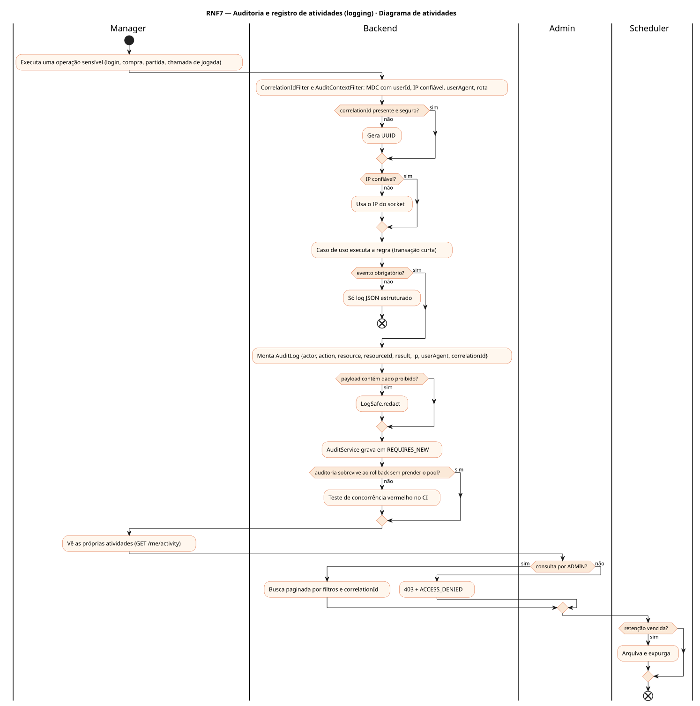
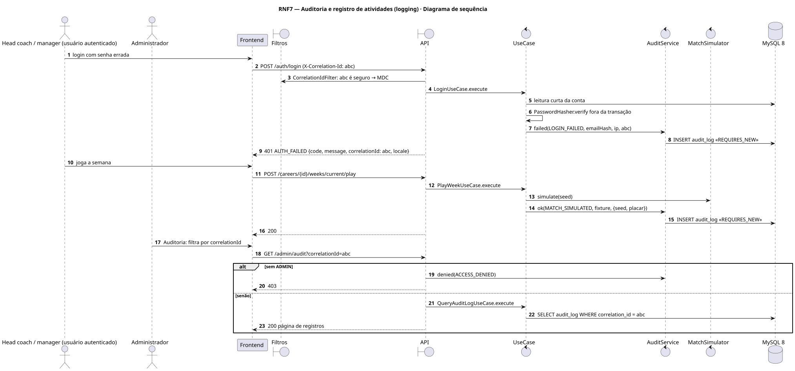
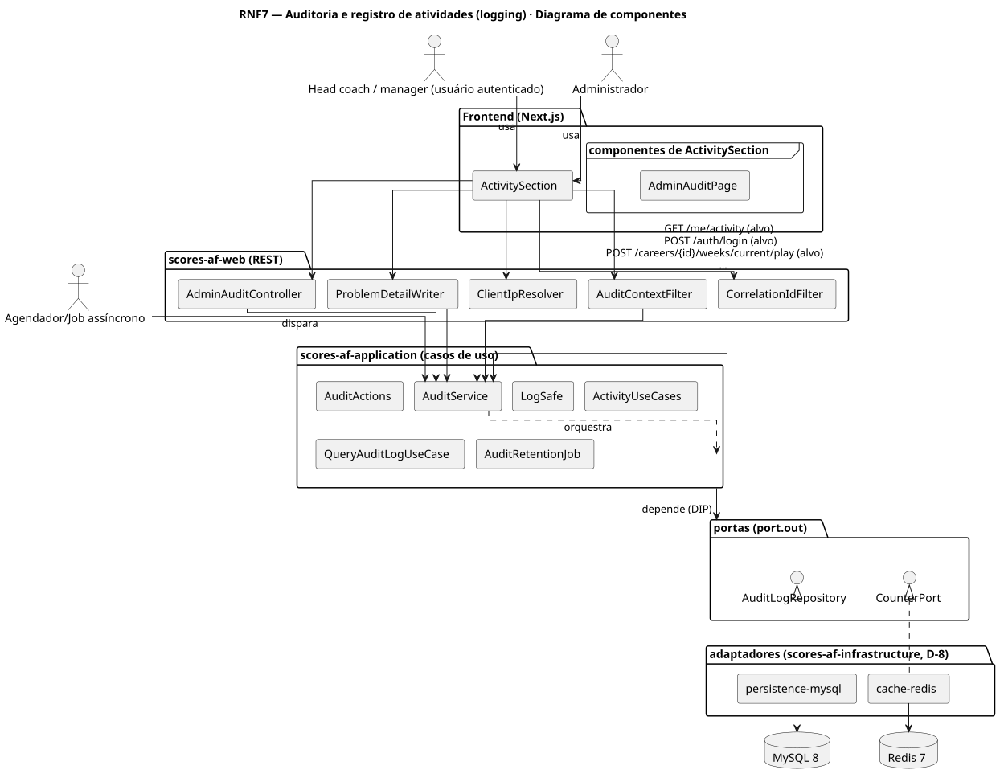
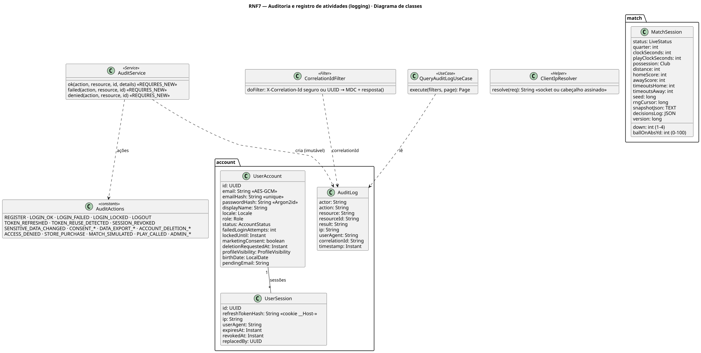
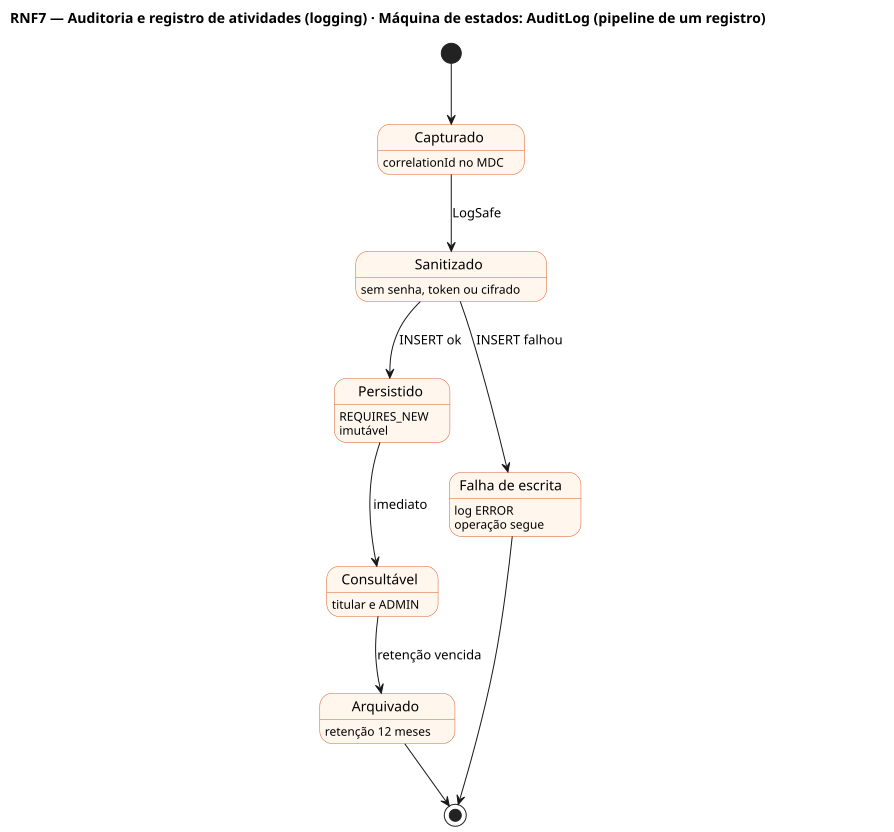

# RNF7 — Auditoria e registro de atividades (logging)

## História de usuário

> RNF7 — O sistema deve registrar, de forma imutável e consultável, quem fez o quê, quando, de onde (IP confiável) e com que resultado, com correlationId de ponta a ponta (o mesmo do corpo de erro RFC 7807), em toda operação sensível (login, acesso negado, dado sensível, consentimento, exportação e exclusão, compra, simulação de partida com seed, chamada de jogada, admin), sem gravar senha, token ou campo cifrado.

Sprint: 3 · Atores: Manager, Admin, Scheduler · Tela: Transversal · Configurações → Seus dados → Atividade · Admin → Auditoria

## Diagramas

### Atividades

Fonte: [`RNF7-act.puml`](RNF7-act.puml)

### Sequência

Fonte: [`RNF7-seq.puml`](RNF7-seq.puml)

### Componentes

Fonte: [`RNF7-cmp.puml`](RNF7-cmp.puml)

### Classes

Fonte: [`RNF7-cls.puml`](RNF7-cls.puml)

### Máquina de estados: AuditLog (pipeline de um registro)

Fonte: [`RNF7-stm.puml`](RNF7-stm.puml)

## Endpoints

✅ = existe num controller do `scores-af-web` · ⛔ alvo = previsto no modelo, ainda sem controller (lista em `generator/endpoints_code.json`).

| Estado | Método | Rota | Caso de uso | Autorização | Descrição |
|---|---|---|---|---|---|
| ✅ | `GET` | `/api/v1/me/activity` | `ActivityUseCases.list` | JWT | Atividades da própria conta |
| ✅ | `POST` | `/api/v1/auth/login` | `LoginUseCase` | público | LOGIN_OK / LOGIN_FAILED / LOGIN_LOCKED · o LOGIN_FAILED sobrevive ao rollback |
| ⛔ alvo | `POST` | `/api/v1/careers/{id}/weeks/current/play` | `PlayWeekUseCase` | JWT · dono do save | MATCH_SIMULATED com seed e placar · replay verificável |
| ⛔ alvo | `GET` | `/api/v1/admin/audit` | `QueryAuditLogUseCase` | JWT · ADMIN | Consulta paginada por actor, action, resource, período, correlationId |

## Pontos de decisão

| Gateway | Regra | Se falso |
|---|---|---|
| correlationId presente e seguro? | aceita X-Correlation-Id só sem CR/LF e com tamanho limitado · senão gera UUID · devolvido no cabeçalho e no corpo RFC 7807 | valor injetado trocado por UUID |
| IP confiável? | IP do socket ou cabeçalho assinado pelo proxy · nunca X-Forwarded-For cru | XFF forjado é ignorado |
| Evento obrigatório? | REGISTER, LOGIN_*, LOGOUT, TOKEN_*, SESSION_REVOKED, PASSWORD_*, SENSITIVE_DATA_CHANGED, CONSENT_*, DATA_EXPORT_*, ACCOUNT_DELETION_*, ACCESS_DENIED, STORE_PURCHASE, MATCH_SIMULATED, PLAY_CALLED, ADMIN_* | só log estruturado |
| Payload contém dado proibido? | senha, token, cookie, campo cifrado, chave | grava · se contém: LogSafe.redact antes |
| Auditoria sobrevive ao rollback sem prender o pool? | AuditService em REQUIRES_NEW próprio · auditar depois da escrita curta e fora do hash de senha | teste de concorrência vermelho (60 logins paralelos sem 500) |
| Consulta por ADMIN? | jwt.roles contém ADMIN | 403 + ACCESS_DENIED |
| Retenção vencida? | timestamp < hoje − 12 meses | mantém · se vencida: arquiva e expurga |

---
Gerado por `../generator/generate.py` a partir de `../generator/model/*.py` e `../generator/common.py`; não edite os .puml à mão.
