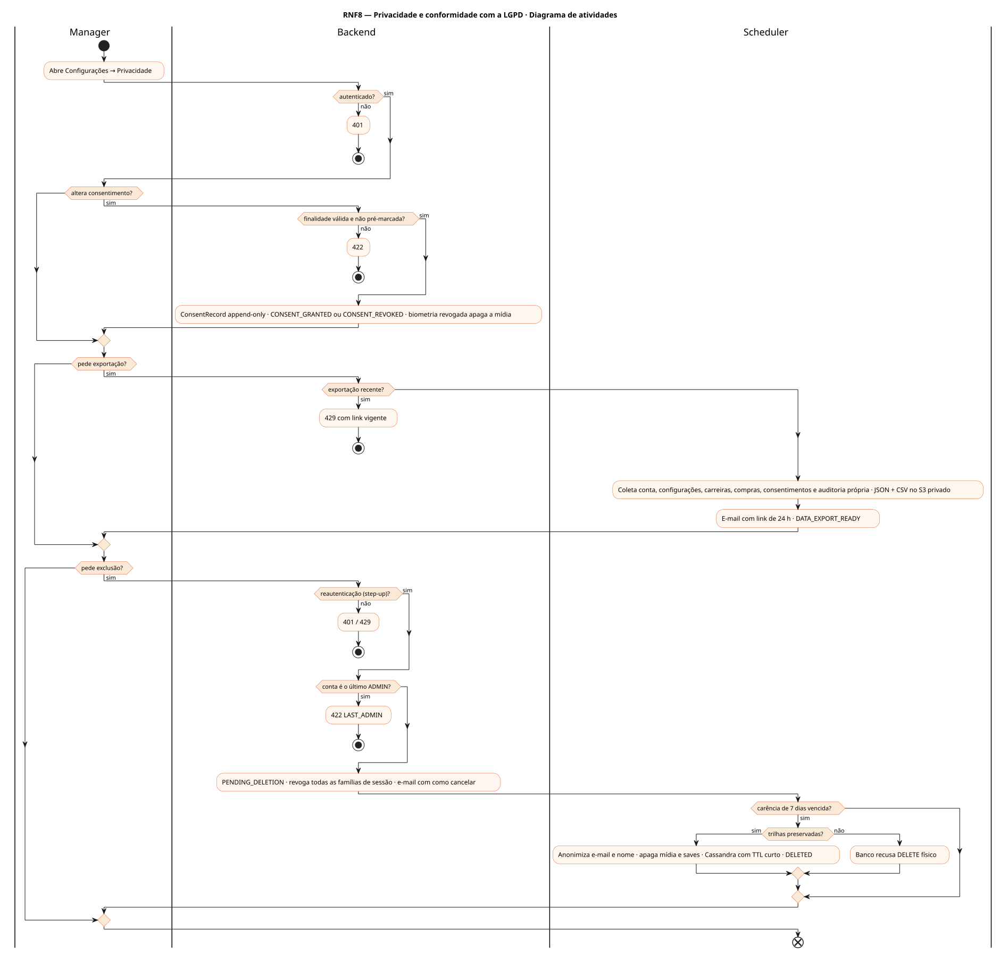
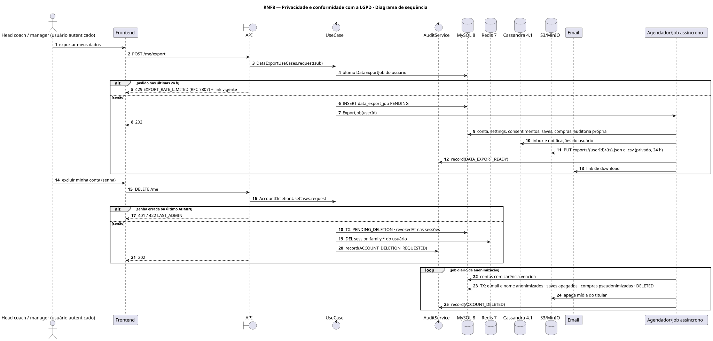
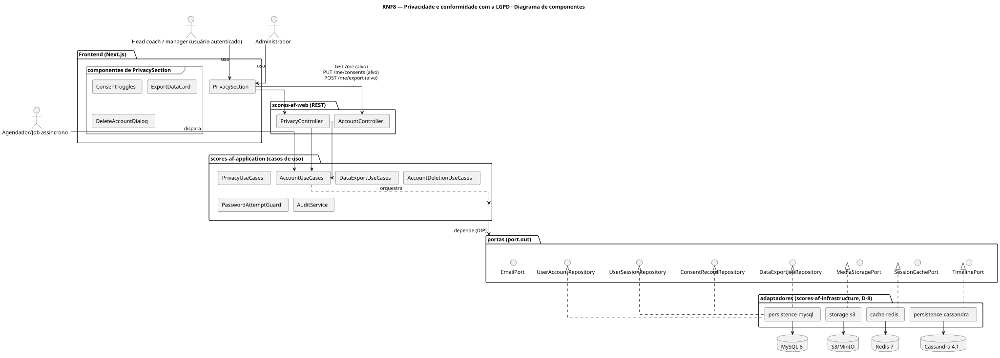
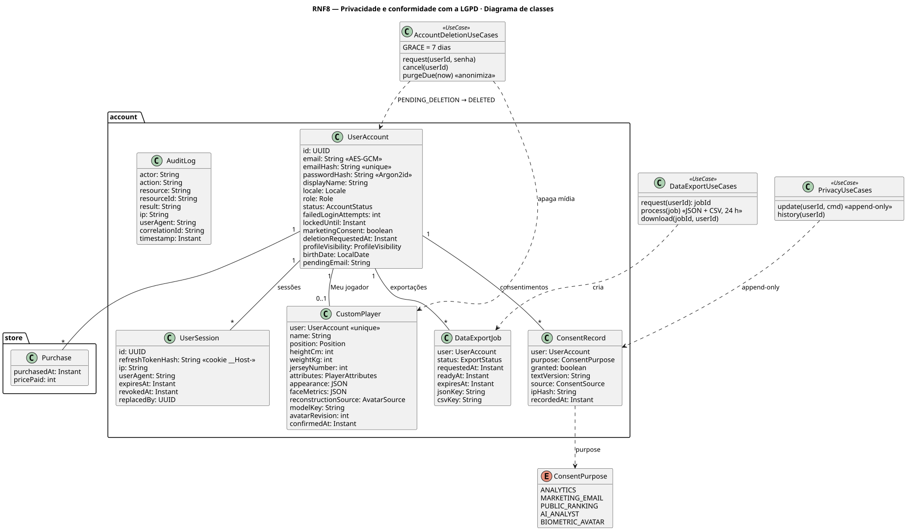
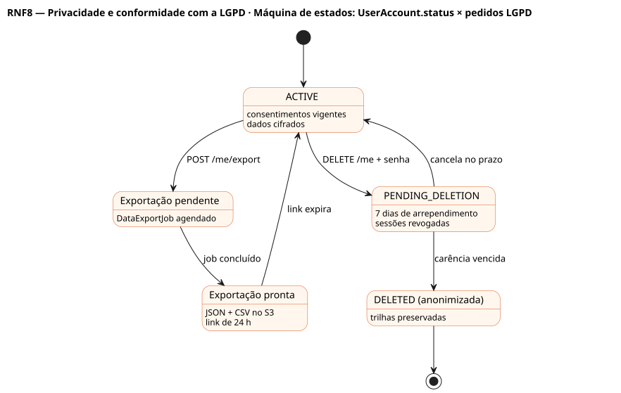

# RNF8 — Privacidade e conformidade com a LGPD

## História de usuário

> RNF8 — O sistema deve tratar dados pessoais conforme a LGPD: consentimento explícito por finalidade (ANALYTICS, MARKETING_EMAIL, PUBLIC_RANKING, AI_ANALYST, BIOMETRIC_AVATAR), minimização e cifragem, direitos do titular (acesso, correção, portabilidade assíncrona, revogação, exclusão com 7 dias de arrependimento) e anonimização que preserva trilhas.

Sprint: 3 · Atores: Manager, Scheduler, Admin · Tela: Configurações → Privacidade e Seus dados (/settings, RF46)

## Diagramas

### Atividades

Fonte: [`RNF8-act.puml`](RNF8-act.puml)

### Sequência

Fonte: [`RNF8-seq.puml`](RNF8-seq.puml)

### Componentes

Fonte: [`RNF8-cmp.puml`](RNF8-cmp.puml)

### Classes

Fonte: [`RNF8-cls.puml`](RNF8-cls.puml)

### Máquina de estados: UserAccount.status × pedidos LGPD

Fonte: [`RNF8-stm.puml`](RNF8-stm.puml)

## Endpoints

✅ = existe num controller do `scores-af-web` · ⛔ alvo = previsto no modelo, ainda sem controller (lista em `generator/endpoints_code.json`).

| Estado | Método | Rota | Caso de uso | Autorização | Descrição |
|---|---|---|---|---|---|
| ⛔ alvo | `GET` | `/api/v1/me` | `AccountUseCases.profile` | JWT | Acesso: dados pessoais decifrados só para o titular |
| ⛔ alvo | `PUT` | `/api/v1/me/consents` | `PrivacyUseCases.update` | JWT | Concede ou revoga por finalidade (ConsentRecord append-only) · biometria revogada apaga a mídia |
| ⛔ alvo | `POST` | `/api/v1/me/export` | `DataExportUseCases.request` | JWT | Portabilidade: DataExportJob → JSON + CSV no S3 privado por 24 h |
| ⛔ alvo | `GET` | `/api/v1/me/export/{jobId}/download` | `DataExportUseCases.download` | JWT · dono do job | DATA_EXPORT_DOWNLOADED |
| ⛔ alvo | `DELETE` | `/api/v1/me` | `AccountDeletionUseCases.request` | JWT · senha (step-up) | PENDING_DELETION, sessões revogadas, 7 dias de arrependimento, depois anonimização |
| ⛔ alvo | `POST` | `/api/v1/me/deletion/cancel` | `AccountDeletionUseCases.cancel` | JWT | Cancela no prazo |

## Pontos de decisão

| Gateway | Regra | Se falso |
|---|---|---|
| Autenticado? | JWT válido e conta ativa | 401 |
| Finalidade válida e não pré-marcada? | ConsentPurpose conhecido · nada pré-marcado · texto versionado | 422 INVALID_CONSENT_PURPOSE |
| Reautenticação (step-up)? | exclusão, troca de e-mail e de senha exigem a senha atual (5 tentativas em 15 min) | 401 AUTH_FAILED / 429 |
| Exportação recente? | pedido nas últimas 24 h | agenda job · se recente: 429 EXPORT_RATE_LIMITED com link vigente |
| Conta é o último ADMIN? | role ADMIN e único admin ativo | segue · se sim: 422 LAST_ADMIN |
| Carência de 7 dias vencida? | agora ≥ deletionRequestedAt + 7 d e não cancelada | aguarda · se vencida: anonimiza |
| Trilhas preservadas? | consentimento, compra, carteira e ledger com FK RESTRICT: a conta é anonimizada, nunca apagada | DELETE físico recusado pelo banco |

---
Gerado por `../generator/generate.py` a partir de `../generator/model/*.py` e `../generator/common.py`; não edite os .puml à mão.
