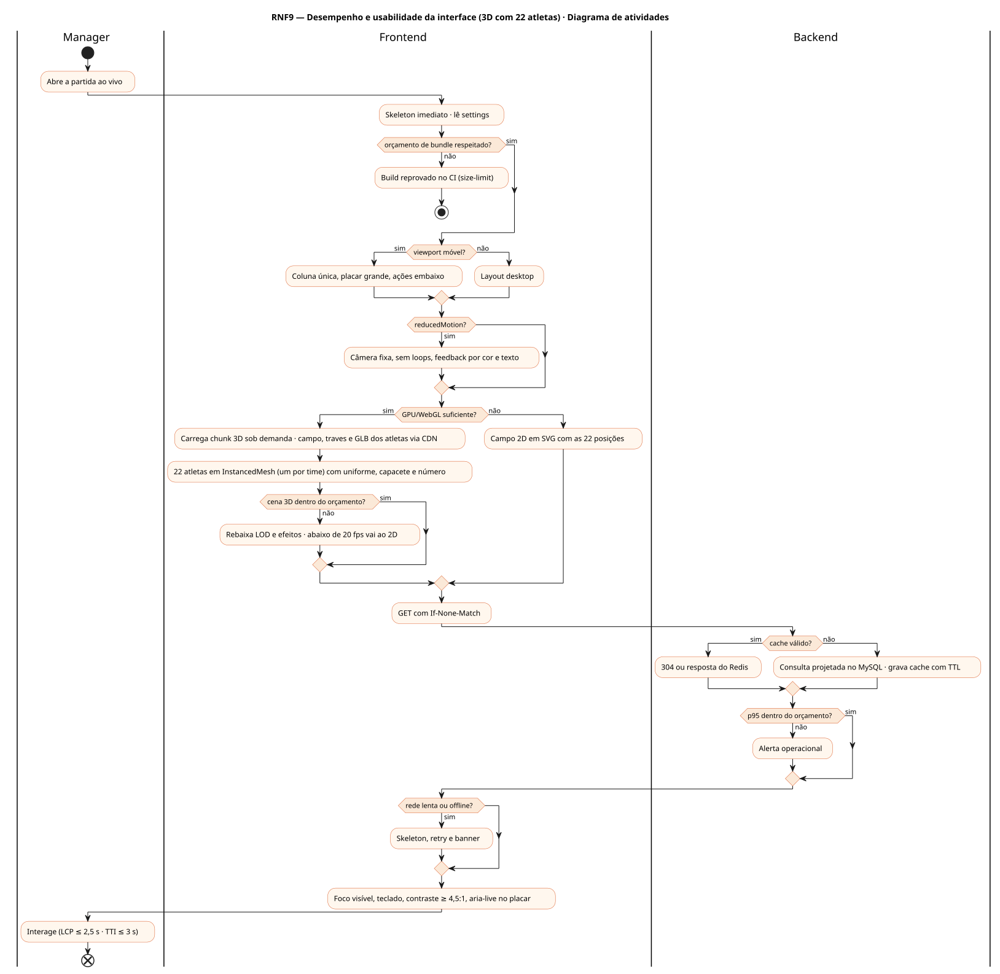
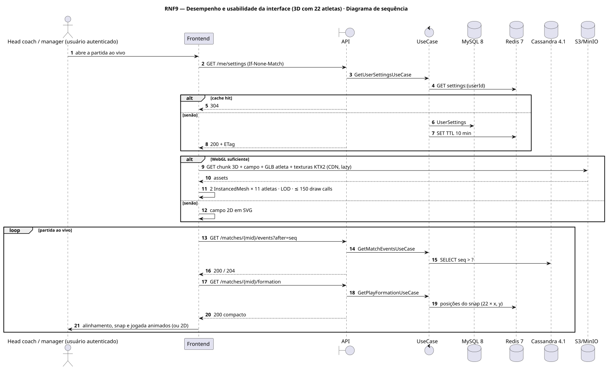
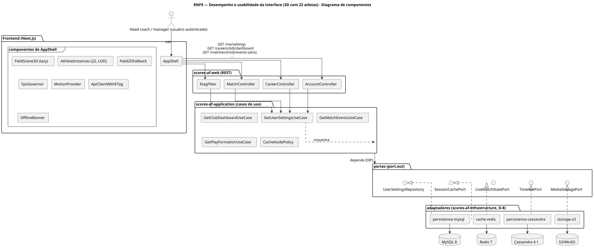
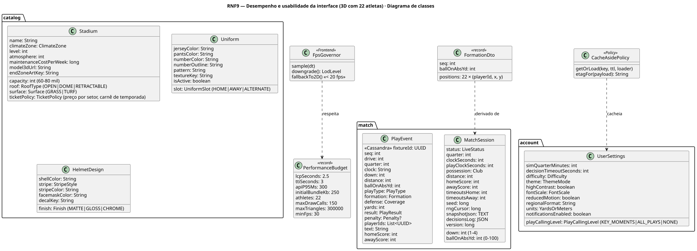
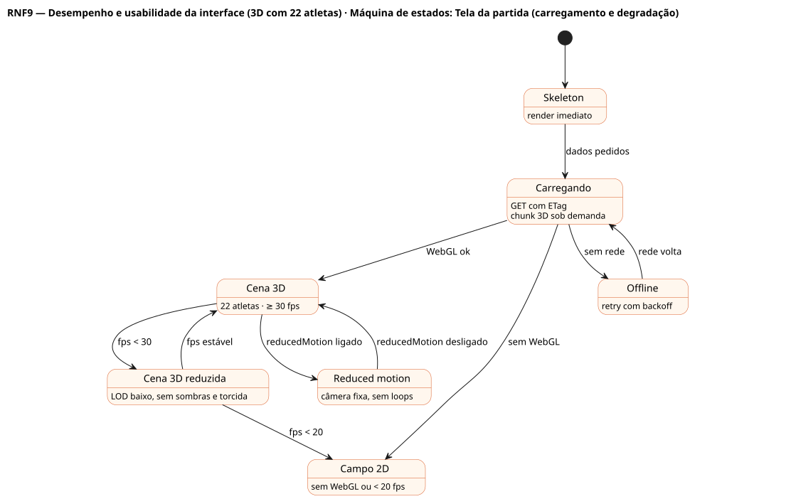

# RNF9 — Desempenho e usabilidade da interface (3D com 22 atletas)

## História de usuário

> RNF9 — A interface deve ser rápida e usável em desktop e celular: LCP ≤ 2,5 s, TTI ≤ 3 s, p95 da API ≤ 300 ms nas leituras do ciclo de jogo, semana simulada < 1 s, placar com descida e distância legível no celular, reducedMotion, acessibilidade, e a cena 3D do campo de 120 × 53,3 jardas com 22 atletas a ≥ 30 fps em aparelho médio (instancing, LOD, chunk sob demanda e fallback 2D).

Sprint: 8 · Atores: Manager · Tela: Transversal · Partida ao vivo e estádio 3D (RF26, RF27) · Configurações (/settings)

## Diagramas

### Atividades

Fonte: [`RNF9-act.puml`](RNF9-act.puml)

### Sequência

Fonte: [`RNF9-seq.puml`](RNF9-seq.puml)

### Componentes

Fonte: [`RNF9-cmp.puml`](RNF9-cmp.puml)

### Classes

Fonte: [`RNF9-cls.puml`](RNF9-cls.puml)

### Máquina de estados: Tela da partida (carregamento e degradação)

Fonte: [`RNF9-stm.puml`](RNF9-stm.puml)

## Endpoints

✅ = existe num controller do `scores-af-web` · ⛔ alvo = previsto no modelo, ainda sem controller (lista em `generator/endpoints_code.json`).

| Estado | Método | Rota | Caso de uso | Autorização | Descrição |
|---|---|---|---|---|---|
| ⛔ alvo | `GET` | `/api/v1/me/settings` | `GetUserSettingsUseCase` | JWT | reducedMotion, highContrast, fontScale (preferências de desempenho e acessibilidade) |
| ⛔ alvo | `GET` | `/api/v1/careers/{id}/dashboard` | `GetClubDashboardUseCase` | JWT · dono do save | Leitura crítica com p95 ≤ 300 ms (cache Redis + ETag) |
| ⛔ alvo | `GET` | `/api/v1/matches/{mid}/events` | `GetMatchEventsUseCase` | JWT · dono do save | Poll incremental leve (after=seq, 204 sem novidade) |
| ⛔ alvo | `GET` | `/api/v1/matches/{mid}/formation` | `GetPlayFormationUseCase` | JWT · dono do save | Posições dos 22 atletas no snap (coordenadas compactas para a cena 3D) |

## Pontos de decisão

| Gateway | Regra | Se falso |
|---|---|---|
| reducedMotion? | prefers-reduced-motion do SO ou settings.reducedMotion | animações completas · se sim: sem loops 3D, câmera fixa, transições instantâneas |
| Viewport móvel? | largura < 768 px | layout desktop · se sim: coluna única, placar grande com descida e distância, gutter 16 px |
| GPU/WebGL suficiente? | webgl2 e deviceMemory ≥ 4 | campo 2D em SVG com as 22 posições |
| Cena 3D dentro do orçamento? | 22 atletas com InstancedMesh por time · LOD 3 níveis · ≤ 150 draw calls · ≤ 300 mil triângulos · texturas KTX2 · ≥ 30 fps | rebaixa LOD, desliga sombras e torcida · abaixo de 20 fps: fallback 2D |
| Orçamento de bundle respeitado? | rota inicial ≤ 250 kB gz · three/R3F/drei em chunk lazy | CI vermelho (size-limit) |
| Cache válido? | ETag confere ou chave Redis viva | recalcula · se válido: 304 ou resposta do cache |
| p95 dentro do orçamento? | http.server.requests p95 ≤ 300 ms nas rotas do ciclo | alerta operacional |
| Rede lenta ou offline? | navigator.onLine e RTT < 1 s | skeleton, retry com backoff e banner Sem conexão |

---
Gerado por `../generator/generate.py` a partir de `../generator/model/*.py` e `../generator/common.py`; não edite os .puml à mão.
